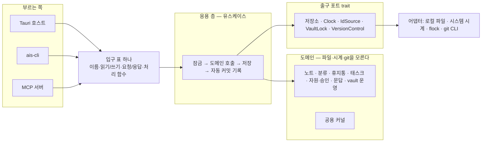

# engine-rs DDD·헥사고날 리팩토링 계획

## 요약

**결론:** 엔진(`ais-core`·`ais-cli`)의 **동작은 한 글자도 바꾸지 않고** 구조만 9단계(0~8)로 바꾼다. 가장 먼저 「바뀐 게 없다」를 Java 없이 빠르게 증명하는 안전망(0단계)을 깔고, 그 위에서 안쪽(공용 부품·값 타입)부터 바깥(저장소·입구·크레이트) 순서로 간다. 단계 하나는 그대로 `main`에 올릴 수 있는 크기로 끊는다.

이 문서는 외부 분석 보고서(「engine-rs DDD·헥사고날 리팩토링 분석」, 2026-11-15, 기준 `main` `1a173b7`)를 **실행 계획**으로 바꾼 것이다. 보고서의 진단은 이 계획을 쓰면서 현재 `main`(`5433eed`, 그 사이 커밋은 문서뿐)에서 다시 센 값과 맞췄다(§1). **결정이 5가지 필요하다(§5).** 이 계획을 쓰는 동안 빌드와 시험은 돌리지 않았다(`CommonRule.md` §6).

### 용어 (처음 나오는 뜻만)

| 말 | 이 문서에서의 뜻 |
| --- | --- |
| 포트(port) | 안쪽 코드가 바깥(파일·시계·git)에 바라는 일을 적은 약속. Rust에서는 `trait`으로 쓴다 |
| 어댑터(adapter) | 포트를 실제로 해내는 바깥 코드. 예: 로컬 파일 저장소, `git` 명령 호출 |
| 도메인 / 애그리거트 | 업무 규칙을 담은 타입 / 함께 바뀌어야 하는 객체 묶음. 바깥에서는 대표 객체(루트)만 고치고 루트가 규칙을 지킨다 |
| 값 객체(newtype) | 값이 같으면 같은 것으로 보는 작은 타입. `struct NoteId(String)`처럼 감싸 잘못된 값이 섞이지 못하게 한다 |
| 공용 커널 | 여러 영역이 같이 쓰는 아주 작은 공통 코드(id 모양, 날짜 계산) |
| 골든 시험 | 미리 녹화해 둔 정답 출력과 바이트 단위로 견주는 시험 |
| 의존 방향 시험 | 「어느 모듈은 어느 모듈을 쓰면 안 된다」를 소스에서 검사하는 시험 |
| 유스케이스(응용 층) | 요청 하나를 처리하는 순서(잠금 → 도메인 호출 → 저장 → 자동 커밋 기록). 규칙 자체는 갖지 않는다 |

## 1. 지금 구조와 문제

엔진은 Java 엔진을 결과까지 같게 옮긴 것이라 구조도 Java를 닮은 **트랜잭션 스크립트**(요청 하나를 명령 함수 하나가 처음부터 끝까지 처리하는 방식)다.

| 지금 | 값 | 확인 |
| --- | --- | --- |
| `ais-core` 소스 | 29,132줄 | 이 계획이 다시 셈 |
| `ais-cli` 소스 | 5,352줄 | 이 계획이 다시 셈 |
| 명령 층 `commands/` | 9,712줄(코어의 33%) | 이 계획이 다시 셈 |
| `pub trait` (포트) | 0개 | 이 계획이 다시 셈 |
| `WriteScope::begin` 직접 호출 | 40곳 | 이 계획이 다시 셈 |
| `#[serde(deny_unknown_fields)]` | 0곳 | 이 계획이 다시 셈 |
| `std::fs`를 직접 부르는 파일 | 보고서 43개 / 이 계획이 `std::fs` 글자로 센 값 41개(`ais-core`) | 세는 방법이 달라 다르다. 0단계 시험에서 규칙을 못박는다 |
| 거꾸로 된 의존(안쪽 → 명령 층·옆 영역) | 10줄기 | 보고서 값. 0단계 시험이 목록으로 박제 |
| 명령 하나를 더할 때 고칠 곳 | 8~12곳 | 보고서 값 |

미비점 8묶음(보고서 §3)을 한 줄씩만 적는다. 근거 줄 번호는 보고서에 있다.

| 묶음 | 한 줄 요약 | 해당 단계 |
| --- | --- | --- |
| A. 모듈이 컨텍스트가 아니라 기술 층(읽기·쓰기·명령)으로 나뉨 | 한 영역의 규칙이 세 폴더에 흩어지고 거꾸로 된 의존이 생김 | 1, 5, 6 |
| B. 도메인 모델이 빈약함 | 칸만 있고 `pub`인 구조체, 모든 칸이 `String`인 노트 머리, 저장 칸이 도메인 타입에 섞임 | 2, 5, 6 |
| C. 규칙이 흩어져 이미 갈라짐 | 「기록 층」 판정 9곳, 문서 유형 목록 9벌, 「만든 시각 차례」 3뜻 | 2 |
| D. 포트가 없음 | 시계·난수·`flock`·`git`·`sqlite3`·환경 변수를 직접 부름 | 3, 5 |
| E. 응용 층이 없음 | 명령마다 같은 골격 복제, `Drop`의 숨은 부수효과, 읽기가 쓰기 길을 탐 | 4, 6 |
| F. 입구와 어댑터 경계가 샘 | 문자열 82갈래 `match`, CLI 모양이 코어 안에 있음, 공개 면 약 795개 | 7 |
| G. 오류 모델이 전송 코드에 묶임 | `EngineError` 하나에 Java 코드·종류·문구가 한 덩어리 | 7 |
| H. 안전망이 Java 기준에 기댐 | 맞대기가 태그에서 기준 엔진을 지어야(JDK 21) 돈다 | 0 |

## 2. 가는 길

(GitHub에서 그림으로 보인다.)

목표 구조는 **도메인이 가운데**, 바깥 둘레에 응용 층, 그 바깥에 포트와 어댑터다.

- 부르는 쪽 셋(호스트·CLI·MCP)이 **모두 입구 표로 바로** 들어온다. 지금처럼 MCP와 호스트가 CLI 글을 거치지 않는다.
- 안쪽은 도메인이다. 컨텍스트(노트·분류·휴지통·태스크·자원·문답·vault 운영)마다 애그리거트가 자기 규칙을 지킨다.
- 파일 형식 코덱(`frontmatter`, `write/snake_dump.rs`, `write/json_out.rs`)은 순수 함수지만 저장 표현이라 도메인 쪽이 아니라 **저장소 어댑터 쪽**에 둔다. YAML 파스 트리가 도메인 타입으로 새지 않게 하려는 것이다.

## 3. 요구사항 확정

| 항목 | 내용 |
| --- | --- |
| 무엇을 | `engine-rs/crates/ais-core`·`ais-cli`의 내부 구조를 도메인·응용·포트/어댑터로 바꾼다 |
| 왜 | 규칙 정본이 없어 한 동작을 고칠 때 한 곳을 빠뜨리기 쉽고(이미 갈라진 복사본 존재), 바깥(파일·시계·git)에 포트가 없어 시험과 저장소 교체(훗날 클라우드 저장소)가 어렵다 |
| 완료 기준 | 9단계 각각의 「끝 기준」(§4)을 만족하고, 모든 단계에서 **골든 차이 0**이다. 마지막에 명령 하나를 더할 때 고칠 곳이 2곳(표 한 줄 + 처리 함수)이다 |
| 제외 | ① 동작·응답·파일 바이트·오류 문구 변경(Java에서 물려받은 이상한 동작 포함, §6) ② 화면(`native-host/src/`)의 동작 변경 ③ 새 기능 ④ 클라우드 저장소 구현(포트만 준비) |

### 지켜야 할 호환 계약

리팩토링 내내 바뀌면 안 된다. 0단계 골든 묶음이 이것들을 녹화해야 한다.

| 무엇 | 왜 | 어떻게 재나 |
| --- | --- | --- |
| 파일 바이트: 노트 YAML, 태스크·자원 YAML, `activity.jsonl`, `ledger.json`, `trash.json`, 대기 변경 파일 | 옛 vault를 읽고 다시 써도 글자가 안 바뀌어야 한다. 칸 차례도 바이트다 | 폴더 전체 바이트(해시) 골든 |
| 오류 코드·문구·검사 순서 | CLI·MCP 출력이 같아야 하고 화면이 문구로 가르는 곳이 있다 | 표준 오류·종료 코드 골든, IPC `{code,kind,message}` |
| 난수를 뽑는 순서 | 하네스가 단계마다 난수 4개를 차례로 먹인다(예: `create_doc`은 아젠다 id를 노트 id보다 먼저 뽑는다) | 골든 |
| 실패 뒤 폴더 상태(부분 쓰기) | 「상한 초과에서 새 아젠다가 남음」 같은 결과까지 맞대기에 박혀 있다 | 골든 |
| 시간 정책 넷의 혼합 | 프로세스 시간대에 `+09:00` 고정, 고정 KST, 프로세스 시간대 변환, UTC가 섞여 있고 하네스가 시간대를 바꿔 가며 견준다 | 골든(시간대를 바꿔 돌림) |
| 공백 규칙 둘 | `text::is_blank`는 U+00A0을 공백으로 보고 `java_blank`는 안 본다. 합치면 바이트가 바뀐다 | 단위 시험 |
| 응답 JSON 키 차례 | **상관없다.** `serde_json`의 차례 보존 기능이 꺼져 있어 키가 정렬돼 나온다 | — |

## 4. 단계별 작업

모든 단계 공통: ① 기계적 변경(옮기기·이름 바꾸기)과 동작 변경을 **다른 커밋**으로 나눈다(`CommonRule.md` §4). ② 단계 끝에 골든 차이 0을 확인한다. ③ 큰 단계(5·6·7)는 컨텍스트 하나씩 `main`에 올린다. ④ 줄 수는 코드를 읽고 어림한 값이지 잰 값이 아니다.

### 0단계. 안전망 — Java 없이 도는 골든 묶음 (위험 없음, 약 500~800줄)

**왜 먼저인가.** 구조를 바꾸는 동안 「바뀐 게 없다」를 자주 재야 한다. 지금 맞대기(`compat_check`·`cli_compat`·`mcp_compat`)는 태그 `java-engine-final`에서 기준 엔진을 지어야(JDK 21) 돌아서 무겁다. Rust와 Java가 같은 답을 내는 **지금** 녹화해 두면 JDK 없이 빠르게 돌고 CI에도 넣을 수 있다.

| 커밋 | 내용 | 끝났다고 보는 것 |
| --- | --- | --- |
| 0-1 | **하네스 읽기와 설계 확정.** `compat_check.rs`는 기준 엔진 호출이 `Java::run_with` 한 곳(`examples/compat_check.rs:18~52`)에 모여 있어, 이를 「실행기 호출(Live)」과 「녹화본 재생(Golden)」 두 방식으로 가를 수 있어 보인다. `cli_compat.rs`·`mcp_compat.rs`는 아직 읽지 않았으므로 먼저 읽고 같은 방식이 되는지 확인한다 | 설계 한 장(어디서 녹화하고 어디서 재생하는지)과 골든 크기 어림 |
| 0-2 | 하네스에 `--record=<폴더>`를 더한다. Java와 Rust가 **같다고 확인된 단계만** 응답·표준 출력·표준 오류·종료 코드·폴더 해시를 적는다. 합성 vault만 쓴다(진짜 vault 내용 금지) | 기준 엔진이 있는 환경에서 녹화가 끝나고 어긋남 0 |
| 0-3 | 골든 시험: Java 없이 같은 명령열을 Rust만으로 돌려 녹화본과 견준다. 기본 `cargo test`에 들어갈 크기인지 보고 `--test golden` 따위로 분리한다 | 현재 `main`에서 차이 0 |
| 0-4 | 맞대기가 못 보는 구멍 메우기: AI 대기 변경 경로는 Rust에서만 돌고 그 파일을 Java 쪽에 복사해 넣으므로(`compat_check.rs:5127~5135`) 칸 차례가 틀려도 못 잡는다. `activity.jsonl`·`ledger.json` 직렬화 골든 시험을 따로 둔다 | 칸 차례를 일부러 바꾸면 실패 |
| 0-5 | **의존 방향 시험** `ais-core/tests/architecture.rs`: 소스의 `crate::모듈` 사용을 읽어 「`vault`·`write`·`task`·`resource`·`session`·`model`은 `crate::commands`를 못 쓴다」 등을 검사한다. 지금 위반 10줄을 허용 목록에 적어 두고 단계마다 줄인다. `std::fs`·`SystemTime::now`·`env::var`·`Command::new` 사용 위치의 세는 규칙도 여기 못박는다 | 허용 목록 = 지금 위반 그대로, 새 위반이 생기면 실패 |
| 0-6 | **명령 목록 교차 시험**: `engine.rs`의 `COMMANDS`·`WRITE_COMMANDS`(`engine.rs:33`, `:119`) ↔ `ais-cli/src/spec_table.rs` ↔ `mcp_tools.rs` ↔ 화면 `native-host/src/data/commands.ts`(`POSITIONAL`). 이미 아는 불일치(`commit-vault`가 `spec_table.rs:436`에서 `write: false`인데 엔진은 쓰기로 본다)는 「알려진 차이」로 적는다 | 새 불일치가 생기면 실패 |
| 0-7 | **안전망 점검(변이 확인).** 일부러 동작을 깨 본다: 노트 칸 하나 순서 바꾸기, 난수 순서 바꾸기, 오류 문구 한 글자 바꾸기, 명령 표에서 한 줄 빼기 | 네 가지 모두 시험이 실패한다. 잡지 못하는 것은 시험을 고친다 |

**끝 기준:** 현재 `main`에서 골든 차이 0, Java 기준과도 어긋남 0, 변이 확인 통과. **되돌리기:** 시험 코드만 더하므로 커밋을 되돌리면 끝.

### 1단계. 공용 커널을 세우고 거꾸로 된 의존을 끊는다 (위험 하, 약 500줄 옮기기 + `import` 약 40곳)

| 커밋 | 내용 | 종류 |
| --- | --- | --- |
| 1-1 | `kernel::java`(`java_trim`·`java_blank`·`value_to_string`·`java_double_string`·`to_json_value`), `kernel::time`(`CivilDate`·`days_from_civil`·`parse_iso_date`·ISO 시각 해석·UTC 글), `kernel::ids`(id 정규식 모음), `kernel::actor`(지금의 `Caller`), `confine`을 만들어 코드를 **옮긴다** | 기계적 |
| 1-2 | 같은 규칙의 복사본을 하나로 합친다: 날짜 계산(`commands/ask_chat_commands.rs:981`·`vault/note_meta.rs:512`), id 모양(`text.rs:9~13`), Java 글 규칙(`task/format.rs:86~100`). **공백 규칙 둘은 합치지 않고** 이름만 갈라 둔다 | 동작 변경 없음을 골든으로 확인 |
| 1-3 | 결과를 버리는 I/O 4곳을 지운다(`daily_notes.rs:74`·`export_markdown.rs:32`·`write_attachment.rs:112`의 `let _ = attach_text::extract`, `shard_notes.rs:236`의 `let _ = reindex::execute`). **지우기 전에 각각 부수효과가 정말 없는지 확인한다** | 별도 커밋 |

**끝 기준:** 의존 방향 시험의 허용 목록 0줄, 날짜 함수·id 정규식의 복사본 0벌, 골든 차이 0.

### 2단계. 값 객체와 닫힌 집합 enum (위험 하~중, 약 400~600줄)

개념마다 커밋 하나씩, 이 차례로: `DocType`(9벌 → 1벌) → `Tier`·`NoteVisibility`(기록 층 규칙 9곳을 정책 하나로) → `LinkKind`·`Hue` → `NoteId`·`SubNoteId`·`AgendaId`·`AgendaSlug`·`TrashId`·`TaskKey`·`ResourceId` → `ContentToken`(f1·precondition·token 세 이름을 하나로) → `Created`(시각과 오프셋을 함께 보존).

- `as_str()`는 지금 글자를 그대로 낸다. 층 정규화(`vault/note_meta.rs:173~179`)를 지킨다.
- 쓰기에 기록 층 검사가 없는 것(`delete_doc`) 같은 **이상한 동작은 여기서 고치지 않는다**(§6).

**끝 기준:** 커널 밖에서 `"record"`·`"reading"`·문서 유형 배열·`"blocks"` 글자가 0건(grep 시험), 골든 차이 0.

### 3단계. 시계·난수·잠금·버전 관리 포트 (위험 중, 약 300줄 + 호출부 약 45곳)

- `trait Clock { now_millis, zone }`, `trait IdSource`, `trait VaultLock`, `trait VersionControl`, `trait SqliteReader`, 환경·홈 디렉터리 설정을 만든다.
- `Engine`이 이 묶음을 들고, 명령에는 맥락(`&Ctx`)으로 넘긴다.
- **기본 어댑터는 지금처럼 환경 변수(`AISURADA_TEST_NOW` 등)와 `static` 큐를 읽는다.** 그래서 하네스가 그대로 돈다.
- 시간 정책 넷은 섞인 것을 그대로 두고 이름 붙은 순수 함수로 꺼낸다. 편집 도장 판정 `judge`(`write/meta_writer.rs:195`)는 시각을 인자로 받게 한다.

순서: `Clock`(`write/autocommit.rs:75`에 이미 씨앗이 있다) → `IdSource` → `VaultLock` → `VersionControl` → `SqliteReader` → 환경·홈. **난수 순서를 꼭 지킨다**(골든이 잡아 준다).

**끝 기준:** `SystemTime::now`·`env::var`·`Command::new`·`tzset`이 어댑터 모듈 밖에서 0건, 골든 차이 0.

### 4단계. 쓰기 길을 분해한다 (위험 중, 40곳 + 약 400줄)

| 커밋 | 내용 |
| --- | --- |
| 4-1 | `WriteScope`(잠금 잡기·표식 맞추기·색인 맞추기·`Drop`의 자동 커밋 기록 묶음)를 「잠금」 「필요할 때만 색인 맞추기」 「자동 커밋 기록(`Drop` 대신 명시적 호출)」으로 나눈다 |
| 4-2 | `begin`을 명령마다 부르지 않고 **디스패처 한 곳**에서 부른다. 임시로 명령별 「표식 필요」「색인 필요」 칸을 작은 표로 두고(7단계가 명령 표에 흡수한다), `command != "init_workspace"` 글자 비교(`write/pipeline.rs:43`)를 없앤다 |
| 4-3 | `create_doc_in`이 JSON 대신 `CreatedDoc` 타입을 돌려준다(`daily_notes.rs:176~180`이 JSON에서 키 4개를 뽑아 쓰는 약속에 타입을 준다) |
| 4-4 | 쓰기를 「효과 목록」으로 모은다. **지금 순서대로 실행하고 기록만 한다.** 되돌리기는 넣지 않는다(부분 쓰기가 호환 계약이라서) |

**꼭 지킬 동작:** 범위 열기가 인자 검사보다 먼저고, 실패한 명령에서도 자동 커밋 기록을 쓴다(`Drop`의 숨은 부수효과를 명시 호출로 옮길 때 이것이 사라지기 쉽다).

**끝 기준:** `WriteScope::begin` 직접 호출 40곳이 0곳, 골든 차이 0.

#### 게이트 1 (4단계 뒤)
여기까지가 **안전한 정리 구간**이다. 4단계가 끝나면 한 번 멈추고, 그때까지의 골든 유지 결과와 실제 비용을 보고한 뒤 5~8단계를 진행할지 묻는다.

### 5단계. 컨텍스트별 저장소 포트 (위험 중, 약 2,000줄, 컨텍스트 하나씩)

- 바닥에 `VaultStore`(목록·읽기·쓰기·옮기기·지우기) 포트와 로컬 파일 어댑터를 둔다. **UTF-16 정렬**과 **심볼릭 링크 처리 차이**(첨부 글은 따라가고 훑기는 건너뜀)를 지킨다.
- 쉬운 것부터 컨텍스트별로 올린다: **`AgendaRepository`**(노트 훑기와 독립이라 가장 쉽다. `list_agendas`·`get_agenda_facts`가 노트 전체를 안 훑어도 된다) → `TaskRepository`·`ActivityLog` → `ResourceRepository`·`ApprovalLedger` → `AskStore` → **`NoteRepository`**(가장 크고 바이트 위험도 가장 크다) → 휴지통·코멘트·첨부.
- `NoteIndex`를 「질의」 「훑기 진단 보고」 「쓰기 전 검사」 셋으로 나누고 `vault_root`를 비공개로 한다.
- 엔티티에서 저장 칸(`rel_path`·`content_file`·`token`)을 빼서 저장 봉투 `Stored<T> { value, location, token }`로 옮긴다.
- `ais-cli/src/legacy.rs`가 `NoteIndex::fresh`로 vault를 다시 훑지 않고 코어 질의로만 쓰게 한다(보고서 §3 묶음 A의 「어댑터가 코어 내부로 바로 들어간다」).

**끝 기준:** 명령·도메인 모듈에서 `std::fs` 0건, `legacy.rs`의 `NoteIndex::fresh` 0건, 골든 차이 0.

### 6단계. 규칙을 애그리거트로 옮긴다 (위험 중~상, 약 2,500줄)

순서와 까닭: **태스크 → 자원 → 노트.** 태스크는 작고 상태 기계(`task/transitions.rs`)가 이미 순수하며 이벤트가 뚜렷하다. 노트는 가장 크고 바이트 위험도 가장 크다.

- **태스크:** `create`·`edit`·`transition_to`·`link`·`unlink`·`comment`가 `TaskEvent`(created, edited, status, linked, comment)를 돌려준다. 저장소는 `activity.jsonl`에 **붙이기만** 한다. 「막힘」 계산은 도메인 서비스로 뺀다.
- **자원:** `Resource`·`ProjectRefs`·`PendingChange { approve, reject, mark_stale }`·`TrustState`(지금 approved/dirty/new와 Untrusted 두 이름을 하나로). 낡음(stale) 판정을 오류 코드 글자(`resource_commands.rs:1441`의 `"AIS-400" | "AIS-404" | "AIS-409" | "AIS-412"`) 대신 도메인 오류 종류로 바꾼다. 대기 변경 파일 형식은 저장 어댑터의 매퍼로 가둔다. **0단계의 직렬화 골든이 먼저 있어야 한다.**
- **노트:** `Note::apply(변경, 호출자, 시계)`가 f1 검사·AI 날짜 무시·상한·편집 도장을 강제한다. 폴더 자리 정책(`Placement`)을 순수하게 만들고, 월별 폴더 여부(`AISURADA_NOTES_SHARD_BY_MONTH`)는 환경 변수 대신 **정책 입력**으로 받는다.

**끝 기준:** store와 명령 함수에 남은 업무 규칙 0(리뷰 점검표), 도메인 단위 시험이 생긴다(`transitions.rs` 포함), 골든 차이 0.

#### 게이트 2 (6단계 뒤)
7단계는 호스트·MCP의 호출 경로를 바꾼다. 6단계까지의 결과를 보고하고 7단계 착수 여부를 확인한다.

### 7단계. 입구를 정리한다 (위험 중, 3,000줄 넘음, 컨텍스트 하나씩)

| 커밋 | 내용 |
| --- | --- |
| 7-1 | 명령 표 하나(`commands!` 매크로)에 이름·kebab 이름·읽기/쓰기·요청/응답 타입·처리 함수·자리 인자·도구 노출·표식 필요를 적는다. `COMMANDS`·`WRITE_COMMANDS`·디스패처·`catalog()`를 이 표에서 만든다. 합칠 대상은 `engine.rs`의 두 목록과 원본이 된 `spec_table.rs`·`mcp_tools.rs`다(5d 뒤 이 둘은 생성물이 아니라 원본이다) |
| 7-2 | `Engine::call(&CallContext, name, args)`로 호출자를 요청 칸 밖으로 뺀다. 과도기에는 요청의 `caller` 칸도 별칭으로 받는다 |
| 7-3 | MCP와 호스트가 CLI 글을 거치지 않고 엔진을 부른다(`ais-cli/src/mcp.rs:235, 391~396`, `native-host/src-tauri`의 CLI 호출 길). 옛 응답 모양으로 되돌리는 층(`legacy`)은 타입 있는 DTO만 바꾸게 한다 |
| 7-4 | 오류를 `DomainError`·`InfraError`로 나누고, Java 코드·문구·종료 코드 매핑 표를 어댑터(`ais-cli/src/error.rs`, IPC) 쪽으로 옮긴다. **문구는 바이트까지 같다** |
| 7-5 | `*_USAGE` 상수 43개와 글 옵션 맵, 배열·글 두 모양 입력을 CLI로 옮긴다 |
| 7-6 | 공개 면을 줄인다: 바깥이 쓰는 약 30개만 남기고 `pub(crate)`로 내린다. 시험용 이음매는 `test-support` feature 뒤로 보낸다 |

**끝 기준:** 명령 하나를 더할 때 고칠 곳이 8~12곳에서 2곳(표 한 줄 + 처리 함수)으로, `pub` 항목이 약 795개에서 약 30개로. CLI·MCP 골든 차이 0, 호스트 계약(IPC) 골든 차이 0.

### 8단계. 크레이트를 나눈다 (선택, 위험 하, 대부분 파일 옮기기)

`ais-kernel`(순수) · `ais-domain` · `ais-app`(유스케이스와 포트) · `ais-infra`(파일·git·시계·잠금 어댑터, 파일 형식 코덱) · `ais-core`(앞문 파사드, 이름 유지) · `ais-cli` · `ais-ops`(에이전트 등록·진단·이주). 그러면 의존 방향을 시험이 아니라 컴파일러가 막는다. 훗날 클라우드 저장소는 `VaultStore`의 두 번째 구현으로 붙인다.

## 5. 결정할 것

보고서가 이미 정리한 결정 1~3에, 이 계획을 쓰면서 새로 생긴 4·5를 더했다. 「가」가 추천이다.

**확정(2026-11-15): 결정 2~5 모두 추천대로 가.** 결정 2·5로 미룬 일은 기술 부채 이슈로 올렸다: [#74](https://github.com/bnjjong/aisurada/issues/74)(AI 쓰기 보호 구멍 3건), [#75](https://github.com/bnjjong/aisurada/issues/75)(쓰기 길·오류 분류 5건), [#76](https://github.com/bnjjong/aisurada/issues/76)(화면 오류 문구 정규식). 진행 추적은 [#77](https://github.com/bnjjong/aisurada/issues/77)이다.

**1. 리팩토링을 Java 지우기(5d) 앞에 하나, 뒤에 하나 — 확정**

5d가 먼저 끝났다(`main` `1a173b7`, 2026-11-15). 기준 엔진은 태그 `java-engine-final`에서 다시 지을 수 있으므로 0단계부터 바로 시작해도 Java 맞대기를 쓸 수 있다. 더 정할 것이 없다.

**2. Java에서 물려받은 이상한 동작을 언제 고치나**

보고서 §9가 가린 8건: 쓰기에 기록 층 검사가 없어 AI가 id만 알면 기록 층 노트를 `delete_doc`으로 휴지통에 보낼 수 있음 / 코멘트·후속 노트 삭제가 f1(읽은 뒤 안 바뀌었다는 확인 값) 없이 부모 본문을 고침 / `commit_vault`가 vault 파일 잠금 없이 커밋함 / 읽기 명령(`check_notes`·`facts_brief`·자원 읽기)이 쓰기 길을 탐 / 여러 파일 쓰기에 되돌리기가 없어 부분 쓰기가 남음 / 태스크·자원 쓰기도 노트 색인 맞추기에 막힘 / 태스크 `update`가 진행 중 태스크의 저장소·완료 기준을 지울 수 있음 / 오류 분류가 Java 흉내(도메인 위반 500, YAML 덤프 실패 400).

| 선택 | 내용 | 장단점 |
| --- | --- | --- |
| **가(추천)** | 구조 단계(0~8)가 끝난 뒤 **따로 묶음**으로 고친다. 그때 골든을 근거와 함께 갱신한다 | 구조 단계의 안전망이 「골든 차이 0」으로 단순하게 유지된다. 이상한 동작이 그만큼 더 남는다 |
| 나 | 해당 단계에서 같이 고친다(예: 2단계에서 기록 층 검사 추가) | 한 번에 끝난다. 골든이 바뀌면 어느 차이가 의도인지 가를 수 없고, 구조 변경 실수를 가려 낼 수 없다 |
| 다 | 고치지 않고 호환 계약으로 영구히 둔다 | 가장 안전하다. 물려받은 버그가 코드에 새 구조로 굳는다 |

**3. 크레이트부터 나누나, 모듈부터 나누나**

| 선택 | 내용 | 장단점 |
| --- | --- | --- |
| **가(추천)** | 모듈과 의존 방향 시험부터 하고 크레이트 분리는 8단계(선택)로 둔다 | 지금 거꾸로 된 의존이 10줄기라 크레이트부터 나누면 컴파일이 안 돼 한 번에 다 고쳐야 한다. 모듈부터 하면 단계마다 `main`에 올릴 수 있다 |
| 나 | 크레이트부터 나눈다 | 컴파일러가 방향을 처음부터 막는다. 큰 변경이 한 번에 몰리고 중간에 `main`에 올릴 수 없다 |

**4. 단계마다 시험을 돌려도 되나 (`CommonRule.md` §6과 충돌)**

`CommonRule.md` §6은 평소 작업에서는 빌드만 보고 시험 묶음은 릴리스 전이나 사용자가 시킬 때만 돌리라고 한다. 이 리팩토링의 안전망이 바로 시험이다. 단계마다 「골든 차이 0」을 재지 않으면 안전망이 의미가 없다.

| 선택 | 내용 | 장단점 |
| --- | --- | --- |
| **가(추천)** | 이 리팩토링 동안만 **엔진 시험**(골든 + `bash test.sh`)을 단계 끝마다 돌린다. 화면·호스트 시험(`test-native.sh`, acceptance)은 호스트 계약을 바꾸는 7단계 뒤에만 돌린다 | 구조 실수를 단계 안에서 잡는다. 엔진 시험을 돌리는 시간이 든다 |
| 나 | 규칙대로 빌드만 보다가 마지막에 몰아서 돌린다 | 시간이 적게 든다. 실수가 쌓인 뒤에 터져 어느 단계 탓인지 알 수 없다 |
| 다 | 매 단계 화면·호스트 시험까지 전부 돌린다 | 가장 안전하다. 호스트 시험에는 이미 알려진 실패 4건(`ask::tests`)과 병렬 때 불안정한 5건이 있어 비교 기준 관리가 번거롭다 |

**5. 화면의 오류 문구 정규식 교체를 이 범위에 넣나**

화면이 오류 문구를 정규식으로 가르는 곳이 있다(`native-host/src/ui/resourcesClient.ts`, `tasksClient.ts`의 「이미 바뀌었다」 판정). 7단계에서 오류에 `kind`를 정식으로 세우면 화면이 문구 대신 `kind`로 가를 수 있다.

| 선택 | 내용 | 장단점 |
| --- | --- | --- |
| **가(추천)** | 이번 범위에서는 **제외**한다. 7단계는 오류 문구를 바이트까지 같게 두고 매핑 표만 어댑터로 옮긴다. 화면 교체는 후속 이슈로 남긴다 | 화면이 안 바뀌어 실제 창 점검(acceptance) 범위가 줄고, 구조 변경과 화면 변경이 섞이지 않는다. 문구 의존은 당분간 남는다 |
| 나 | 7단계 마지막에 화면 정규식을 `kind` 판정으로 바꾸는 커밋을 별도로 넣는다 | 문구 계약이 사라진다. 실제 창 점검이 필요하고 화면 쪽 변경 위험이 이 리팩토링에 들어온다 |

## 6. 진행 규칙

- **커밋·푸시:** `CommonRule.md` §4대로 단계마다 `main`에 빨리 감기(`git merge --ff-only`)로 올린다. 브랜치와 PR은 쓰지 않는다. 티켓 체계는 이 프로젝트에서 쓰지 않으므로 `[Empty]`다. scope는 엔진과 문서는 `aisurada`, 호스트와 화면은 `native-host`.
- **작업 폴더:** 시험이 길고 다른 세션과 겹칠 수 있으므로 단계마다 별도 worktree에서 짓는다(`CommonRule.md` §5). 브랜치 이름은 `ref/<단계 설명>`(예: `ref/golden-safety-net`). 끝나면 worktree와 병합된 로컬 브랜치를 지운다.
- **시험 실행:** 결정 4에 따른다. 시험을 돌릴 때는 쓰기 잠금 파일이 실제 홈에 쌓이지 않게 `test.sh`처럼 `AISURADA_LOCK_DIR`을 임시 폴더로 지정한다.
- **문서:** 단계를 끝낼 때마다 완료 기록 `docs/refactor-step<N>-complete.md`를 새로 쓴다. 명령·구조·시험 진입점이 바뀌면 `docs/developer-guide.md`를 고치고 `pnpm --dir native-host docs:guide`로 HTML을 다시 만든다.
- **공개 저장소:** 골든은 합성 vault로만 만든다. 진짜 vault의 노트 id·제목·계정 번호를 시험 자료와 문서에 넣지 않는다. 커밋 전에 `grep`으로 훑는다.

## 7. 위험과 막는 법

| 위험 | 까닭 | 막는 법 |
| --- | --- | --- |
| 골든이 구멍 난 채로 통과한다 | 맞대기가 못 보는 곳이 있다(대기 변경 파일 복사, `activity.jsonl` 직렬화) | 0-4, 0-7(변이 확인) |
| 난수·시간 순서가 바뀌어 id와 바이트가 달라진다 | 하네스가 난수 4개를 차례로 먹인다 | 3단계에서 기본 어댑터를 지금 방식 그대로 두고 골든으로 확인 |
| 실패 경로 동작이 사라진다 | `Drop`의 자동 커밋 기록, 부분 쓰기가 호환 계약이다 | 4단계 「꼭 지킬 동작」, 실패 뒤 폴더 상태 골든 |
| 공백 규칙을 합쳐 바이트가 바뀐다 | U+00A0 처리가 둘이 다르다 | 합치지 않음, 단위 시험(0단계) |
| 큰 단계(5·6·7)에서 길을 잃는다 | 줄 수가 크고 `NoteRepository`·노트 애그리거트가 가장 위험하다 | 컨텍스트 하나씩 `main`에 올림, 게이트 1·2 |
| 호스트·화면이 깨진다 | 7단계가 호출 경로와 오류 모양을 건드린다 | 결정 5 가(오류 문구 바이트 불변), 7단계 뒤 호스트·화면 시험, 호스트 기준 실패 4건은 변경 전 `main`과 직렬로 비교 |
| 보고서가 놓친 동작 차이 | 보고서 분석은 코드를 읽고 한 것이며 빌드·시험으로 확인하지 않았다 | 모든 단계의 골든 차이 0, 차이가 나면 멈추고 원인을 보고 |

## 8. 진행 현황

- **0단계 완료**(2026-11-15): [완료 기록](refactor-step0-complete.md). 골든 재생·직렬화 골든·의존 방향·명령 목록 시험 5건이 `bash test.sh`(183건)에 들어갔고, 변이 6건을 모두 잡았다.
- **1단계 완료**(2026-11-15): [완료 기록](refactor-step1-complete.md). 거꾸로 된 의존 10줄기를 모두 끊었고(허용 목록 10줄 → 0), 날짜 계산과 id 모양의 복사본을 합쳤으며, 결과를 버리는 호출 4곳을 지웠다. 골든 어긋남 0, 엔진 시험 188건.
- **2단계 완료**(2026-11-15): [완료 기록](refactor-step2-complete.md). 문서 유형·노트 층·연결 종류·아젠다 색을 값 객체로 모았다. id 새 타입과 `Created`는 뒤로 미뤘다(5·6단계). 골든 어긋남 0, 엔진 시험 198건.
- **3단계 완료**(2026-11-15): [완료 기록](refactor-step3-complete.md). 시계·난수·환경 변수·잠금·git·sqlite3를 포트로 가리고 어댑터로 모았다. 어댑터 밖 직접 호출 0건. `&Ctx` 대신 현재 스레드에 묶음을 거는 방식을 택했다(7단계에서 다시 본다). 골든 어긋남 0, 엔진 시험 201건.
- **4단계 완료**(2026-11-16): [완료 기록](refactor-step4-complete.md). 쓰기 범위를 디스패처 한 곳에서 연다(48곳 → 1곳). 효과 목록(4-4)은 하지 않았다. 골든 어긋남 0, 엔진 시험 202건.
- **게이트 1:** 통과(2026-11-16, 사용자가 5단계 진행을 승인).
- **5단계 1차 완료**(2026-11-16): [완료 기록](refactor-step5-complete.md). 도메인의 `std::fs` 직접 사용 0건, 파일 단위 저장소 포트(`VaultStore`)와 메모리 저장소 시험. 컨텍스트별 저장소·`Stored<T>`·`NoteIndex` 나누기·`legacy.rs`는 6·7단계로 미뤘다. 골든 어긋남 0, 엔진 시험 218건.
- **6단계 1/3 완료**(2026-11-16): [태스크 애그리거트 기록](refactor-step6a-complete.md). 태스크 규칙을 파일을 모르는 도메인(`task/aggregate.rs`)으로 모았고 도메인 단위 시험 9건이 생겼다. 골든 어긋남 0, 엔진 시험 229건.
- **6단계 2/3 완료**(2026-11-16, 1차): [자원 애그리거트 기록](refactor-step6b-complete.md). 자원의 승인 규칙(갈래·정책·결정, `TrustState`, 대기 변경 상태, 낡음 판정)을 도메인(`resource/aggregate.rs`)으로 모았다. `Resource`·`ProjectRefs` 규칙과 `PendingChange` 값 객체는 남았다. 골든 어긋남 0, 엔진 시험 232건.
- **6단계 3/3 완료**(2026-11-16, 1차): [노트 도메인 기록](refactor-step6c-complete.md). 노트의 메타 타입·머리 짓기와 편집 도장 판정(`judge`는 시각과 편집자를 인자로)·자리 정책(월별 배치는 입력)·`update_doc` 규칙을 순수한 `note` 모듈로 모았다. 다른 노트 쓰기 명령, id 새 타입, `Created`, `NoteIndex` 나누기, `Stored<T>`는 남았다. 골든 어긋남 0, 엔진 시험 256건.
- **게이트 2 결정(2026-11-16):** 「가」, 6단계의 남은 몫을 먼저 끝낸다.
- **6단계 4/N 완료**(2026-11-16): [노트 쓰기 규칙의 나머지](refactor-step6d-complete.md). `create_doc`, `set_favorite`·`evaluate_doc`·`link_docs`, 후속 노트 만들기·고치기, 코멘트 쓰기의 인자 검사와 값 계산을 `note` 모듈로 옮기고, 저장 상한 검사 여섯 곳과 `created` 글 짓기를 하나로 모았다. 휴지통·코멘트 파일·경고 글은 vault 모양에 묶여 남았다. 골든 어긋남 0, 엔진 시험 274건. 
- **6단계 5/N 완료**(2026-11-16): [자원 쓰기 규칙](refactor-step6e-complete.md). 범위·종류·칸 인자 읽기, 종류·범위 불변, 스킬 전용 인자 거절, 프로젝트 참조 목록 계산, 변경 요약을 순수한 `resource/rules.rs`로 모았다. `PendingChange` 값 객체와 승인 흐름의 쓰기 차례는 남았다. 골든 어긋남 0, 엔진 시험 284건. **6단계를 여기서 마무리하고 7단계 시작 여부를 게이트로 묻는다.** 게이트 1(4단계 뒤)에서 5~8단계 진행 여부를 묻는다.
- **7단계 1/N 완료**(2026-11-16): [명령 표 하나](refactor-step7a-complete.md). 두 이름 목록과 82줄 디스패처를 `engine/table.rs`의 표 한 곳으로 합쳤다. 명령 목록, 쓰기 구분, 쓰기 범위 여는 방식이 모두 이 표에서 나온다. 호출 맥락 분리(7-2), CLI·MCP·호스트 호출 길(7-3), 오류 나누기(7-4), 사용법 글 옮기기(7-5), 공개 면 줄이기(7-6)가 남았다. 골든 어긋남 0, 엔진 시험 287건.
- **7단계 2/N 완료**(2026-11-16): [호출 맥락 분리](refactor-step7b-complete.md). `WriteContext`를 커널의 `CallContext`로 옮기고 `Engine::call_as(&CallContext, 명령, 인자)` 입구를 더했다. 명령줄 도구 표면(AI)·명령 표면(앱)·호스트 `engine_call`이 맥락을 인자 밖에서 넘긴다. 처리 함수 시그니처는 그대로이고 요청의 `caller`·`context` 칸은 남았다. 골든 어긋남 0, 엔진 시험 290건.
- **7단계 3/N 완료**(2026-11-16): [공개 면 줄이기](refactor-step7c-complete.md). `ais-core`의 공개 항목이 1,040개에서 122개로 줄었다(rustdoc JSON으로 셈). 바깥이 쓰던 길(`engine`·`error`·`json`·`text`·`kernel::actor`·`write::autocommit`·`vault`의 읽기 다섯)만 `pub`이고 나머지는 `test-support` feature일 때만 열린다. 모듈을 닫으며 드러난 죽은 코드를 지웠다. 골든 어긋남 0, 엔진 시험 296건, 호스트 시험 158건 통과.
- **7단계 4/N 완료**(2026-11-16): [오류 번호를 어댑터로](refactor-step7d-complete.md). 코어의 `EngineError`가 `code` 문자열 칸을 버리고 종류와 문구만 가진다. 기록 층 거절은 종류 `RecordTier`(응답 글자는 `forbidden` 그대로)가 됐다. Java 번호(`AIS-409` 따위)와 종료 코드는 `ais-cli`의 `error` 모듈 표(`aisurada_number`)가 붙이고, 앱 IPC는 `IpcError`(`{code, kind, message}`)를 돌려준다. 문구와 응답 JSON은 바이트까지 그대로다. `DomainError`·`InfraError`를 별개 타입으로 가르는 일은 미뤘다. 골든 어긋남 0, 엔진 시험 299건, 호스트 시험 158건.

## 9. 근거와 한계

- 진단(미비점 A~H, 호환 계약, 단계 크기)은 분석 보고서에서 가져왔다. 보고서는 `main` `8c2d451`(= 태그 `java-engine-final`)에서 분석하고 `1a173b7`에서 인용 줄 번호와 숫자를 다시 맞췄다. 이 계획은 §1의 숫자 일부를 `5433eed`에서 다시 셌다.
- 이 계획의 줄 번호 인용 중 `compat_check.rs:18~52`, `engine.rs:33`·`:119`, `spec_table.rs:436`은 이 계획을 쓰면서 직접 확인했다. 나머지 줄 번호는 보고서를 따랐고 다시 읽지 않았다.
- 단계 크기(줄 수)는 보고서가 코드를 읽고 어림한 값이다. 재지 않았다.
- `cli_compat.rs`·`mcp_compat.rs`의 내부 구조는 읽지 않았다(0-1에서 읽는다). 골든 묶음의 크기와 저장 위치도 0-1에서 어림해 정한다. 합성 vault만 쓰므로 저장소에 둘 수 있는지는 그 크기로 판단한다.
- 빌드와 시험은 돌리지 않았다.
