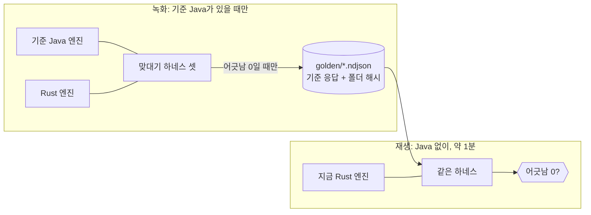

# 리팩토링 0단계 완료 기록 — Java 없이 도는 안전망

## 요약

**결론:** 구조를 바꾸는 동안 「동작이 안 바뀌었다」를 **기준 Java 엔진 없이 1분 안쪽**으로 잴 수 있게 됐다. 어긋남 0을 확인한 순간의 기준 응답과 폴더 해시를 테이프로 녹화했고, 엔진 시험(`bash test.sh`)이 이를 재생해 지금 Rust 엔진과 견준다. 의존 방향, 직렬화 바이트, 명령 목록 세 가지도 시험으로 못박았다. 일부러 동작을 깬 변이 6건을 모두 시험이 잡았다.

계획: [`refactor-ddd-hexagonal-plan.md`](refactor-ddd-hexagonal-plan.md) §4 0단계. 추적: [이슈 #77](https://github.com/bnjjong/aisurada/issues/77). 결정 2~5는 모두 추천대로(가) 확정했다(2026-11-15).

## 만든 것

| 항목 | 위치 | 하는 일 |
| --- | --- | --- |
| 테이프 | `engine-rs/crates/ais-core/examples/support/tape.rs` | 하네스의 기준 호출을 순서대로 적고(`--record`) 되돌려 준다(`--replay`). 임시 폴더 경로는 자리표시자로 적고 재생 때 지금 경로로 되돌린다. 폴더 해시는 직전과 달라진 것만 적는다 |
| 하네스 셋 | `compat_check.rs`, `cli_compat.rs`, `mcp_compat.rs` | 기준 호출 입구(`Java::run_with`, `Harness::java`, 구동기 한 번)와 폴더 비교(`folders`) 두 곳에 테이프를 붙였다. 호출 지점 수십 곳은 그대로다 |
| 녹화·재생 스크립트 | `engine-rs/tools/golden/run.sh` | `record`는 기준 Java와 어긋남 0일 때만 테이프를 쓰고, `replay`는 셋을 병렬로 돌린다 |
| 테이프 | `engine-rs/golden/{compat,cli,mcp}.ndjson` | 합계 약 5.2MB(4.4 + 0.76 + 0.11) |
| 골든 재생 시험 | `ais-cli/tests/golden.rs` | `bash test.sh`가 재생을 부른다 |
| 직렬화 골든 | `ais-core/tests/serialization_golden.rs`, `tests/golden/serialization/` | 태스크, `activity.jsonl`, `ledger.json`, 승인 대기 변경, `trash.json`의 **바이트**를 못박는다(맞대기가 못 보던 구멍) |
| 의존 방향 시험 | `ais-core/tests/architecture.rs`, `architecture-baseline.txt` | 모듈 사이 참조와 바깥 직접 호출(`fs::`, `SystemTime::now`, `env::var`, `Command::new`, 시간대)을 센 값을 박제한다. 늘어도 줄어도 실패한다 |
| 명령 목록 교차 시험 | `ais-cli/tests/command_tables.rs` | 엔진 목록, 명령줄 표, MCP 도구, 화면 `POSITIONAL`의 어긋남을 검사한다 |
| 빌드 프로필 | `engine-rs/Cargo.toml`의 `[profile.golden]` | 재생용으로만 최적화한다(`dev`는 그대로) |

## 숫자

| 항목 | 값 |
| --- | --- |
| 녹화 때 Java와 Rust의 어긋남 | 0 (compat 3,186건, cli 2,194건, mcp 174건) |
| 재생 | 같은 건수에서 어긋남 0 |
| 녹화에 걸린 시간 | compat 약 12분(Java가 도는 만큼), cli 약 3분 |
| 재생에 걸린 시간 | 약 1분(`golden` 프로필, 캐시된 빌드). `dev` 프로필에서는 6분 넘게 걸려 프로필을 따로 만들었다 |
| 엔진 시험 전체 | 183건 통과(변경 전 기준 178건 + 새 5건), `bash test.sh` 약 81초 |

## 변이 확인(안전망이 실제로 잡는가)

일부러 동작을 깨고 해당 시험이 실패하는지 봤다. 모두 잡았고, 수정은 되돌렸다.

| # | 깬 것 | 잡은 시험 |
| --- | --- | --- |
| M1 | 노트 머리 칸 순서(`title`과 `created`) | 골든 재생(하네스가 이어지는 호출 인자가 달라져 테이프와 어긋남) |
| M2 | 난수를 뽑는 순서(앞에서 뽑던 것을 뒤에서) | 골든 재생 |
| M3 | 오류 문구 한 글자 | 골든 재생 |
| M4 | `COMMANDS`에서 `update_task` 한 줄 | `command_tables` |
| M5 | `vault`가 `commands`를 쓰게 함 | `architecture` |
| M6 | 승인 대기 변경 파일의 키 차례 | `serialization_golden` |

M1·M2는 어긋남 건수가 아니라 「하네스 순서가 테이프와 다르다」로 멈춘다. 깨진 값(노트 id, 난수 id)이 이어지는 호출의 인자로 들어가기 때문이다. 시험은 실패하므로 잡은 것이지만 오류 글이 바로 원인을 가리키지는 않는다.

## 이 일을 하며 알게 된 것

- **보고서의 거꾸로 된 의존 10줄기 표가 맞다.** `architecture.rs`가 센 모듈 사이 참조(`commands→write` 97, `commands→vault` 81, `write→commands` 3, …)가 분석 보고서의 표와 일치한다.
- **맞대기 하네스에 시간 의존이 하나 있었다.** `recent_sessions`의 `lastActiveAt`은 세션 파일의 수정 시각이라 실행마다 달랐다. 같은 실행 안에서는 두 엔진이 같은 값을 읽어 맞았지만 녹화본과는 맞지 않았다. 세션 파일의 수정 시각을 고정하는 `pin_session_mtimes`를 하네스에 넣어 고쳤다(수정 시각의 차례는 지킨다).
- **`commit-vault`의 읽기/쓰기 표 불일치**(명령줄 표 `write: false`, 엔진 쓰기 목록 포함)와 **`purge_doc`**(MCP 서버가 의도적으로 내놓지 않음)를 `command_tables`가 「알려진 차이」로 박제했다. 앞의 것을 고칠지는 [#75](https://github.com/bnjjong/aisurada/issues/75)에서 정한다.
- **승인 대기 변경 파일은 테이프 해시를 키 정렬해서 센다.** 맞대기가 원래 Java(넣은 차례)와 Rust(이름 차례)의 키 차례를 같게 보는 파일이라서다. Rust가 쓰는 바이트 자체는 `serialization_golden`이 따로 못박는다.

## 한계

- 테이프는 합성 vault(`make-fixture.sh`)로만 만든다. 진짜 vault 내용은 없다. 앱 창에서는 확인하지 않았다.
- 테이프는 약 5.2MB다. 동작을 알고 바꿔 다시 녹화하면 큰 차이가 한 커밋에 들어간다. 압축은 의존 크레이트를 더해야 해서 하지 않았다.
- 재생은 Java가 아니라 **녹화한 응답**과 견준다. 녹화 때 Java와 Rust가 같았던 입력·시나리오만 보증한다. 하네스에 없는 입력은 이 안전망이 못 본다.
- `architecture.rs`는 주석 줄만 빼고 센다. 문자열 안의 글자와 `#[cfg(test)]` 코드는 구별하지 않는다. 「어댑터 밖 0건」으로 가는 단계(3·5단계)에서 시험 코드를 가르는 규칙을 더해야 한다.
- 호스트·화면 시험(`test-native.sh`, acceptance)은 돌리지 않았다. 호스트 코드는 바꾸지 않았다(결정 4-가).

## 다음

1단계(공용 커널): [계획](refactor-ddd-hexagonal-plan.md) §4. 단계 끝마다 `bash test.sh`의 골든 재생이 어긋남 0이어야 한다.
