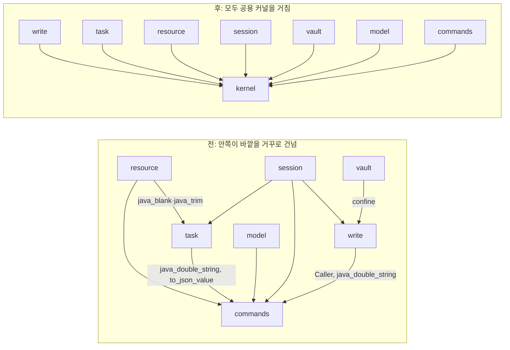

# 리팩토링 1단계 완료 기록 — 공용 커널과 거꾸로 된 의존 끊기

## 요약

**결론:** 안쪽 모듈이 명령 층이나 옆 컨텍스트를 거슬러 쓰던 **거꾸로 된 의존 10줄기를 모두 끊었다.** 여러 영역이 같이 쓰던 작은 코드를 공용 커널(`ais-core/src/kernel/`)로 옮겼고, 같은 규칙의 복사본을 하나로 합쳤다. 동작은 그대로다: 0단계 골든 재생(기준 Java 녹화본)이 어긋남 0이고 엔진 시험 188건이 통과한다.

계획: [`refactor-ddd-hexagonal-plan.md`](refactor-ddd-hexagonal-plan.md) §4 1단계. 추적: [이슈 #77](https://github.com/bnjjong/aisurada/issues/77). 앞 단계: [0단계 기록](refactor-step0-complete.md).

## 한 일

| 커밋 | 내용 | 종류 |
| --- | --- | --- |
| 1-1 | `kernel` 모듈을 세우고 코드를 옮겼다: `actor`(`Caller`), `java`(`java_trim`·`java_blank`·`value_to_string`·`java_double_string`·`to_json_value`), `time`(날짜 계산, ISO 시각 읽기·쓰기, `format_utc_millis`), `confine`(`write::confine`) | 기계적 |
| 1-2 | 복사본을 합쳤다: `days_from_civil` 두 벌 → 한 벌, id 모양 `tr`·`ag` 두 벌씩 → `kernel::ids` 한 곳 | 동작 변경 없음(시험으로 확인) |
| 1-3 | 결과를 버리는 호출 4곳을 지웠다 | 별도 커밋 |

1-1과 1-2는 같은 커밋(`baec505`)에, 1-3은 따로(`6f7633f`) 올렸다. 1-1과 1-2가 같은 파일을 같이 고쳐서 갈라 내지 못했다.

### 커널의 모양

커널은 영역(`vault`, `write`, `task`, `resource`, `session`, `commands`, `model`, `engine`)을 쓰지 않는다. 쓰는 것은 바탕 모듈(`text`, `json`, `frontmatter`, `error`)뿐이고, 시험(`architecture.rs`의 `the_kernel_uses_no_context_module`)이 이를 막는다.

옛 경로는 바깥 크레이트와 같은 방향의 안쪽 사용을 위해 **다시 내보내기**로 남겼다: `commands::Caller`(`ais-cli`가 씀), `write::confine`(`write`와 `commands`의 20개 파일이 씀), `task::format::{java_blank, java_trim, value_to_string}`(`task`와 `commands`가 씀). 모두 `commands→kernel`, `write→kernel`, `task→kernel` 방향이라 허용된다. 거꾸로 된 쪽(`resource`, `session`, `write`, `vault`, `model`이 `task`·`commands`를 건너던 곳)은 모두 커널 경로로 바꿨다.

### 복사본을 합친 근거

- **`days_from_civil`:** `commands/ask_chat_commands.rs`(`i64` 월·일)와 `vault/note_meta.rs`(`u32` 월·일)가 같은 알고리즘(Hinnant)을 두 식으로 적었다. 한 벌로 합치고, 합치기 전 `note_meta` 식을 시험 안에 남겨 −1200년부터 4000년까지 월마다 1·15·28일에서 값이 같고 `civil_from_days`로 되돌아오는지 견준다.
- **id 모양:** `tr`는 `vault/trash.rs`와 `commands/trash_write.rs`에, `ag`는 `vault/agenda.rs`와 `vault/trash.rs`에 같은 정규식이 따로 있었다. 새 id를 만드는 `write::apparatus::next_id`와 짝이므로 `kernel::ids`로 모았다(`tk`, `sk|ap`, `pc`, `cm`도 같이). 노트(`nd`)·후속 노트(`sn`) id는 `text` 모듈에 남기고 `kernel::ids`가 다시 내보낸다(`text`와 `kernel`이 서로를 쓰는 고리를 만들지 않으려고).
- **합치지 않은 것:** 공백 규칙 둘(`java_blank`는 U+00A0을 공백으로 보지 않고 `text::is_blank`는 본다). 합치면 바이트가 바뀐다. 단위 시험이 둘이 다르다는 사실을 못박는다.

### 결과를 버리는 호출 4곳을 지운 근거

| 호출 | 하는 일 | 지워도 같은 이유 |
| --- | --- | --- |
| `attach_text::extract` 3곳(`daily_notes`, `export_markdown`, `write_attachment`) | 노트의 HTML 첨부 글을 읽어 `Option<String>`을 돌려준다 | 파일을 읽기만 하고 저장하지 않으며 결과를 버렸다. 응답이 같다 |
| `reindex::execute` 1곳(`shard_notes`) | `NoteIndex::reconciled`로 vault를 훑어 요약을 만든다 | 읽기만 하고 저장하지 않으며 결과를 버렸다. 이동 결과(`result`)는 그대로 돌려준다 |

## 숫자

| 항목 | 값 |
| --- | --- |
| 거꾸로 된 의존 | 10줄기 → 0 (`architecture-baseline.txt`에서 10줄 삭제) |
| 골든 재생 | 어긋남 0 (compat 3,186건, cli 2,194건, mcp 174건) |
| 엔진 시험 | 188건 통과(2단계 시작 전 183건 + 새 5건: 커널 단위 시험 4건, 커널 의존 시험 1건), `bash test.sh` 약 81초 |
| 고친 파일 | 44개(커밋 `baec505`) + 5개(커밋 `6f7633f`) |

## 한계와 남은 것

- `resource→write`(15)와 `task→write`(6)는 도메인 후보가 쓰기 기반의 파일 부품을 직접 보는 길이라 **일부러 남겼다.** 5단계(저장소 포트)가 없앤다. `architecture.rs`가 「과도기」로 따로 적어 두었다.
- 호스트(`native-host/src-tauri`)와 화면은 건드리지 않았다. 호스트가 쓰는 `ais_core` 경로는 `write::autocommit::watch`와 `engine::COMMANDS` 둘뿐이라 영향이 없음을 확인했다(호스트 빌드는 돌리지 않았다).
- 이 단계에서 계획이 말한 「`import` 약 40곳」 가운데 거꾸로 된 쪽 약 25곳을 새 경로로 바꿨다. 나머지는 다시 내보내기로 옛 경로가 그대로 컴파일된다. 옛 경로를 걷어내는 일은 하지 않았다(영향 대비 이득이 작다).
- 변이 확인은 0단계에서 했다. 의존 방향 시험이 이번 변경으로 기준이 바뀌었으므로 새 위반(`vault`가 `commands`를 씀 따위)을 잡는지는 시험 코드로 확인하지 않았다.

## 다음

2단계(값 객체와 닫힌 집합 enum): [계획](refactor-ddd-hexagonal-plan.md) §4. `DocType` 9벌을 한 벌로, 기록 층 규칙 9곳을 정책 하나(`NoteVisibility`)로 모으는 일부터 시작한다.
