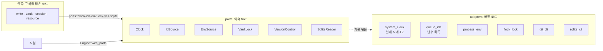

# 리팩토링 3단계 완료 기록 — 시계·난수·환경·잠금·git·sqlite 포트

## 요약

**결론:** 엔진 안쪽 코드가 시계, 난수, 환경 변수, 파일 잠금, git, sqlite3를 직접 부르던 것을 **포트(`trait`)로 가리고**, 실제로 해내는 코드를 어댑터 모듈(`adapters/`)로 모았다. 어댑터 밖에서 `SystemTime::now`, `env::var`, `Command::new`, `tzset`·`localtime_r`는 **0건**이다. 기본 어댑터는 지금까지처럼 환경 변수와 실제 시계, 정해 둔 난수 목록을 읽어서 동작은 그대로다: 골든 재생이 어긋남 0이고 엔진 시험 201건이 통과한다.

계획: [`refactor-ddd-hexagonal-plan.md`](refactor-ddd-hexagonal-plan.md) §4 3단계. 추적: [이슈 #77](https://github.com/bnjjong/aisurada/issues/77). 앞 단계: [2단계 기록](refactor-step2-complete.md).

## 한 일

| 포트 | 어댑터 | 안쪽에서 바뀐 곳 |
| --- | --- | --- |
| `Clock`(지금, 시간대로 푼 날짜·시각) | `adapters/system_clock.rs`: `AISURADA_TEST_NOW`가 있으면 그 값, 아니면 실제 시계. `TZ`를 따르는 `tzset`·`localtime_r` | `write/apparatus.rs`(`now_millis`), `write/local_time.rs`, `session/claude.rs` |
| `IdSource`(id 꼬리, 임시 이름용 난수) | `adapters/queue_ids.rs`: `AISURADA_TEST_RANDOM` 목록을 차례로 쓰고 다 쓰면 운영체제 난수 | `write/apparatus.rs` |
| `EnvSource` | `adapters/process_env.rs` | 승인 기록 폴더, 세션 홈 폴더, 월별 폴더 배치, 자동 커밋 설정 |
| `VaultLock` | `adapters/flock_lock.rs`(옛 `write/lock.rs`를 옮김) | `write/pipeline.rs`, `write/autocommit.rs` |
| `VersionControl` | `adapters/git_cli.rs`(옛 `vault/git.rs`의 실행부) | `vault/git.rs`는 `Git::strict`·`legacy`·`run`만 남은 얇은 껍데기가 됐다 |
| `SqliteReader` | `adapters/sqlite_cli.rs`(옛 `session/antigravity.rs`의 실행부) | `session/antigravity.rs`는 글을 받아 줄·열로 가르는 일만 한다 |

- `CivilDate`와 `LocalClock`은 시계 포트의 반환 타입이라 `kernel::time`으로 옮겼다(`write/doc_place.rs`는 다시 내보낸다).
- `Engine::with_ports(vault, ports)`로 약속 묶음을 바꿔 끼울 수 있다. 묶음은 명령을 부르는 동안만 현재 스레드에 걸리고(`ports::install`), 안 끼우면 기본 어댑터다.

### 가짜 포트 시험

`tests/ports_fake.rs`는 시계, 난수, 환경 변수, 잠금 폴더, git, sqlite3를 모두 가짜로 끼운 엔진이 **환경 변수 없이** `create_doc`을 결정적으로 처리하는지 본다. 노트 id는 가짜 시계와 가짜 난수로 정해지고(`nd` + 36진수 밀리초 + `-00000001`), 날짜와 시각은 가짜 시간대(UTC)로 정해지며, 잠금 파일은 환경 변수가 아니라 약속에 준 폴더에 생기고, 자동 커밋이 꺼져 git은 한 번도 안 불리며, 호출이 끝나면 가짜 시계가 호출 밖으로 새지 않는다. 포트가 실제로 바꿔 끼워진다는 증거다.

### 시험

- `architecture.rs`의 `clock_env_process_and_timezone_calls_stay_in_adapters`: 어댑터와 시험 모듈 밖에서 위 호출이 0건이다.
- `adapters_depend_on_ports_only_and_only_ports_wires_them`: 어댑터는 포트와 바탕 모듈만 쓰고, 안쪽 코드가 어댑터를 직접 쓰는 곳은 기본 묶음을 엮는 `ports/mod.rs` 하나뿐이다.

## 이 단계에서 찾아 고친 것: 골든의 시간 폭탄

`session/claude.rs`의 `recent_sessions`가 **시험 시계를 무시하고 실제 시계(`SystemTime::now`)를 읽었다**(분석 보고서가 짚은 D 묶음의 한 곳). 0단계에서 세션 파일의 수정 시각을 시험 시계 근처로 고정했는데, 「최근 1일」 창은 실제 시계에서 하루를 빼서 가른다. 그래서 골든 재생은 **녹화한 지 하루가 지나면** 이 사례가 어긋나 실패하게 돼 있었다(녹화 2026-11-15, 어긋나기 시작하는 때 11-16 아침). 시계 포트를 거치게 해서 고쳤다. 시험 시계가 없는 실제 사용은 같은 실제 시계라 그대로이고, 시험 시계가 있을 때만 그 시계를 따른다. 녹화 때 Java와 Rust가 같던 결과는 그대로다(Java는 그때 실제 시계였지만 파일 수정 시각이 두 창 안에 있어 같은 답이 나왔다).

## 숫자

| 항목 | 값 |
| --- | --- |
| 어댑터 밖 시계·환경·프로세스·시간대 직접 호출 | 환경 13곳·프로세스 3곳·시계 4곳·시간대 3곳(`architecture-baseline.txt`의 센 값, 시험 코드 포함) → **0** (`ais-core`, 시험 모듈 제외). `ais-cli`는 그 자체가 명령줄 어댑터라 대상이 아니다 |
| 골든 재생 | 어긋남 0 (compat 3,186건, cli 2,194건, mcp 174건) |
| 엔진 시험 | 201건 통과(2단계 198건 + 새 3건: 어댑터 규칙 시험 2건, 가짜 포트 시험 1건), `bash test.sh` 약 1분 10초~1분 45초 |

## 계획과 다르게 한 것, 하지 않은 것

- **맥락(`&Ctx`)을 명령 함수마다 넘기지 않았다.** 계획은 `Engine`이 약속 묶음을 들고 명령에 `&Ctx`로 넘기는 것이었다. 안쪽 시계·난수·환경을 부르는 곳이 백 곳이 넘고 깊은 도우미 함수까지 서명을 모두 바꿔야 해서, 같은 결과를 더 작은 변경으로 얻는 방식을 택했다: 묶음을 현재 스레드에 걸고 `ports::clock()` 따위로 꺼내 쓴다. 호출자 맥락을 요청 밖으로 빼는 7단계(`CallContext`)에서 묶음을 명시 인자로 바꾸는 것을 다시 본다. 이 방식의 약점은 **엔진이 새로 만든 스레드가 묶음을 물려받지 않는 것**이다(자동 커밋의 5초 주기 스레드는 기본 어댑터를 쓴다. 지금 동작과 같다). 그리고 `ports/mod.rs`가 기본 묶음을 만들려고 어댑터를 부르는 의존이 한 줄 있다(시험이 이 한 곳만 허용한다).
- **편집 도장 판정 `judge`가 시각을 인자로 받게 하는 일**과 「시간 정책 넷을 이름 붙은 순수 함수로」는 하지 않았다. `judge`는 이제 시계 포트를 거쳐 시각을 읽어 바꿔 끼울 수 있게 됐지만 서명은 그대로다. 노트 애그리거트가 `Note::apply(변경, 호출자, 시계)`로 시계를 받는 6단계에서 같이 한다.
- **자동 커밋의 `Clock` 별칭**(`Arc<dyn Fn() -> i64>`)은 시험이 쓰고 있어 그대로 두었다. 포트의 `Clock`과 이름이 겹치지만 하는 일은 「지금」 하나다. 6단계에서 정리한다.
- `fs::`(파일 읽기·쓰기)는 이 단계의 대상이 아니다. 5단계(저장소 포트)가 한다. `architecture-baseline.txt`에 센 값이 그대로 있다.
- 환경·홈 폴더 설정을 타입 있는 설정 구조체로 만들지 않고 `EnvSource`로 변수를 읽게 했다. 변수 이름은 읽는 곳에 있다.

## 한계

- 호스트(`native-host/src-tauri`)와 화면은 건드리지 않았다. 호스트가 쓰는 `ais_core` 경로는 `write::autocommit::watch`와 `engine::COMMANDS`뿐이고 둘 다 그대로다. `ais-cli`는 `vault::git::Git`을 그대로 쓴다. 호스트 빌드는 돌리지 않았다.
- `ais_core::write::lock`은 `ais_core::adapters::flock_lock`이 됐다(`hold_lock` 예제와 `lock_interop` 시험을 고쳤다). 바깥 크레이트가 이 경로를 쓰는지 찾아봤으나 없다.
- 호스트·화면 시험은 돌리지 않았다(결정 4-가).

## 다음

4단계(쓰기 길 분해): [계획](refactor-ddd-hexagonal-plan.md) §4. `WriteScope`를 「잠금」, 「필요할 때만 색인 맞추기」, 「자동 커밋 기록」으로 나누고 `begin`을 디스패처 한 곳에서 부른다. 4단계가 끝나면 게이트 1이다.

## 후속(2026-11-18): 미뤘던 일이 어떻게 됐나

이 기록이 「나중에 한다」고 적은 일의 실제 결과다. 위 본문은 그날의 상태라 고치지 않았다.

| 이 기록에서 미룬 것 | 결과 |
| --- | --- |
| 편집 도장 판정 `judge`가 시각을 인자로 받게 하기 | **했다.** 6c에서 시각(`now_millis`)과 편집자를 인자로 받는다([6c 기록](refactor-step6c-complete.md)) |
| 시간 정책 넷을 이름 붙은 순수 함수로 | 하지 않았다(`note::front`의 `judge` 하나만 순수 함수가 됐다) |
| 포트 묶음을 명시 인자로(7단계에서 다시 본다) | **7단계에서 호출자 맥락(`CallContext`)만 명시 인자가 됐다**([7-2 기록](refactor-step7b-complete.md)). 포트 묶음은 지금도 현재 스레드에 거는 방식이고, 바꿀지는 [이슈 #86](https://github.com/bnjjong/aisurada/issues/86)에서 정한다 |
| 자동 커밋의 `Clock` 별칭 정리(6단계) | 하지 않았다. `write/autocommit.rs`에 그대로 있다 |

