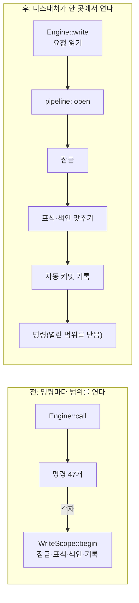

# 리팩토링 4단계 완료 기록 — 쓰기 길 분해

## 요약

**결론:** 쓰기 명령 47개가 각자 `WriteScope::begin`(또는 `begin_write`)을 불러 「잠금 → 표식 → 색인 맞추기 → 자동 커밋 기록」 순서를 40곳에서 되풀이하던 것을, **디스패처(`Engine::write`) 한 곳**에서 범위를 열도록 바꿨다. 명령은 범위를 열지 않고 열린 범위(`&WriteScope`)를 받는다. 범위 열기는 잠금, 색인 맞추기, 자동 커밋 기록 세 조각으로 갈렸다. 동작은 그대로다: 골든 재생이 어긋남 0이고 엔진 시험 202건이 통과한다.

계획: [`refactor-ddd-hexagonal-plan.md`](refactor-ddd-hexagonal-plan.md) §4 4단계. 추적: [이슈 #77](https://github.com/bnjjong/aisurada/issues/77). 앞 단계: [3단계 기록](refactor-step3-complete.md).

## 한 일

| 커밋 | 내용 |
| --- | --- |
| 4-1 | `WriteScope`를 세 조각으로 갈랐다: `acquire_lock`(잠금), `reconcile_index`(표식 확인과 색인 맞추기), `CommitRecord`(자동 커밋 앞 판단과 놓일 때의 쓴 쪽 기록) |
| 4-2 | `begin`을 명령마다 부르지 않고 `Engine::write` 한 곳에서 연다. 요청에서 호출 맥락을 꺼내는 `HasWriteContext`를 요청 종류마다 붙였다. `command != "init_workspace"` 글자 비교는 `MARKER_EXEMPT` 표로 바꿨고, 자원 명령의 기록장 기준선은 `ledger_baseline` 칸으로 바꿨다 |
| 4-3 | `create_doc_in`이 JSON 대신 `CreatedDoc` 타입을 돌려준다. `plan_day`가 JSON에서 키 네 개를 뽑아 쓰던 약속에 타입이 생겼다 |
| (정리) | `cargo fmt --all`을 별도 커밋으로 올렸다. 1~3단계에서 스크립트로 `use` 줄을 옮기며 차례가 어긋나 `cargo fmt --check`가 실패하던 것이다. 글자 모양만 바뀐 47개 소스다 |

- 명령 함수 가운데 범위의 색인을 쓰던 것(25개 명령)만 `scope: &WriteScope` 인자를 받는다. 쓰지 않던 명령(태스크, 자원, 템플릿, 프로젝트 만들기·고치기 등)은 인자가 그대로이고 범위는 디스패처가 쥐고 있다.
- 요청을 읽는 일(`parse_args`)이 범위 열기보다 먼저인 순서도 그대로다(인자 모양 오류가 표식 오류보다 먼저 난다).

### 지킨 동작

- **범위 열기가 인자 검사보다 먼저, 실패해도 기록:** 범위 열기는 각 명령 함수의 첫 줄(상수 `USAGE` 정의만 앞에 있었다)이었으므로 디스패처가 함수를 부르기 직전에 여는 것과 같은 순서다. 쓴 쪽 기록(`after_write`)은 실패한 명령에서도 남고, 기록이 먼저·잠금이 나중에 풀리는 차례도 그대로다(필드 차례).
- **`Drop` 가드를 남겼다.** 계획은 `Drop` 대신 명시적 호출이었으나, 호스트가 패닉을 가로채는 길에서 명시 호출은 건너뛰어져 쓴 쪽 기록이 빠진다(부분으로 쓴 파일이 있을 수 있는 때다). 그래서 `CommitRecord`가 `Drop`으로 기록하게 두고, 그 가드를 만드는 곳을 `pipeline::open` 한 곳으로 모았다.
- **태스크·자원 쓰기도 색인 맞추기를 거친다.** 색인을 쓰지 않는데 막히는 동작은 [#75](https://github.com/bnjjong/aisurada/issues/75)에 있고 이 단계에서 고치지 않았다. 「필요할 때만 색인 맞추기」 칸은 모든 명령이 지금 색인을 맞추므로 만들지 않았다.

### 시험

`architecture.rs`의 `write_scope_is_opened_only_by_the_dispatcher`: 옛 `WriteScope::begin`이 없고 새 입구 `pipeline::open`이 `engine.rs` 밖에 없다. 직접 호출 40곳이 0곳이다.

## 숫자

| 항목 | 값 |
| --- | --- |
| 쓰기 범위를 여는 곳 | 명령마다 48곳(`WriteScope::begin` 40 + `begin_write` 8) → **`Engine::write` 1곳** |
| 골든 재생 | 어긋남 0 (compat 3,186건, cli 2,194건, mcp 174건) |
| 엔진 시험 | 202건 통과(3단계 201건 + 새 1건), `bash test.sh` 약 1분 30초 |

## 하지 않은 것

- **쓰기를 「효과 목록」으로 모으는 일(계획 4-4)은 하지 않았다.** 지금 순서대로 실행하고 기록만 하는 층인데, 쓰는 코드가 파일을 직접 쓰는 한 이 층이 모을 효과가 없다. 저장소 포트(5단계)와 애그리거트가 이벤트를 돌려주는 6단계가 이 일의 자연스러운 자리라 거기서 한다.
- 「표식 필요」, 「색인 필요」를 명령 표의 칸으로 두는 일은 작은 상수 표(`MARKER_EXEMPT`)까지만 했다. 명령 표 하나로 합치는 7단계가 이 표를 흡수한다.
- 호스트와 화면은 건드리지 않았다. 호스트 빌드는 돌리지 않았다. 호스트가 쓰는 `ais_core` 경로(`write::autocommit::watch`, `engine::COMMANDS`)는 그대로다.

## 게이트 1

계획대로 여기서 멈춘다. 0~4단계는 **안전한 정리 구간**이었다(동작 변경 없음, 골든 어긋남 0, 새 의존 위반 없음). 5~8단계를 계속할지 결정이 필요하다.

- **5단계(저장소 포트)**: `VaultStore` 아래 컨텍스트별 저장소를 올린다. 약 2,000줄, 컨텍스트 하나씩 `main`에 올린다. `NoteRepository`가 가장 크고 바이트 위험도 가장 크다. 이 단계에서 `std::fs` 직접 호출 0건이 목표다.
- **6단계(애그리거트)**: 태스크 → 자원 → 노트. 약 2,500줄. 가장 위험한 구간이다. 2단계에서 미룬 id 새 타입과 `Created`, 3단계에서 미룬 `judge`의 시각 인자를 함께 한다.
- **7단계(입구 정리)**: 명령 표 하나로 합치고 `CallContext`, 오류 분리, 공개 면 축소. 3,000줄이 넘는다. 호스트·MCP의 호출 경로를 건드려 호스트·화면 시험이 필요하다.
- **8단계(크레이트 분리)**: 선택.
