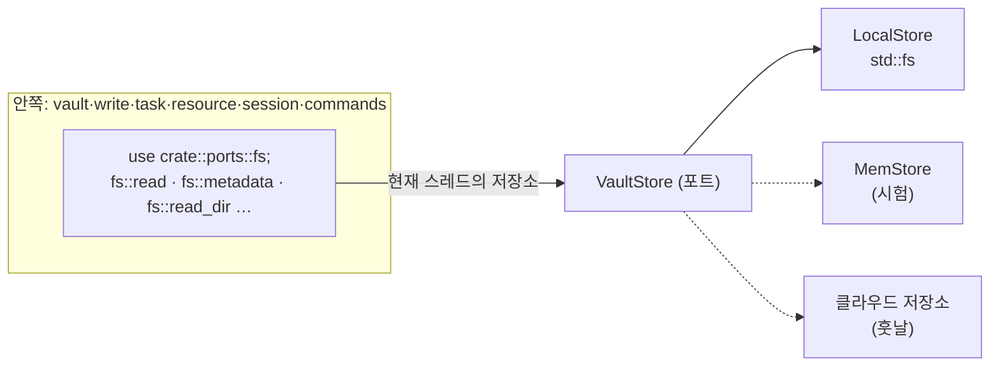

# 리팩토링 5단계 완료 기록 — 저장소 포트(1차)

## 요약

**결론:** 도메인 코드가 `std::fs`로 디스크를 직접 읽고 쓰던 것을 **저장소 포트(`VaultStore`)** 뒤로 모두 옮겼다. 어댑터(`adapters/`)와 시험 코드 밖에서 `std::fs`는 **0건**이다. 디스크에 없는 vault를 메모리 저장소만 끼워서 읽는 시험(`store_memory`)이 통과한다. 동작은 그대로다: 골든 재생이 어긋남 0이고 엔진 시험 218건이 통과한다.

**이 단계는 계획의 절반이다.** 가장 낮은 층(파일 단위 포트)과 그 위로 영역 전부의 전환을 끝냈다. 계획에 있던 **컨텍스트별 저장소**(`AgendaRepository`, `TaskRepository` 등), `NoteIndex` 세 갈래 나누기, 저장 봉투 `Stored<T>`, `ais-cli/src/legacy.rs`의 재훑기 제거는 **하지 않았다**(까닭은 아래).

계획: [`refactor-ddd-hexagonal-plan.md`](refactor-ddd-hexagonal-plan.md) §4 5단계. 추적: [이슈 #77](https://github.com/bnjjong/aisurada/issues/77). 앞 단계: [4단계 기록](refactor-step4-complete.md).

## 한 일

| 커밋 | 내용 |
| --- | --- |
| 포트 | `ports/store.rs`(`VaultStore`와 `Metadata`·`FileType`·`DirEntry`), `ports/fs.rs`(`std::fs`와 같은 모양의 함수 모음), `adapters/local_store.rs`(`std::fs` 그대로). `Ports`에 `store` 칸을 더했다 |
| 전환 | `use std::fs;`를 `use crate::ports::fs;`로 바꿨다: `vault/`(읽기), `write/`, `task/`와 `resource/`, `commands/`, `session/`. 호출 모양(`fs::read(..)`, `fs::metadata(..)`)은 그대로라 줄 하나하나의 의미가 바뀌지 않았다 |
| 시험 | `architecture.rs`에 `file_access_goes_through_the_store_port`, `store_memory.rs`에 메모리 저장소 시험 |

- `Metadata`·`FileType`·`DirEntry`는 `std::fs`의 같은 이름 타입과 **같은 메서드 이름**을 가진다. `std::fs::Metadata`는 로컬 디스크에 묶여 있어 포트에 노출할 수 없어서다. 그 덕에 호출하는 쪽 코드는 거의 안 바뀌었다.
- 폴더 항목의 정보(`entry.metadata()`)는 필요할 때 묻는다(심볼릭 링크를 따라가지 않는 정보, `std`와 같다). 폴더 항목 목록은 한 번에 읽어 오는 방식이라 큰 폴더에서 일찍 멈추는 반복이 항목을 모두 읽는 값을 치른다. 골든 재생 시간(약 1분 20초)은 변하지 않았다.
- 원자적 쓰기의 이름 정하기·`rename`·정리 순서는 `write/atomic.rs`에 그대로 두고, 임시 파일 만들기(새로 만들기, 쓰기, 디스크에 내리기)만 포트의 `write_new`로 옮겼다.
- 파일의 머리·꼬리를 읽던 `File` + `seek`(`session/claude.rs`)은 `read_range(path, offset, length)`로 바꿨다. 파일을 한 번이 아니라 두 번 열지만 읽는 바이트는 같다.

### 메모리 저장소 시험

`tests/store_memory.rs`는 **디스크에 없는 경로**의 vault(아젠다 파일 하나, 노트 하나)를 메모리 저장소에 놓고, 나머지 포트는 기본으로 둔 채 `list_agendas`와 `list_docs`를 부른다. 두 명령이 메모리의 내용을 읽어 답하고 디스크에는 아무것도 생기지 않는다. 도메인 코드가 정말로 저장소 포트만 거친다는 증거이고, 같은 자리에 클라우드 저장소가 들어갈 수 있다.

## 숫자

| 항목 | 값 |
| --- | --- |
| 어댑터·시험 코드 밖 `std::fs` 직접 사용 | 도메인 38개 파일에서 → **0** (`ais-core`). 전환한 `fs::` 호출은 시험 코드를 뺀 약 160곳이다 |
| 골든 재생 | 어긋남 0 (compat 3,186건, cli 2,194건, mcp 174건) |
| 엔진 시험 | 218건 통과(새 시험 2건: 규칙 1, 메모리 저장소 1), `bash test.sh` 약 1분 35초 |

## 하지 않은 것과 까닭

- **컨텍스트별 저장소 포트**(`AgendaRepository`, `TaskRepository`·`ActivityLog`, `ResourceRepository`·`ApprovalLedger`, `AskStore`, `NoteRepository`와 휴지통·코멘트·첨부): 파일 단위 포트 위에 영역별 얇은 저장소 층을 올리는 일이다. 지금 각 영역의 저장 코드는 이미 영역 안(`task/store.rs`, `resource/store.rs`, `vault/*`)에 모여 있고 파일 접근은 포트를 거친다. 그 위에 `trait` 층을 더하면 규칙을 모으는 이득 없이 이름만 늘어난다. 저장소 층의 값이 생기는 때는 **애그리거트가 저장소에서 값을 불러오고 돌려주는 6단계**라서 거기서 영역마다 같이 올린다.
- **`NoteIndex` 세 갈래 나누기**(질의, 훑기 진단 보고, 쓰기 전 검사)와 `vault_root` 비공개: 6단계의 노트 애그리거트와 맞물린다.
- **저장 봉투 `Stored<T>`**(저장 칸 `rel_path`·`content_file`·`token`을 엔티티에서 빼기): 같은 이유로 6단계다.
- **`ais-cli/src/legacy.rs`가 `NoteIndex::fresh`로 vault를 다시 훑는 5곳**: 엔진이 답한 뒤 옛 응답 모양을 만들려고 다시 훑는다. 이 훑기는 `Engine`이 들고 있는 저장소가 아니라 **기본 디스크 저장소**를 쓰므로, 엔진에 다른 저장소를 끼우면 이 길이 어긋난다. 엔진 응답이 필요한 값을 처음부터 담게 하거나 옛 모양 변환을 엔진 쪽으로 옮겨야 해서 7단계(입구 정리)에서 한다.
- `write/autocommit.rs`의 `.git/` 안 대기 기록 파일과 `adapters/flock_lock.rs`의 잠금 파일은 저장소 포트를 거치지만 잠금은 어댑터가 직접 `std::fs`를 쓴다(잠금 파일은 vault 밖 운영체제 자원이라 저장소의 일이 아니다).

## 한계

- 저장소 포트는 **파일 단위**다. 클라우드 저장소가 들어오려면 `rename`의 원자성, `read_dir`의 순서, 수정 시각, 심볼릭 링크 같은 로컬 디스크의 성질을 어떻게 흉내 낼지를 그때 정해야 한다(UTF-16 정렬과 심볼릭 링크 처리 차이는 지금 도메인 코드가 지킨다).
- 포트는 지금 `Ports` 묶음의 한 칸이고 현재 스레드에 거는 방식(3단계)이다. 엔진이 새로 만든 스레드(자동 커밋의 주기 스레드)는 기본 저장소를 쓴다.
- 호스트·화면 시험은 돌리지 않았다(결정 4-가). 호스트 빌드는 돌리지 않았다. 호스트가 쓰는 `ais_core` 경로(`write::autocommit::watch`, `engine::COMMANDS`)는 그대로다.

## 다음

6단계(규칙을 애그리거트로): [계획](refactor-ddd-hexagonal-plan.md) §4. 태스크 → 자원 → 노트 순이다. 이 단계에서 미룬 컨텍스트별 저장소, `Stored<T>`, `NoteIndex` 나누기, 그리고 2단계에서 미룬 id 새 타입·`Created`, 3단계에서 미룬 `judge`의 시각 인자를 함께 한다. **게이트 2는 6단계 뒤**다.

## 후속(2026-11-18): 미뤘던 일이 어떻게 됐나

이 기록이 「6단계」나 「7단계」에서 한다고 적은 일의 실제 결과다. 위 본문은 그날의 상태라 고치지 않았다.

| 이 기록에서 미룬 것 | 결과 |
| --- | --- |
| 컨텍스트별 저장소 `trait`(`AgendaRepository`, `TaskRepository` 등) | **하지 않았다.** 6a가 같은 판단으로 만들지 않았고([6a 기록](refactor-step6a-complete.md)), 8단계 뒤에도 없다. 남은 일은 [이슈 #77](https://github.com/bnjjong/aisurada/issues/77)에 있다 |
| 저장 봉투 `Stored<T>`, `NoteIndex` 세 갈래 나누기 | 하지 않았다(6c, 6d, 8단계 기록이 모두 남은 일로 적었다) |
| `ais-cli/src/legacy.rs`의 `NoteIndex::fresh` 재훑기 5곳(7단계) | **하지 않았다.** 7-3으로 검토했으나 한도·오류 글이 달라질 위험이 이득보다 커서 접었다([7단계 기록](refactor-step7-complete.md)) |
| `vault_root` 비공개 | 하지 않았다 |

