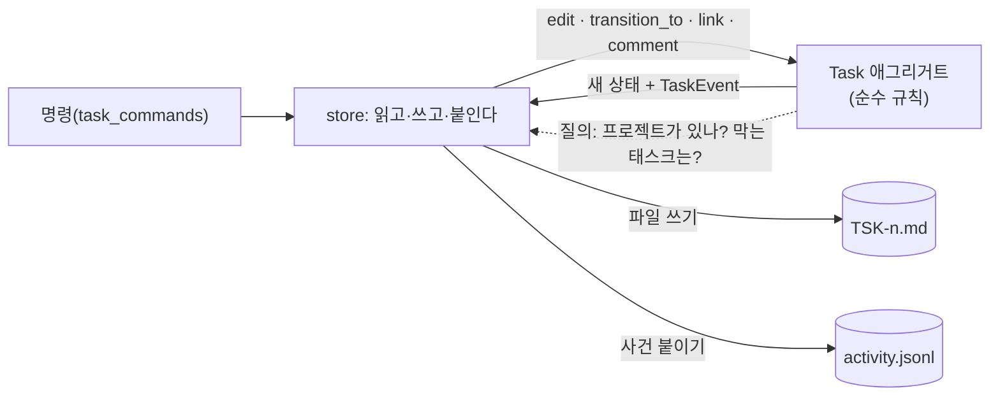

# 리팩토링 6단계 완료 기록 (1/3) — 태스크 애그리거트

## 요약

**결론:** 태스크의 규칙을 파일을 모르는 도메인 코드(`task/aggregate.rs`)로 모았다. 만들기 검사, 고칠 때의 확인 값, 상태 전이, 연결 규칙, 막힘 계산이 그곳에 있다. 저장소(`task/store.rs`)는 도메인이 돌려준 **새 상태와 사건**을 파일에 쓰고 사건을 `activity.jsonl`에 붙이기만 한다. 규칙을 디스크 없이 시험하는 단위 시험이 9건 생겼다. 동작은 그대로다: 골든 재생이 어긋남 0이고 엔진 시험 229건이 통과한다.

6단계는 태스크 → 자원 → 노트 순으로 컨텍스트 하나씩 올린다. 이 기록은 그 첫째(태스크)다.

계획: [`refactor-ddd-hexagonal-plan.md`](refactor-ddd-hexagonal-plan.md) §4 6단계. 추적: [이슈 #77](https://github.com/bnjjong/aisurada/issues/77). 앞 단계: [5단계 기록](refactor-step5-complete.md).

## 한 일

| 도메인(`task/aggregate.rs`) | 하는 일 |
| --- | --- |
| `NewTask::from_fields` → `into_task` | 요약(title), 저장소(repo), 완료 기준 하나 이상이 필수. 검사 차례가 곧 오류가 나오는 차례다. Draft로 시작하고 완료 기준 확인자를 적는다 |
| `Task::edit` | 직전에 읽은 확인 값(`f1`)이 지금 파일과 맞아야 한다(`AIS-412`). 달라지는 게 없으면 `None`. 고친 칸 이름을 사건에 담는다 |
| `Task::transition_to` | 기대한 상태(`from`)가 지금과 같은지(`AIS-409`), `transitions`의 규칙과 조건, 막는 미완료 태스크가 없는지 |
| `Task::link` | 자기 자신에게 못 걸고, 서로 막는 순환을 못 만들고, 태스크마다 50개까지. 푸는 일은 두 방향 가운데 있는 쪽을 지운다. 두 태스크의 활동에 각각 사건을 남긴다 |
| `Task::comment` | 댓글은 파일을 바꾸지 않고 사건 하나다 |
| `TaskEvent` | 활동 파일의 한 줄 모양(`at`, `kind`, `by`, `session`, `agent`, 사건별 칸)을 만든다 |
| `unfinished_blockers`, `related` | 여러 태스크에 걸친 규칙(막힘 계산, 반대쪽 이름으로 보이는 연결)을 도메인 서비스로 옮겼다 |

- **프로젝트 존재 확인과 막힘 질의는 규칙이 아니라 질의로 받는다.** 프로젝트는 다른 컨텍스트의 데이터이고 막는 태스크는 다른 파일들을 읽어야 구해서, `edit`와 `transition_to`가 클로저로 받는다. 전이는 기대한 상태를 검사한 **뒤에** 막힘을 묻는다(검사가 실패하면 vault를 훑지 않는 순서를 지켰다).
- `Stamp`(누가 언제 고쳤는지의 값)는 `kernel::stamp`로 옮겼다. 시각과 호출 맥락에서 만드는 `stamp_of`는 쓰기 쪽에 남았다. 도메인이 쓰기 모듈을 거치지 않게 하려는 것이다.
- 도메인은 `format::render`로 「바뀐 게 없는가」를 가린다. 파일 형식 코덱이 도메인 안에 한 줄 걸려 있는 셈이다. 저장 형식을 가르는 일은 노트까지 끝난 뒤 크레이트를 나눌 때(8단계) 다시 본다.

### 시험

- `task/aggregate.rs`의 단위 시험 9건: 필수 검사의 차례, 만들기의 시작 상태와 확인자, 확인 값과 「바뀐 게 없다」, 프로젝트는 바뀔 때만 확인, 기대한 상태 검사가 막힘 질의보다 먼저, 막힌 태스크는 시작 못 함, 연결 규칙과 양쪽 사건의 방향, 막힘 계산과 반대쪽 이름, 댓글 사건. 디스크도 vault도 쓰지 않는다.
- `architecture.rs`의 `aggregate_files_are_pure_domain_code`: 애그리거트 파일(`task/aggregate.rs`, `task/transitions.rs`)이 포트·쓰기·vault·어댑터·`std::fs`를 쓰지 않는다. 영역마다 애그리거트를 올릴 때 이 목록에 파일을 더한다.

## 숫자

| 항목 | 값 |
| --- | --- |
| `store.rs` 안의 규칙 | 만들기 검사, `update`의 계산, `transition`의 검사, `link`의 규칙, 사건 만들기가 모두 도메인으로 갔다. `store.rs`는 약 300줄 줄었다 |
| 골든 재생 | 어긋남 0 (compat 3,186건, cli 2,194건, mcp 174건) |
| 엔진 시험 | 229건 통과(새 시험 10건: 도메인 9, 규칙 1), `bash test.sh` 약 1분 35초 |

## 하지 않은 것과 남은 것

- **`TaskRepository`·`ActivityLog` trait**은 만들지 않았다. 저장소 층은 `task/store.rs`의 함수들이고 파일 접근은 저장소 포트를 거친다. 이 단계의 목표는 규칙을 도메인으로 옮기는 것이었다. 지금 저장소를 `trait`으로 세우면 이름만 늘고 얻는 것이 없다(5단계 기록과 같은 판단이다). 클라우드 저장소를 붙일 때 이 함수들이 그대로 `trait`의 모양이 된다.
- 태스크 진행 중 `update`가 저장소·완료 기준을 지울 수 있는 동작([#75](https://github.com/bnjjong/aisurada/issues/75))은 고치지 않았다. 규칙이 한 곳에 모였으니 고칠 자리는 `Task::edit` 하나다.
- 호스트와 화면은 건드리지 않았다. 호스트 빌드는 돌리지 않았다.

## 다음

6단계 둘째: **자원**(`resource/`, `commands/resource_commands.rs` 약 1,700줄). `Resource`, `PendingChange { approve, reject, mark_stale }`, `TrustState`를 도메인으로 옮기고 낡음 판정을 오류 코드 글자(`AIS-400`·`404`·`409`·`412`) 대신 도메인 오류 종류로 바꾼다. 대기 변경 파일 형식은 저장소 매퍼로 가둔다(직렬화 골든이 이미 있다). 그 뒤 **노트**가 셋째이고, 게이트 2는 6단계가 모두 끝난 뒤다.
