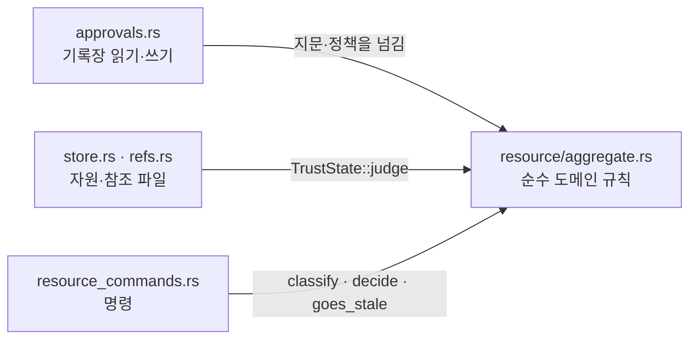

# 리팩토링 6단계 완료 기록 (2/3) — 자원 애그리거트(1차)

## 요약

**결론:** 자원(스킬·에이전트)의 **승인 규칙**을 파일과 기록장을 모르는 도메인 코드(`resource/aggregate.rs`)로 모았다. 변경의 갈래와 정책, 파일 지문으로 가리는 「믿을 수 있는 상태」, 대기 변경의 상태와 낡음 판정이다. 낡음 판정은 오류 코드 글자(`AIS-400`·`404`·`409`·`412`) 대신 오류 **종류**로 바꿨다. 동작은 그대로다: 골든 재생이 어긋남 0이고 엔진 시험이 통과한다(이 브랜치만 232건, 같은 시기에 `main`에 올라온 다른 시험까지 합치면 249건).

**이 기록은 자원의 1차다.** 자원 저장·삭제·되살리기·참조 규칙은 아직 `commands/resource_commands.rs`(약 1,650줄)에 남아 있다. 까닭과 남은 일은 아래에 적었다.

계획: [`refactor-ddd-hexagonal-plan.md`](refactor-ddd-hexagonal-plan.md) §4 6단계. 추적: [이슈 #77](https://github.com/bnjjong/aisurada/issues/77). 앞 기록: [태스크 애그리거트](refactor-step6a-complete.md).

## 한 일

| 도메인(`resource/aggregate.rs`) | 하는 일 | 옮겨 온 곳 |
| --- | --- | --- |
| `Category`, `Policy`, `Decision`, `classify`, `classify_refs`, `decide` | 변경의 갈래(권한 올림·내림, 도구 칸 변경, 참조 켜기·끄기, 글로벌·프로젝트 자원 변경), 정책 네 칸(`auto`/`approve`), `fixed` 갈래는 늘 승인. 앱 통로는 늘 바로 적용하고 AI는 정책이 요구하는 갈래가 하나라도 있으면 대기에 올린다 | `approvals.rs`에 있던 순수 코드 |
| `TrustState`와 `judge` | 파일 지문이 승인 기록과 같으면 `Approved`, 다르면 `Dirty`(승인해 둔 사본을 쓴다), 기록이 없으면 `Untrusted`(응답에는 `new`). 자원 파일(`store.rs`의 `approved`/`dirty`/`new` 글자)과 참조 목록(`refs.rs`의 `State`)이 **같은 규칙을 두 이름으로** 쓰던 것을 하나로 했다 | `store.rs`, `refs.rs` |
| `ChangeStatus` | 대기 변경 상태(`pending`·`approved`·`rejected`·`stale`)를 글자 상수 네 개 대신 타입으로. `changes.rs`의 상수는 여기서 만든다 | `changes.rs` |
| `goes_stale` | 승인한 변경을 적용하다 난 오류가 「변경이 더는 맞지 않는다」는 뜻인가. 인자 틀림·찾는 것 없음·부딪힘·지원 안 함·읽은 뒤 바뀜이면 낡음으로 남고 내부 오류 따위는 대기로 남는다 | `resource_commands.rs`의 `matches!(e.code, "AIS-400" \| …)` |
| `already_decided` | 이미 결정된 변경을 다시 결정하려 할 때의 오류 | `resource_commands.rs` |

- **낡음 판정이 같은 오류들인 까닭:** 코드 `AIS-409`에는 지금 상태와 부딪힘(`Conflict`), 이 판에 없는 명령(`Unsupported`), 기록 층 노트 거절(종류는 `Forbidden`)이 섞여 있다. 앞의 둘은 낡음이고 마지막은 노트 영역의 오류라 자원 적용 경로에 닿지 않는다(확인했다). 그래서 종류로 가르면 코드로 가르던 것과 같은 결과다. 단위 시험이 다섯 종류가 낡음이고 `Forbidden`·`Internal`은 아님을 못박는다.
- `approvals.rs`는 이제 승인 기록장(`ledger.json`, 사본 폴더)을 읽고 쓰는 일만 한다. 기록장 안의 정책을 파일로 적는 한 함수(`Policy`의 `to_value`)만 저장 모양이라 `approvals.rs`에 남겼다.

### 시험

- `resource/aggregate.rs`의 단위 시험 7건: 갈래·정책·결정(옮겨 온 4건), `TrustState` 판정과 응답 이름, 낡음이 되는 오류 종류, 상태 이름과 「이미 결정됨」 오류(새 3건). 디스크도 기록장도 쓰지 않는다.
- `architecture.rs`의 순수 도메인 파일 목록에 `resource/aggregate.rs`를 더했다(포트·쓰기·vault·어댑터·`std::fs`를 쓰지 않는다).

## 숫자

| 항목 | 값 |
| --- | --- |
| 골든 재생 | 어긋남 0 (compat 3,186건, cli 2,194건, mcp 174건). 승인 대기 변경·기록장 바이트는 직렬화 골든도 그대로다 |
| 엔진 시험 | 232건 통과(229건 + 새 3건). 같은 시기에 `main`에 올라온 다른 세션의 시험까지 합친 상태에서는 249건 통과, `bash test.sh` 약 2분 |
| 코드 위치 | `approvals.rs` 약 630줄 → 약 320줄, 도메인 `aggregate.rs` 약 465줄(시험 포함) |

## 하지 않은 것과 까닭

6단계 계획의 자원 몫(`Resource`·`ProjectRefs`·`PendingChange { approve, reject, mark_stale }`·`TrustState`) 가운데 **`TrustState`와 승인 규칙, 낡음 판정은 했고 나머지는 아직이다.**

- **`Resource`·`ProjectRefs` 애그리거트**: 자원의 만들기·고치기·지우기·되살리기·참조 켜고 끄기 규칙(`save`, `delete`, `restore`, `ref_impl`)은 `resource_commands.rs` 안에서 문자열 옵션(`Opts`, 키-값)을 읽는 일과 섞여 있다. 규칙을 꺼내려면 옵션 읽기를 먼저 타입 있는 명령 값으로 바꿔야 해서(명령 표와 입력 모양을 정리하는 7단계와 맞물린다) 이번에 하지 않았다.
- **`PendingChange` 값 객체와 대기 변경 파일 모양 매퍼**: 대기 변경은 지금 칸 차례를 지키는 JSON 객체(`changes::Change`)이고 `decide`가 그 칸들을 직접 고친다. 값 객체로 바꾸고 파일 모양을 저장 쪽 매퍼로 가두려면 `serialization_golden`이 이미 못박은 바이트를 그대로 내는 매퍼를 써야 한다. 이번에는 상태(`ChangeStatus`)와 판정(`goes_stale`, `already_decided`)만 도메인으로 가져왔다.
- 그래서 6단계의 끝 기준 「store와 명령 함수에 남은 업무 규칙 0」은 **자원에서는 아직 못 채웠다.**
- 이 단계에서도 화면이 오류 문구를 정규식으로 가르는 곳([#76](https://github.com/bnjjong/aisurada/issues/76))과 오류 코드 문구는 바뀌지 않았다.

## 한계

- 호스트와 화면은 건드리지 않았다. 호스트 빌드는 돌리지 않았다.
- `Resource`(자원 값)와 `ResourceKind`는 `resource/mod.rs`에 있어 도메인 코드가 `super::format::PERMISSIONS`(파일 형식 모듈)를 쓴다. 파일 형식 코덱을 저장 쪽으로 가르는 일은 8단계(크레이트 분리)에서 본다.

## 다음

6단계 셋째: **노트**(`Note::apply`, `Placement`, 월별 폴더 정책, 기록 층 가시성이 이미 `Tier`로 있다). 가장 크고 바이트 위험도 가장 큰 구간이라 이 앞에서 한 번 더 멈추고 방향을 확인하려 한다. 자원의 남은 몫(`Resource`·`ProjectRefs` 규칙, `PendingChange` 값 객체)은 노트 뒤 또는 7단계와 함께 할 수 있다.
