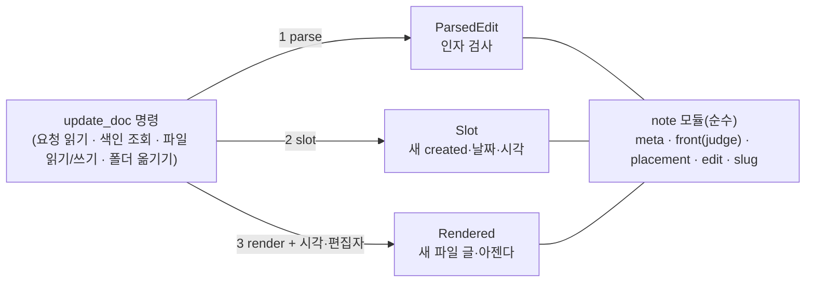

# 리팩토링 6단계 완료 기록 (3/3) — 노트 도메인(1차)와 게이트 2

## 요약

**결론:** 노트의 규칙 가운데 **메타 타입, 머리 짓기와 편집 도장 판정, 자리 정책, `update_doc`의 고치기 조건**을 파일도 vault도 모르는 순수한 `note` 모듈로 모았다. 지금 시각과 편집자와 월별 배치 여부는 **인자**로 받는다(3단계에서 미룬 「`judge`가 시각을 인자로 받게」가 이것이다). 동작은 그대로다: 골든 재생이 어긋남 0이고 엔진 시험 256건이 통과한다.

6단계의 세 컨텍스트(태스크, 자원, 노트)를 모두 1차까지 올렸다. **그러나 6단계의 끝 기준 「store와 명령 함수에 남은 업무 규칙 0」은 자원과 노트에서 아직 채우지 못했다.** 남은 일과 까닭은 아래에 적었고, 이 기록 끝에 **게이트 2**의 결정거리를 정리했다.

계획: [`refactor-ddd-hexagonal-plan.md`](refactor-ddd-hexagonal-plan.md) §4 6단계. 추적: [이슈 #77](https://github.com/bnjjong/aisurada/issues/77). 앞 기록: [태스크](refactor-step6a-complete.md), [자원](refactor-step6b-complete.md).

## 한 일

| 모듈(`note/`) | 하는 일 | 옮겨 온 곳 |
| --- | --- | --- |
| `meta` | `MetaData`, `Link`, `Evaluation`, 본문 형식 `Format`, 머리 맵 값 읽기 도우미(`get`, `text`, `agent_for_file`, `read_agent`), `parse_iso_date` | `vault/note_meta.rs`, `vault/scanner.rs`(옛 경로로 다시 내보낸다) |
| `front` | `NoteFront`(머리 줄 짓기), `Draft`, **`judge`**(편집 도장 판정), 편집자 `Editor`, 저장 상한 | `write/note_front.rs`, `write/meta_writer.rs` |
| `placement` | `date`·`time` 인자 읽기, `created` 가르기, 폴더 이름, 부모 폴더. **월별 배치 여부는 `Layout` 입력** | `write/doc_place.rs` |
| `edit` | `update_doc`의 규칙을 세 걸음으로: 인자 검사, 새 `created`·날짜·시각, 새 파일 글 | `commands/doc_write.rs` |
| `slug` | 제목에서 폴더·파일 이름 만들기 | `write/slug.rs` |

- **`judge`는 이제 지금 시각(`now_millis`)과 편집자(`Editor { tool, session, session_agent }`)를 인자로 받는다.** 편집 도장은 시각과 편집자만으로 정해지므로 시계를 바꿔 끼운 시험이 가능하다. 호출하는 세 곳(`update_doc`, 후속 노트 고치기, 머리만 고치는 `write_meta`)은 포트의 시계에서 읽은 값을 넘긴다.
- **월별 폴더 배치 여부는 규칙이 아니라 입력이다.** 예전에는 `parent_folder`가 vault를 훑거나 환경 변수(`AISURADA_NOTES_SHARD_BY_MONTH`)를 읽어서 알아냈다. 이제 도메인의 `parent_folder`는 `Layout`을 받고, 알아내는 일은 실행 쪽 `write/doc_place.rs`의 얇은 함수가 한다(호출하는 쪽 코드는 그대로다).
- **`update_doc`은 세 걸음**이다. 오류가 나오는 차례(날짜 → 시각 → 제목 → 노트 없음 → 쓸 수 있는가 → `created`를 못 읽음 → JSON 본문 → 확인 값 → 파일 읽기)를 그대로 지키려고 파일 읽기와 색인 조회 사이에 끼워 넣었다. 파일 읽기, 폴더 옮기기, 쓰기, 경고, 응답은 명령에 남았다.

### 시험

- `note/edit.rs`의 단위 시험 7건: 날짜·시각·제목이 검사되는 차례, AI 도구는 날짜·시각을 못 바꾸고 앱은 오프셋을 지키며 바꾼다, `created`를 못 읽거나 JSON 노트에 본문을 주면 파일을 읽기 전에 거절한다, 템플릿은 모양이 맞을 때만 바뀐다, **같은 입력이라도 시계와 편집자에 따라 편집 도장이 정해진다**(앱 `app`, AI `tool`과 세션·에이전트, 한 시간 뒤 시계는 한 시간 뒤 도장), 아젠다는 파일에서 오고 비면 경로에서 온다. 디스크도 색인도 쓰지 않는다.
- 옮겨 간 시험(자리 정책과 날짜·시각 인자, 한국 시각 글)도 함께 돈다.
- `architecture.rs`: `note/` 파일들이 포트·쓰기·vault·어댑터·`std::fs`를 쓰지 않는다(순수 도메인 파일 목록에 추가), 그리고 `note`는 바탕 모듈과 커널만 쓴다.

## 숫자

| 항목 | 값 |
| --- | --- |
| 골든 재생 | 어긋남 0 (compat 3,186건, cli 2,194건, mcp 174건). 직렬화 골든도 그대로다 |
| 엔진 시험 | 256건 통과(249건 + 새 시험), `bash test.sh` 약 2분 |
| 코드 위치 | `commands/doc_write.rs` 342줄 → 262줄, 도메인 `note/` 약 1,500줄(시험·문서 포함) |

## 하지 않은 것과 까닭

6단계 계획의 노트 몫 가운데 **`Note::apply`가 모든 노트 쓰기를 강제하는 단계까지는 가지 못했다.** 구체적으로:

- **다른 노트 쓰기 명령의 규칙**(`create_doc`, 후속 노트 만들기·고치기·지우기, 코멘트, 휴지통, `set_favorite`·`evaluate_doc`·`link_docs`)은 아직 명령 안에 있다. 이 가운데 머리를 짓는 부분(`NoteFront`, `judge`)과 자리 정책은 이번에 공용 도메인 코드가 됐지만 인자 검사, 존재 확인, 파일 쓰기 차례는 명령에 남았다. 한 명령(`update_doc`)에서 세 걸음 모양을 확인했으니, 다른 명령도 같은 모양으로 옮길 수 있다.
- **id 새 타입**(`NoteId`, `SubNoteId`, `AgendaId`, `AgendaSlug`, `TrashId`, `TaskKey`, `ResourceId`)과 **`Created`**: 2단계에서 5·6단계로 미룬 일이다. id는 수백 곳에서 `String`으로 오가서 바꿀 곳이 많고 이득은 작다고 판단했다. `MetaData`의 `id`·`created`가 `String`이라 도메인 안에서도 그대로다.
- **`NoteIndex` 세 갈래 나누기**(질의, 훑기 진단 보고, 쓰기 전 검사)와 **저장 봉투 `Stored<T>`**: 5단계에서 미룬 일이다. `MetaData`·`NoteRecord`에 저장 칸(`rel_path`, `content_file`, `token`)이 섞여 있는 것이 그대로다.
- **자원의 남은 몫**(`Resource`·`ProjectRefs` 규칙, `PendingChange` 값 객체와 파일 모양 매퍼)은 [자원 기록](refactor-step6b-complete.md)대로 남았다.
- **화면과 호스트**는 건드리지 않았다. 호스트 빌드는 돌리지 않았다.

## 게이트 2: 7단계를 시작할지 정해 주세요

6단계는 「컨텍스트 하나씩 `main`에 올리기」를 지켜 셋 모두 1차를 올렸다. 끝 기준(업무 규칙 0)은 못 채웠다. 선택지는 이렇다.

| 선택 | 내용 | 장단점 |
| --- | --- | --- |
| **가(추천)** | **6단계의 남은 몫을 먼저 끝낸다.** 노트의 다른 쓰기 명령(`create_doc` 등)과 자원의 `Resource`·`ProjectRefs` 규칙을 `update_doc`과 같은 세 걸음 모양으로 옮긴다. id 새 타입·`Created`·`NoteIndex` 나누기·`Stored<T>`는 이 단계에서 한꺼번에 하거나 하지 않기로 정한다 | 도메인이 완성된 뒤에 입구(7단계)를 정리하면 7단계 변경이 작아진다. 시간이 더 든다 |
| 나 | **지금 7단계로 간다.** 6단계 남은 몫은 이슈로 남긴다 | 7단계의 이득(명령 한 곳 추가 시 고칠 곳 2곳, 오류 분리, 공개 면 축소)을 빨리 얻는다. 7단계가 호스트·MCP 호출 경로와 오류 모양을 건드려 호스트·화면 시험이 필요하고, 명령 입력이 아직 문자열 옵션이라 자원 명령 표 정리가 어렵다 |
| 다 | **여기서 멈춘다.** 0~6단계(1차)까지를 이번 리팩토링의 끝으로 하고 남은 것은 이슈로 둔다 | 큰 위험 없이 구조 이득의 대부분을 얻었다. 끝 기준은 못 채운다 |

제 추천은 **가**다. 7단계는 입구와 오류 모양, 호스트 경로를 바꿔서 위험이 크고, 그 전에 도메인이 입구에서 쓸 값(타입 있는 명령 입력)을 갖추는 편이 안전하다.
