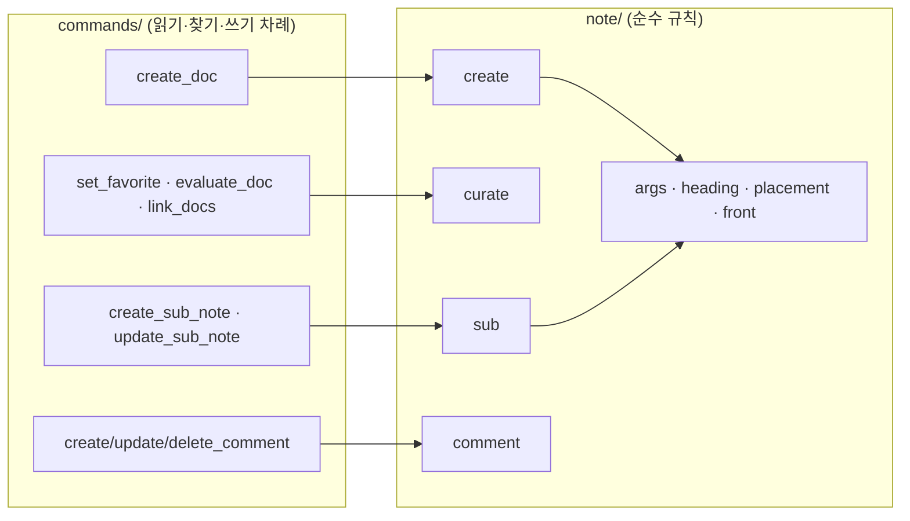

# 리팩토링 6단계 완료 기록 (4/N) — 노트 쓰기 규칙의 나머지

## 요약

**결론:** 게이트 2에서 「가: 6단계의 남은 몫을 먼저 끝낸다」를 골라서, 노트의 다른 쓰기 명령(`create_doc`, `set_favorite`·`evaluate_doc`·`link_docs`, 후속 노트 만들기·고치기, 코멘트 쓰기)의 **인자 검사와 값 계산**을 순수한 `note` 모듈로 옮겼다. 앞 기록([6c](refactor-step6c-complete.md))의 `update_doc`과 같은 모양이다. 동작은 그대로다: 골든 재생이 어긋남 0이고 엔진 시험 274건이 통과한다(이전 256건 + 새 도메인 시험 18건).

노트의 쓰기 명령 가운데 **휴지통 쓰기, 코멘트 파일 다루기, 경고 글**은 vault나 파일 모양을 읽어야 해서 옮기지 않았다. 아래 「하지 않은 것」에 적었다.

계획: [`refactor-ddd-hexagonal-plan.md`](refactor-ddd-hexagonal-plan.md) §4 6단계. 추적: [이슈 #77](https://github.com/bnjjong/aisurada/issues/77). 앞 기록: [태스크](refactor-step6a-complete.md), [자원](refactor-step6b-complete.md), [노트 1차](refactor-step6c-complete.md).

## 한 일

| 모듈(`note/`) | 하는 일 | 옮겨 온 곳 |
| --- | --- | --- |
| `create` | `create_doc`의 인자 검사(오류 차례 유지), 날짜·시각 배정, 파일 글. **겹치지 않는 5분 칸 고르기**는 읽기 층 `created` 목록을 인자로 받는다 | `commands/doc_create.rs` |
| `curate` | `set_favorite`(뒤집기·라벨 규칙), `evaluate_doc`(점수 읽기·반올림·메모 상한, **평가 시각은 인자**), `link_docs`(두 끝·종류·더하기/빼기) | `commands/note_meta_write.rs` |
| `sub` | 후속 노트 만들기의 인자 검사와 파일 글, 고칠 때의 제목 정하기(준 제목 → 본문 첫 헤딩 → 지금 제목) | `commands/sub_note_write.rs` |
| `comment` | 코멘트 쓰기 인자 검사: 노트·후속 노트 id 모양, 식별자, 본문 20,000자와 인용문 2,000자 상한 | `commands/comment_write.rs` |
| `args` | `tags`·`links` 목록 인자 읽기(호출 객체의 배열과 명령줄의 JSON 글을 모두 받는다) | `commands/doc_write.rs`, `commands/doc_create.rs` |
| `heading` | 본문 첫 헤딩 글 뽑기 | `write/first_heading.rs`(옛 경로로 다시 내보낸다) |

**겹쳐 있던 규칙을 하나로 모은 곳 두 군데:**
- 「저장 상한을 넘으면 거절」이 여섯 곳에 같은 문구로 따로 있었다. `front::check_size(text, rel)` 하나로 모았다.
- `created` 글(`yyyy-MM-ddTHH:mm:00+09:00`) 짓기를 `placement::created_text` 하나로 모았다.

**오류가 나오는 차례는 그대로다.** 예를 들어 `create_doc`은 본문 형식 → 아젠다 → 유형 → 제목 → 본문 → 날짜 → 시각 → 연결 → 태그 → 층 → 제목 비었음 → 아젠다 이름 비었음 순이고, `link_docs`는 두 끝 → 종류 → remove → 자기 자신 순이다. 이 차례를 단위 시험이 고정한다.

### 시험

- 새 도메인 단위 시험 18건: `create` 4건(필수 인자 차례, 앱만 층을 정함, 시각 밀기, AI 도구만 세션 기록), `curate` 6건, `sub` 4건, `comment` 4건. 디스크도 색인도 쓰지 않는다.
- `architecture.rs`: 새 `note/` 파일 여섯 개(`args`, `create`, `curate`, `sub`, `heading`, `comment`)도 순수 도메인 파일 목록에 넣었다. 포트·쓰기·vault·어댑터·`std::fs`를 쓰면 시험이 깨진다. 「`note`는 바탕 모듈과 커널만 쓴다」는 규칙도 그대로 통과한다.

## 숫자

| 항목 | 값 |
| --- | --- |
| 골든 재생 | 어긋남 0, 직렬화 골든도 그대로 |
| 엔진 시험 | 274건 통과(256건 + 18건), `bash test.sh` 약 2분 |
| 명령 파일 줄 수 | `doc_create.rs` 205줄, `doc_write.rs` 212줄, `note_meta_write.rs` 256줄(335줄에서), `sub_note_write.rs` 393줄(449줄에서), `comment_write.rs` 251줄(296줄에서) |

## 하지 않은 것과 까닭

- **휴지통 쓰기**(`delete_doc`, `restore_doc`, `purge_doc`, `empty_trash`): 규칙의 대부분이 휴지통 기록 파일의 모양과 vault 경로에 묶여 있다. 순수 규칙만 뽑으면 얇은 조각 몇 개가 남을 뿐이라 옮기지 않았다.
- **코멘트 파일 다루기**(읽기 실패 시 거절, 식별자 겹침, 앵커 걷어내기 뒤 본문 다시 쓰기): `Comment`와 코멘트 파일 봉투가 vault 쪽 타입이다.
- **경고 글**(`write/warnings.rs`): 같은 아젠다의 노트 목록(`NoteRecord`)을 읽는 규칙(제목 겹침)이 섞여 있다. 도메인이 vault 타입을 알게 되므로 옮기지 않았다.
- **후속 노트의 부모 사슬 풀기**(`resolve_parent`, `direct_child`): 색인(`NoteIndex`, `NoteRecord`)을 읽는 일이라 명령에 남았다.
- **`check_writable`**(AI는 기록 층 노트를 못 고친다): 호출자(`Caller`)와 `NoteRecord`에 묶여 있어 명령 쪽(`commands/subnote.rs`)에 남았다.
- **id 새 타입**, **`Created`**, **`NoteIndex` 세 갈래 나누기**, **`Stored<T>`**: [6c 기록](refactor-step6c-complete.md)에서 미룬 그대로다. 이 가운데 `NoteIndex` 나누기와 `Stored<T>`는 vault 읽기 쪽을 크게 건드려서 7단계 이후로 둘 것을 권한다.
- 호스트·화면 시험과 실제 창 확인은 돌리지 않았다(엔진 안쪽 변경이고 응답 모양이 그대로임을 골든이 확인한다).
