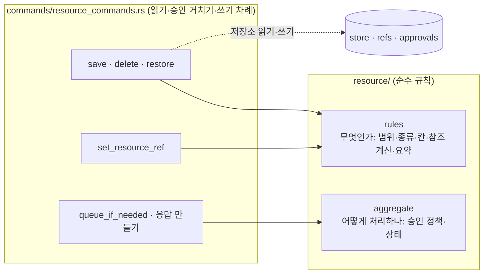

# 리팩토링 6단계 완료 기록 (5/N) — 자원 쓰기 규칙

## 요약

**결론:** 자원(스킬·에이전트) 명령 파일에 문자열 옵션 읽기와 섞여 있던 규칙을 순수한 `resource/rules.rs`로 모았다. 앞의 `aggregate`가 「이 변경을 바로 적용할지, 승인을 기다릴지」를 정했다면, 이번 `rules`는 「이 변경이 무엇인지」를 정한다. 동작은 그대로다: 골든 재생이 어긋남 0이고 엔진 시험 284건이 통과한다(이전 274건 + 새 도메인 시험 10건).

**접근:** 6b 기록은 「규칙을 꺼내려면 옵션 읽기를 먼저 타입 있는 명령 값으로 바꿔야 한다」고 적었다. 이번에는 그 선행 작업 없이, 옵션 읽기를 **이름으로 값을 묻는 접근자**(`get("name")`)로 추상화해서 규칙 함수가 문자열 맵(`Opts`)을 몰라도 되게 했다. 타입 있는 명령 값으로의 전환은 7단계의 몫으로 남는다.

계획: [`refactor-ddd-hexagonal-plan.md`](refactor-ddd-hexagonal-plan.md) §4 6단계. 추적: [이슈 #77](https://github.com/bnjjong/aisurada/issues/77). 앞 기록: [자원 승인 규칙](refactor-step6b-complete.md), [노트 쓰기 규칙](refactor-step6d-complete.md).

## 한 일

| 규칙 | 함수 | 옮겨 온 곳 |
| --- | --- | --- |
| 범위 읽기: `scope=global`이거나 `project=<slug>`이고 둘을 함께 줄 수 없다, 만들 때는 필수 | `scope_of` | `scope_of`(옵션 맵을 읽던 것) |
| 종류 읽기: `skill`이나 `agent` | `kind_of` | `kind_of` |
| 스킬은 `permission`·`skills`·`repo`를 쓰지 않는다 | `reject_agent_only_for_skill` | 같은 이름 |
| 고칠 때 종류와 범위가 지금 자원과 같아야 한다(종류가 먼저 걸린다) | `check_same_kind_and_scope` | `save` 안의 두 검사 |
| 칸 인자를 검사해 고칠 값 묶음(`Fields`)으로 | `fields_of` | 같은 이름 |
| 프로젝트 참조 목록 계산: 글로벌 자원 더하기·빼기, 에이전트의 글로벌 스킬 함께 켜기, 이름 힌트를 지금 이름으로 갱신 | `change_refs` | `ref_impl` 안의 계산과 `add_ref` |
| 변경을 사람이 읽는 한 줄로 요약(승인 대기 목록에 보인다) | `summarize_change`, `changed_fields` | 같은 이름 |

- **`change_refs`는 저장소를 모른다.** 승인한 참조 목록과 「id로 자원을 찾는 함수」를 받아 새 목록, 켠 id, 끈 id를 돌려준다. 명령이 저장소에서 읽은 자원(`Served`)을 클로저로 넘긴다. 에이전트가 가진 스킬을 함께 켜는 규칙, 프로젝트 자원은 참조하지 않는다는 규칙, 이미 있는 항목은 다시 더하지 않는 규칙이 디스크 없이 시험된다.
- **오류가 나오는 차례는 그대로다.** 만들기는 종류 → 범위 → 스킬 전용 인자 → 칸 검사 순이고, 고치기는 저장소에서 자원 찾기 → 종류 → 범위 → 스킬 전용 인자 → 승인한 바탕 읽기 → 칸 검사 순이다. 저장소를 읽는 걸음 사이에 규칙 함수를 한 걸음씩 불러서 지킨다.
- **새 옆 의존을 만들지 않았다.** 처음에 `java_trim`을 `task::format`에서 받아 `resource → task` 의존이 생겨 구조 시험이 잡았다. 원본인 `kernel::java`에서 받도록 고쳐 새 의존 없이 끝났다.

### 시험

- `resource/rules.rs`의 단위 시험 10건: 범위 읽기(둘 다 주면 거절, 빈 글은 안 준 것), 종류 읽기, 스킬 전용 인자 거절, 종류·범위 불변과 검사 차례, 안 준 칸이 `None`으로 남고 `repo`가 다듬어짐, 참조 더하기(중복 방지, 힌트 갱신), 없는 자원·프로젝트 자원 거절과 빼기, 에이전트와 함께 켜는 스킬, 요약 한 줄 다섯 갈래, 바뀐 칸 나열 순서와 권한 이동 표기.
- `architecture.rs`: `resource/rules.rs`를 순수 도메인 파일 목록에 추가했다. 포트·쓰기·vault·어댑터·`std::fs`를 쓰면 시험이 깨진다. 의존 기준선(ratchet)은 자원→오류·커널·글 도구, 명령→자원의 사용 줄 수만 늘었다(허용 방향).

## 숫자

| 항목 | 값 |
| --- | --- |
| 골든 재생 | 어긋남 0, 직렬화 골든도 그대로 |
| 엔진 시험 | 284건 통과(274건 + 10건), `bash test.sh` 약 2분 |
| `commands/resource_commands.rs` | 1,656줄 → 1,441줄 |
| `resource/rules.rs` | 새 파일 약 580줄(시험 포함) |

## 하지 않은 것과 까닭

6단계 계획의 자원 몫은 **정책·상태·판정**(`aggregate`)과 **무엇인지 정하는 규칙**(`rules`)까지 왔고, 아래는 남았다.

- **`PendingChange` 값 객체와 대기 변경 파일 모양 매퍼**: 대기 변경은 지금도 칸 차례를 지키는 JSON 객체(`changes::Change`)이고 `decide`·`queue_if_needed`가 그 칸들을 직접 읽고 쓴다. 값 객체로 바꾸려면 `serialization_golden`이 못박은 바이트를 그대로 내는 매퍼를 새로 써야 하는데, 이득에 비해 바이트 위험이 크다. 7단계의 명령 입력 정리와 같이 보는 편이 낫다.
- **`queue_if_needed`·`approve`·`reject` 같은 승인 흐름의 순서**: 정책(`aggregate`)은 순수하지만, 「적용할지 대기시킬지 정하고 → 대기 파일을 쓰고 → 기록장에 지문을 남긴다」는 걸음은 저장소를 읽고 쓰는 응용 서비스 몫이라 명령에 남겼다.
- **`delete`·`restore`**: 규칙이 거의 없고(휴지통 이동과 지문 기록) 저장소 호출이 전부여서 옮길 규칙이 없다.
- **`Fields`·`refs::Entry` 타입의 자리**: 도메인 파일이 저장소 모듈에 정의된 값 타입을 가져다 쓴다(`rules.rs` 머리에 한계로 적었다). 타입을 도메인으로 올리는 일은 크레이트를 가르는 8단계에서 본다.
- **응답 JSON 만들기**(`row`, `change_row`, `queued_response` 등): 응답 모양은 명령(어댑터) 몫이다.
- 호스트·화면 시험과 실제 창 확인은 돌리지 않았다(엔진 안쪽 변경이고 응답이 그대로임을 골든이 확인한다).

## 6단계 전체 정리

| 컨텍스트 | 도메인으로 모인 것 | 명령·저장소에 남은 것 |
| --- | --- | --- |
| 태스크 | 상태 이동 규칙, 이벤트(`TaskEvent`), 전이표 | 파일 모양 매핑, 알림·승인 외부 호출 |
| 자원 | 승인 정책·믿을 수 있는 상태·대기 변경 판정(`aggregate`), 인자·불변·참조 계산·요약(`rules`) | `PendingChange` 값 객체와 매퍼, 승인 흐름의 쓰기 차례, 응답 만들기 |
| 노트 | 메타 타입, 머리 짓기·편집 도장, 자리 정책, `create`·`update`·`curate`·`sub`·`comment` 규칙 | 휴지통 쓰기, 코멘트 파일 다루기, 경고 글, 부모 사슬 풀기, `check_writable` |
| 공통 미룬 일 | — | id 새 타입, `Created`, `NoteIndex` 나누기, `Stored<T>`, 타입 있는 명령 입력 |

6단계의 끝 기준 「store와 명령 함수에 남은 업무 규칙 0」은 **세 컨텍스트 모두에서 정확히 0은 아니다.** 남은 것은 대부분 (1) vault 읽기 타입에 묶인 규칙(경고 글, 부모 사슬), (2) 파일 바이트 모양을 지키는 매퍼(`PendingChange`, 휴지통), (3) 타입 있는 입력을 요구하는 일(id 새 타입)이다. 이 셋은 7단계(입구 정리)나 8단계(크레이트 분리)와 한 덩어리라 6단계 안에서 억지로 끝내기보다 넘기는 편이 안전하다고 판단한다.

## 게이트: 7단계를 시작할지 정해 주세요

- **가(추천): 7단계로 간다.** 단일 명령 표(`commands!`)로 명령 한 곳 추가 시 고칠 곳을 2곳으로, `Engine::call(&CallContext…)`로 호출 맥락 분리, 오류를 도메인/인프라로 나누기(화면이 오류 문구를 정규식으로 가르는 곳 [#76](https://github.com/bnjjong/aisurada/issues/76) 해소), `*_USAGE`를 CLI로 이동, 공개 면 축소. 호스트·MCP 호출 경로와 오류 모양을 건드려 **호스트·화면 시험이 필요**하다.
- **나: 여기서 멈춘다.** 0~6단계까지를 이번 리팩토링의 끝으로 하고 남은 것은 이슈로 둔다. 구조 이득의 대부분을 위험 없이 얻은 상태다.
