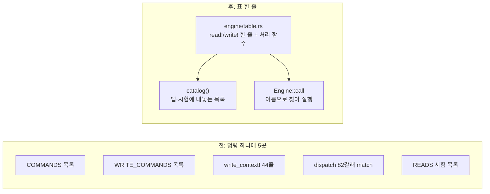

# 리팩토링 7단계 완료 기록 (1/N) — 명령 표 하나

## 요약

**결론:** 엔진이 받는 명령 82개를 `engine/table.rs`의 표 한 곳에 적었다. 한 줄에 이름, 읽기·쓰기, 쓰기 범위를 여는 방식, 요청 종류, 처리 함수가 들어간다. 명령 목록, 쓰기 목록, 디스패처가 모두 이 표에서 나온다. 동작은 그대로다: 골든 재생이 어긋남 0이고 엔진 시험 287건이 통과한다(이전 284건에서 표 시험 4건을 더하고 옛 목록 대조 시험 1건을 뺐다).

계획: [`refactor-ddd-hexagonal-plan.md`](refactor-ddd-hexagonal-plan.md) §4 7단계 7-1. 추적: [이슈 #77](https://github.com/bnjjong/aisurada/issues/77). 앞 기록: [6단계 5/N](refactor-step6e-complete.md).

## 한 일

| 전 | 후 |
| --- | --- |
| `COMMANDS`(82), `WRITE_COMMANDS`(50) 두 글자 목록을 손으로 맞췄다 | `catalog()`가 표에서 이름, 읽기·쓰기, 범위 방식을 낸다. 두 목록은 없다 |
| `write_context!` 매크로 44줄과 `HasWriteContext` 트레이트로 요청에서 호출 맥락을 꺼냈다 | 모든 쓰기 요청이 `context` 칸을 가지므로 `write!` 매크로가 그 칸을 바로 읽는다. 트레이트는 지웠다 |
| 쓰기 명령마다 `ledger_baseline` 불리언과 `MARKER_EXEMPT` 이름 목록(`init_workspace`)이 따로 있었다 | `Scope::{Standard, WithLedger, NoMarker, None}`이 표의 한 칸이다. 승인 기록장 기준선과 표식 검사 면제가 명령 줄에 보인다 |
| 읽기 명령이 쓰기 길을 타지 않는다는 보장이 시험의 `READS` 목록(손으로 적음)이었다 | 읽기 줄은 `read!`로만 쓸 수 있어 범위를 열 수 없다(`Scope::None`). 시험 `only_write_commands_open_a_scope`가 이를 못박는다 |
| 디스패처는 82갈래 `match`(약 480줄) | `Engine::call`이 표에서 이름을 찾아 줄의 처리기를 부른다. `engine.rs`는 845줄에서 167줄이 됐고, 표 파일 `engine/table.rs`가 215줄이다 |

- **같은 동작.** 표 줄마다 옛 갈래와 같은 순서로 일한다: 요청 읽기 → (쓰기면) 범위 열기 → (자원 쓰기면) 기준선 → 처리 함수 → JSON 변환 → 범위 놓기. 인자를 읽지 않던 명령(`list_agendas`, `list_projects`, `reindex`, `get_resource_policy`, `commit_vault`)은 인자를 계속 읽지 않는다. 이름 82개와 차례, 쓰기 50개는 옛 두 목록과 대조해 같음을 확인했다.
- **호출 쪽.** 호스트의 `engine_commands`와 CLI 시험 두 개(`command_tables.rs`, `table_contracts.rs`)가 `COMMANDS`·`WRITE_COMMANDS` 대신 `catalog()`를 쓴다. 구조 시험 기준은 `engine -> error` 참조가 1에서 2로 늘었다(표 파일이 `EngineError`를 쓴다. 바깥 모듈이 안쪽을 쓰는 허용된 방향이라 기준을 새로 썼다).

## 명령을 하나 더할 때

| 곳 | 일 |
| --- | --- |
| `engine/table.rs` | `read!`나 `write!` 한 줄 |
| `commands/<이름>.rs` | 처리 함수와 요청 타입 |
| (명령줄·MCP에 내놓는 명령이면) `ais-cli`의 `registry.rs`, `spec_table.rs`, `mcp_tools.rs` | 이름, 인자 명세, 도구 정의 |

엔진 안에서는 두 곳(표 한 줄 + 처리 함수)이다. 명령줄과 MCP에 내놓는 일은 그쪽 표를 따로 고친다.

## 하지 않은 것과 이유

- **`spec_table.rs`·`mcp_tools.rs`를 같은 표에 합치지 않았다.** 이 둘은 명령줄 사용법 글, 옵션 이름, MCP 입력 스키마(한 줄 JSON 글)라서 엔진이 아니라 명령줄·MCP 어댑터의 데이터다. 엔진 코어가 이 글을 들면 안쪽이 바깥 표현을 알게 된다. 또 `spec_table.rs`의 `write` 깃발은 Java에서 옮긴 값이라 엔진의 쓰기 구분과 일부러 다르다(`commit_vault`, [#75](https://github.com/bnjjong/aisurada/issues/75)). 두 표가 엔진 표와 어긋나지 않는지는 `command_tables.rs`와 `table_contracts.rs`가 계속 본다. 계획서가 말한 「합칠 대상」 가운데 이 둘은 7-5(사용법 글을 CLI로 옮기기)에서 다시 본다.
- **시험.** 엔진 시험(`bash test.sh`, 골든 재생 포함)만 돌렸다. 호스트는 컴파일(`cargo check --tests`)만 확인했고, 호스트·화면 시험은 호출 경로를 바꾸는 7-3 이후에 돌린다.
