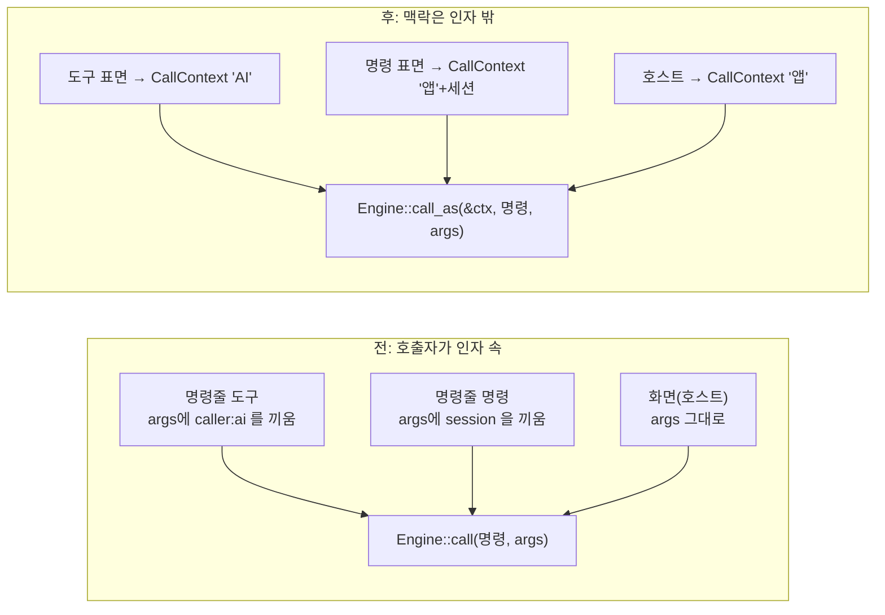

# 리팩토링 7단계 완료 기록 (2/N) — 호출 맥락 분리

## 요약

**결론:** 「누가 불렀나」(앱인지 AI인지, 어느 세션인지)를 요청 인자에서 떼어 `CallContext`로 만들고, 엔진 입구 `Engine::call_as(&CallContext, 명령, 인자)`가 받게 했다. 명령줄의 두 표면과 호스트의 `engine_call`이 이 입구를 쓴다. 동작은 그대로다: 골든 재생이 어긋남 0이고 엔진 시험 290건이 통과한다(이전 287건 + 새 시험 3건). 다른 세션이 올린 쓰기 잠금 경쟁 시험 6건과 합친 `main` 전체는 296건이고, 합친 뒤에도 전부 통과했다. 호스트의 `engine::` 시험 3건도 통과했다.

계획: [`refactor-ddd-hexagonal-plan.md`](refactor-ddd-hexagonal-plan.md) §4 7단계 7-2. 추적: [이슈 #77](https://github.com/bnjjong/aisurada/issues/77). 앞 기록: [7단계 1/N](refactor-step7a-complete.md).

## 한 일

| 전 | 후 |
| --- | --- |
| 호출 맥락 묶음 `WriteContext`가 쓰기 범위 모듈(`write/pipeline.rs`)에 있었다. 읽기 요청도 같은 정보의 일부(`caller`)를 따로 가졌다 | 커널(`kernel/actor.rs`)의 `CallContext`(`caller`, `session`, `session_agent`)로 옮기고 이름을 바꿨다. 읽기 명령도 쓰기 모듈을 거치지 않고 같은 타입을 쓴다. 앱 호출 `CallContext::app()`, AI 호출 `CallContext::ai(..)` |
| 명령줄이 `caller: "ai"`와 `session`, `sessionAgent`를 엔진 인자 JSON에 끼워 넣었다. 어댑터가 인자를 꾸미는 셈이다 | `EngineCall`이 `args`와 `context`를 따로 든다(`map.rs`의 `context_for`). 레거시 층의 「AI 호출이면 사실층을 싣는다」 판정도 `context.caller`를 읽는다 |
| 호스트 `engine_call`은 화면이 준 인자를 그대로 넘겼다 | `CallContext::app()`을 명시해 넘긴다. 화면이 인자에 `caller`나 `session`을 실어도 앱 맥락이 이긴다 |
| — | `Engine::call_as`는 맥락을 인자의 같은 이름 칸에 덮어 쓴 뒤 같은 길로 들어간다(맥락에 없는 `session`·`sessionAgent`는 인자에 있어도 지운다). 인자로 호출자를 속일 수 없다. 객체가 아닌 인자는 건드리지 않아 요청 읽기가 옛 오류를 그대로 낸다 |

- **과도기 입구.** `Engine::call(명령, 인자)`는 남겼다. 호출 맥락을 인자의 `caller`·`session` 칸에서 읽는 옛 방식 그대로라서, 호출 지점이 330곳이 넘는 시험과 녹화 하네스(`compat_check`)의 테이프(인자에 `caller`가 있다)가 바뀌지 않는다.
- **새 시험.** `the_call_context_overrides_the_argument_fields`(맥락이 인자 칸을 이긴다, 없는 값은 지운다, 빈 인자와 객체 아닌 인자), `the_session_goes_into_the_context_not_the_arguments`(도구 표면, `claude`는 에이전트 줄에 안 적는다), `the_command_surface_calls_as_the_app_with_the_session_in_the_context`(명령 표면).
- **구조 시험 기준.** `commands -> kernel` 참조가 20에서 38로 늘고 `commands -> write`가 95에서 90으로 줄었다. 읽기 명령까지 `write::pipeline`을 거치지 않고 커널의 맥락을 쓰게 되어 안쪽으로 향한다. 기준을 새로 썼다.

## 남은 것

- **처리 함수는 아직 요청 속 칸을 읽는다.** 요청 타입의 `caller`·`context` 칸과 처리 함수 시그니처는 그대로다(엔진이 입구에서 칸을 채운다). 처리 함수가 `&CallContext`를 직접 받고 요청에서 칸을 지우려면 읽기·쓰기 처리 함수 약 25곳의 시그니처와 요청 타입의 단위 시험을 바꿔야 한다. 동작은 안 바뀌고 입구 쪽 계약은 이번에 끝나서 뒤로 미뤘다. [이슈 #77](https://github.com/bnjjong/aisurada/issues/77)에 남긴다.
- **MCP 서버는 아직 명령줄 글 길을 탄다.** 도구 호출을 `crate::run([이름, 압축한 JSON])`으로 넘기고 `parse_tool`이 JSON을 다시 읽는다. 맥락은 `parse_tool`이 정하므로 새 입구를 이미 쓰지만, 글로 압축했다 푸는 일은 7-3의 몫이다.
