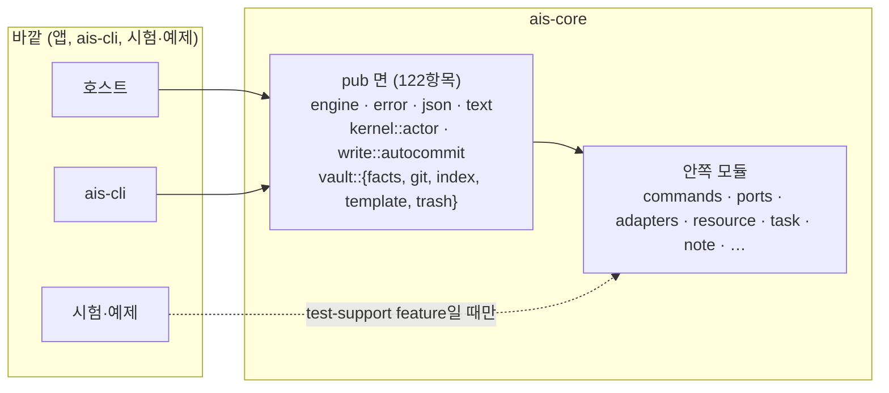

# 리팩토링 7단계 완료 기록 (3/N) — 공개 면 줄이기

## 요약

**결론:** `ais-core`가 바깥에 내놓는 항목을 rustdoc JSON으로 센 값이 **1,040개에서 122개**로 줄었다(모듈 140개에서 15개). 앱(호스트)과 `ais-cli`가 실제로 쓰던 길은 좁았다. 그 길만 `pub`으로 두고 나머지 안쪽 모듈은 크레이트 안에서만 보이게 닫았다. 이제 바깥이 안쪽으로 손을 뻗으면 컴파일이 막는다. 동작은 그대로다: 골든 재생이 어긋남 0이고 엔진 시험 296건이 통과한다.

계획: [`refactor-ddd-hexagonal-plan.md`](refactor-ddd-hexagonal-plan.md) §4 7단계 7-6. 추적: [이슈 #77](https://github.com/bnjjong/aisurada/issues/77). 앞 기록: [7단계 2/N](refactor-step7b-complete.md).

## 한 일

| 전 | 후 |
| --- | --- |
| 모든 모듈이 `pub`이라 바깥이 어디든 불러 쓸 수 있었다. 공개 항목 1,040개 | 바깥이 쓰는 길만 `pub`이다. 공개 항목 122개 |
| `ais-cli`와 호스트가 엔진 안쪽을 쓰는 길을 알 수 없었다 | 실제로 쓰는 길을 세어 보니 `engine`, `error`, `json`, `text`, `kernel::actor`, `write::autocommit`, `vault`의 다섯 읽기 모듈(`facts`, `git`, `index`, `template`, `trash`)뿐이다. 나머지는 닫았다 |
| 시험과 예제가 안쪽을 직접 만졌다 | `test-support` feature가 닫힌 모듈을 `pub`으로 연다. `ais-core`와 `ais-cli`의 `[dev-dependencies]`가 이 feature를 켜므로 `cargo test`와 `--examples` 빌드는 그대로 돌고, 앱·`ais-cli`의 운영 빌드에는 켜지지 않는다 |

- **어떻게 닫았나.** `lib.rs`의 `internal_mods!` 매크로가 안쪽 모듈을 `test-support`일 때는 `pub mod`로, 아니면 `pub(crate) mod`로 선언한다. 같은 매크로를 `kernel`, `vault`, `write`의 `mod.rs`가 써서 모듈 일부만 연다.
- **시험에서만 쓰는 것.** 운영 빌드에 안 쓰이는 `Engine::with_ports`, `reset_random_queue`, `FlockLock::in_dir`은 `test-support`일 때만 컴파일한다. 파일 시스템 약속의 접근자(`is_symlink`, `file_type` 따위)는 `std::fs`의 모양을 따라 둔 것이라 그 모듈에 한해 안 쓰임 경고를 끈다.
- **재수출.** `write/mod.rs`의 4개 `pub use`(`confine`, `note_front`, `first_heading`, `slug`)는 닫힌 모듈을 가리키므로 `test-support`일 때는 `pub use`, 아니면 `pub(crate) use`로 둘 중 하나만 컴파일한다.
- **죽은 코드 정리.** 모듈을 닫으니 운영에서 안 쓰이는 항목이 드러났다. 호출처가 없던 `task::aggregate`의 `kind()`, `resource::changes::get`, `ports::fs::read_to_string`, 코멘트 파싱 결과의 안 읽히던 `note_id` 칸을 지웠다. 응답을 만드는 한 곳에서 문자열을 직접 쓰던 `TrustState`의 `label()`은 그 자리에서 쓰게 했다(`Approved`는 바로 앞에서 걸러져 결과가 같다).

## 확인

| 확인 | 결과 |
| --- | --- |
| 운영 설정 빌드(`cargo build -p ais-core -p ais-cli`) | 경고 0, 오류 0 |
| 시험 설정 빌드(`cargo build --workspace --examples --tests`) | 경고 0, 오류 0 |
| 호스트 크레이트 시험(`native-host/src-tauri`에서 `cargo test`) | 158건 통과, 실패 0, 무시 5건 |
| `bash test.sh`(골든 재생 포함) | 296건 통과, 어긋남 0 |
| 구조 시험 기준 | `write -> kernel` 16에서 17, `write -> note` 9에서 12. 위 재수출을 두 갈래(`cfg`)로 적은 줄이 늘어서 센 값이 는 것이다. 새 의존은 없다 |

## 남은 것

- **`vault::{facts, git, index, template, trash}`가 아직 `pub`이다.** `ais-cli`의 `legacy.rs`가 옛 응답 모양을 만들려고 vault를 다시 훑는 5곳이 쓴다. 이 길은 7-3(`legacy` 재훑기 제거)에서 코어의 질의 함수로 바꾸면 닫을 수 있다.
- **`json`·`text`는 모듈째 `pub`이다.** 항목은 각각 7개와 14개뿐이고 대부분 `ais-cli`가 쓴다(`parse`, `compact`, `JsonValue`, `trim`, `is_blank`, `encode_uri_component`). 줄일 것이 거의 없어 그대로 둔다.
- **계획서의 목표 「약 30개」에는 못 미친다.** 122개를 모듈별로 세면 `vault`의 읽기 다섯 모듈이 약 32개로 가장 크고, `text` 14, `write::autocommit` 등 9, `json` 7, `engine` 7 순이다(나머지는 `kernel`, `error` 같은 작은 모듈과 메서드). 가장 큰 `vault` 다섯은 `ais-cli`의 `legacy.rs`가 옛 응답 모양을 만들려고 쓰는 길이라 7-3의 몫이다.
