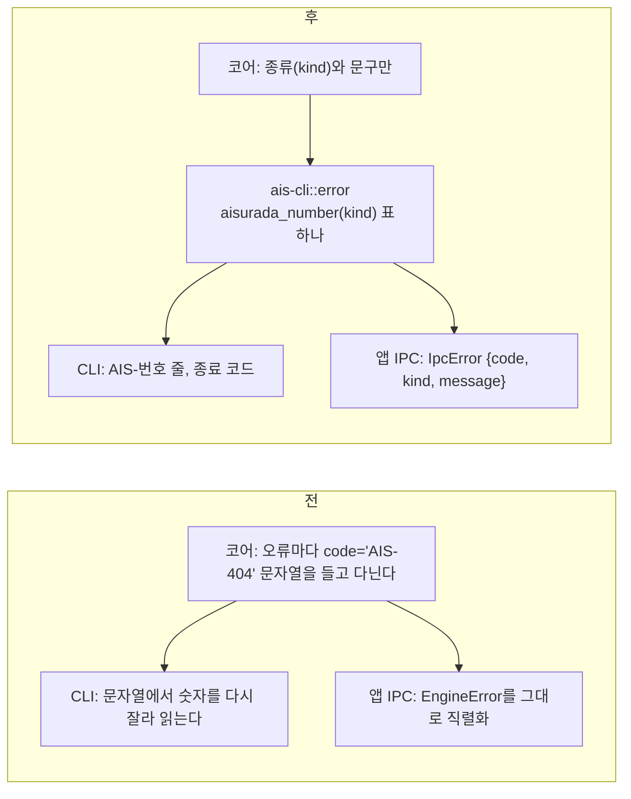

# 리팩토링 7단계 완료 기록 (4/N) — 오류 번호를 어댑터로

## 요약

**결론:** 엔진 코어의 오류에서 Java 시절의 `AIS-400` 같은 번호를 걷어 냈다. 코어는 오류의 **종류와 문구**만 정하고, 번호와 종료 코드는 호출 어댑터(`ais-cli`의 `error` 모듈)가 종류에서 붙인다. 화면이 받는 `{code, kind, message}`와 명령줄의 `AIS-409 문구` 줄, 종료 코드는 바이트까지 그대로다. 골든 재생 어긋남 0이고 엔진 시험 299건(이전 296건 + 새 3건)과 호스트 시험 158건이 통과한다. 다른 세션이 그사이 올린 시험 3건과 합친 `main` 전체는 302건이고 합친 뒤에도 전부 통과했다.

계획: [`refactor-ddd-hexagonal-plan.md`](refactor-ddd-hexagonal-plan.md) §4 7단계 7-4. 추적: [이슈 #77](https://github.com/bnjjong/aisurada/issues/77). 앞 기록: [7단계 3/N](refactor-step7c-complete.md).

## 한 일

| 전 | 후 |
| --- | --- |
| `EngineError`가 `code: &'static str`(`"AIS-404"`)을 생성자마다 박아 들고 있었다 | `EngineError`는 `kind`와 `message`뿐이다. 번호 칸이 없다 |
| 기록 층 거절은 종류가 `forbidden`이지만 번호는 `AIS-409`라서 종류만으로 번호를 되살릴 수 없었다 | 종류에 `RecordTier`를 세웠다. 응답의 `kind` 글자는 `forbidden`으로 그대로 나간다(`serde(rename)`). 이제 종류만으로 번호가 정해진다 |
| CLI가 코드 문자열에서 `AIS-` 접두를 떼고 숫자를 읽었다 | `aisurada_number(kind)` 표 하나가 400·403·404·412·409·500을 정한다. `CliError`와 `IpcError`가 같은 표를 쓴다 |
| 앱 IPC는 `EngineError`를 그대로 직렬화했다 | 호스트 `engine_call`이 `IpcError`(`code`, `kind`, `message`, 칸 차례 그대로)를 돌려준다 |
| 시험이 `error.code == "AIS-404"`처럼 번호 글자를 비교했다(61곳) | `error.kind == ErrorKind::NotFound`처럼 종류를 비교한다. 번호 자체는 `ais-cli`의 새 시험이 표 전체로 확인한다 |

- **문구는 그대로다.** 오류 문구를 만드는 곳은 하나도 건드리지 않았다. 코어와 CLI의 운영 코드 어디서도 `EngineError`의 `Display`(번호가 붙은 글)를 쓰지 않음을 컴파일로 확인했다(`Display`와 `Error`를 지워 보니 오류가 없었다). 그래서 번호를 옮겨도 어떤 글도 달라지지 않는다.
- **새 시험.** `ais-cli/src/error.rs`의 시험 3건: 번호표가 옛 생성자별 번호와 같다(아홉 가지 오류), 앱 IPC 오류의 JSON 글자와 칸 차례(`{"code":"AIS-404","kind":"not_found","message":"…"}`), 종료 코드(412는 5, 나머지는 3). 호스트의 `engine_error_reaches_the_screen_with_code_and_kind`와 IPC 시험이 실제 호출 경로로 같은 모양을 본다.
- **맞대기 하네스.** Java 오류 글과 견주는 `compat_check`는 번호가 필요해서 코어에만 기대 표를 따로 적었다(Java 맞대기 도구를 지울 때 함께 사라진다). `ais_call` 예제는 오류를 `{kind, message}`로 보여 준다.
- **도메인/인프라 구분.** `ErrorKind::Internal`이 인프라 실패이고 나머지는 모두 호출자가 고칠 수 있는 도메인 거절이다. `EngineError::is_infra()`로 이 구분을 코드로 드러냈다. 두 쪽을 별개 타입(`DomainError`, `InfraError`)으로 가르는 일은 처리 함수 수백 곳의 반환 타입을 바꿔야 해서 하지 않았다.

## 남은 것

- **오류를 두 타입으로 가르기.** 계획의 `DomainError`·`InfraError`는 위 이유로 미뤘다. 얻는 것은 「도메인 함수가 인프라 오류를 만들지 못한다」는 타입의 보장이다. 8단계 크레이트 분리와 함께 할 일이다.
- **화면의 문구 정규식([#76](https://github.com/bnjjong/aisurada/issues/76)).** 결정 5에 따라 이번 범위에서 제외했다. `kind`는 이미 응답에 있고, 지금 이 단계로 `RecordTier`까지 종류가 더 정확해졌으므로 화면이 `kind`로 가르는 일은 후속 이슈로 가능하다.

## 확인하면서 본 것

- **간헐 실패 1건.** 번호를 종류로 바꾸는 중 `fixture_vault`의 `queues_ai_resource_changes_until_a_human_approves`가 한 번 실패했다(승인 대기 이유가 `["global-change", "permission-raise"]`여야 하는데 `["permission-raise"]`만 나왔다). 같은 시험을 단독으로 세 번, 파일 전체를 네 번, 전체 묶음을 한 번 더 돌렸을 때는 모두 통과했고 기준 브랜치에서도 통과한다. 번호와 무관한 승인 정책 시험이라 병렬로 도는 시험들이 프로세스 환경 변수를 같이 만지는 경쟁으로 보이지만 원인은 확정하지 못했다. 다시 보이면 따로 조사한다.
