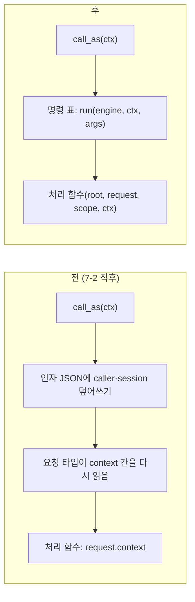

# 리팩토링 7단계 후속 기록 (5/N) — 처리 함수가 호출 맥락을 직접 받는다

## 요약

**결론:** 7-2에서 입구까지만 끝냈던 일을 마저 끝냈다. 요청 타입에서 호출 맥락 칸(`caller`, `context`)을 지우고, 맥락이 필요한 처리 함수 40개 안팎(18개 파일)이 `&CallContext`를 **매개변수로 직접** 받게 했다. 이제 인자 JSON에 `caller`를 실어도 엔진은 읽지 않는다. 동작은 그대로다: 골든 재생 어긋남 0이고 엔진 시험이 통과한다.

계획: [`refactor-ddd-hexagonal-plan.md`](refactor-ddd-hexagonal-plan.md) §4 7단계 7-2의 남은 몫. 추적: [이슈 #77](https://github.com/bnjjong/aisurada/issues/77). 앞 기록: [호출 맥락 분리](refactor-step7b-complete.md), [7단계 전체](refactor-step7-complete.md).

## 한 일

| 전 | 후 |
| --- | --- |
| `Engine::call_as`가 맥락을 인자 JSON의 같은 이름 칸에 덮어쓴 뒤 요청 타입이 그 칸을 다시 읽었다(돌아가는 길) | 명령 표의 처리기가 `(엔진, 맥락, 인자)`를 받고 맥락을 처리 함수에 그대로 넘긴다. JSON 덮어쓰기(`with_context`)는 없다 |
| 쓰기 요청 42종이 `#[serde(flatten)] context: CallContext` 칸을, 읽기 요청 8종이 `caller` 칸을 가졌다 | 칸을 모두 지웠다. 요청 타입은 「무엇을 할지」 인자만 가진다 |
| 처리 함수가 `request.context`, `request.caller`를 읽었다 | `context: &CallContext` 매개변수를 받는다(40개 안팎). 명령 표의 줄이 `|root, request, scope, ctx|`처럼 맥락을 이름 붙여 넘긴다 |
| `plan_day`가 요청 구조체에 세션을 뺀 맥락을 끼워 노트 만들기를 불렀다 | 세션을 뺀 맥락을 따로 만들어 `create_doc_in(.., &plan_context)`로 넘긴다 |

- **과도기 입구는 그대로.** `Engine::call(명령, 인자)`는 인자의 `caller`·`session`·`sessionAgent` 칸을 맥락으로 읽어 `call_as`에 넘긴다. 330곳이 넘는 시험 호출과 녹화 하네스는 바뀌지 않았다. 칸 값이 틀리면(`caller: "robot"`) 요청 읽기와 같은 글(「… 인자가 잘못됐다: unknown variant `robot` …」)로 거절한다.
- **새 시험.** `the_context_decides_who_is_calling_and_an_argument_field_cannot`: 새 입구에서 맥락이 AI이면 인자가 `caller: "app"`이어도 기록 층 노트가 거절되고, 맥락이 앱이면 인자가 `caller: "ai"`여도 읽힌다. 과도기 입구는 인자 칸을 읽는다. `the_legacy_entry_reads_the_context_fields_and_the_new_entry_ignores_them`은 인자에서 맥락을 읽는 규칙(없음, 객체 아님, 틀린 값)을 본다.
- **구조 시험 기준.** `commands -> kernel` 참조가 38에서 46으로 늘었다. 처리 함수가 `kernel::actor::CallContext`를 직접 쓰는 곳이 늘어서이고, 안쪽을 향하는 허용된 방향이다.

## 남은 것

- 요청 타입 안에 `Json`(느슨한 JSON 값) 칸과 글 옵션 맵이 아직 많다. 타입 있는 명령 입력은 따로 정할 일이다([이슈 #77](https://github.com/bnjjong/aisurada/issues/77)).
