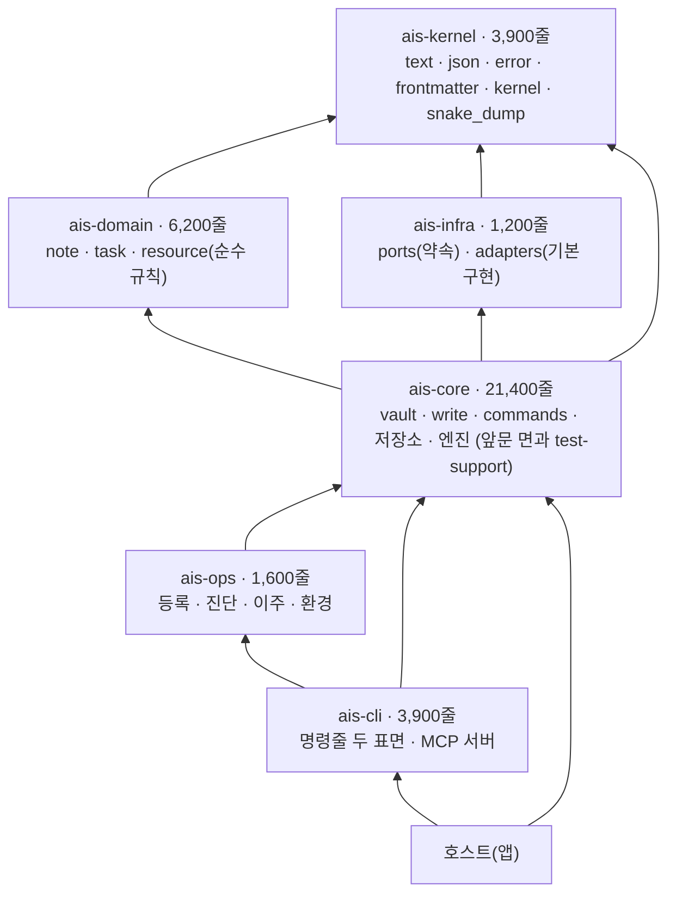

# 리팩토링 8단계 완료 기록 — 크레이트 나누기 전체

## 요약

**결론:** 하나였던 `ais-core`를 네 크레이트로 나눴다. 이제 「바닥은 위를 못 본다, 도메인은 포트와 vault를 못 쓴다, 인프라는 도메인과 엔진을 못 본다, 운영 도구는 명령 해석을 못 쓴다」는 규칙을 **컴파일러가 막는다**. 지금까지는 구조 시험이 글자를 세어 막았다. 모든 조각에서 동작은 그대로이고 골든 재생 어긋남은 0이다. 엔진 시험은 305건, 호스트 시험은 158건이 통과한다.

계획: [`refactor-ddd-hexagonal-plan.md`](refactor-ddd-hexagonal-plan.md) §4 8단계. 추적: [이슈 #77](https://github.com/bnjjong/aisurada/issues/77).

## 조각별 결과

| 조각 | 옮긴 것 | 컴파일러가 막는 것 | 기록 |
| --- | --- | --- | --- |
| 8-1 `ais-kernel` | `text`, `json`, `error`, `frontmatter`, `kernel` | 바닥이 위(vault, write, commands …)를 봄 | [기록](refactor-step8a-complete.md) |
| 8-2 `ais-domain` | `note` 전체, `task`·`resource`의 모양·전이·집합체·규칙 파일, 방출기 `snake_dump`는 바닥으로 | 도메인이 포트, 어댑터, vault 읽기·쓰기를 씀 | [기록](refactor-step8b-complete.md) |
| 8-3 `ais-infra` | `ports`와 `adapters` | 인프라가 도메인이나 엔진을 봄 | [기록](refactor-step8c-complete.md) |
| 8-4 `ais-ops` | `register`, `agent_cli`, `doctor`, `install`, `old_sidecar`, `migrate`, `env` | 운영 도구가 명령 해석(`parse`, `map`, `tool`, `legacy`)과 MCP 서버를 씀 | [기록](refactor-step8d-complete.md) |

## 계획과 다른 점

- **`ais-app`을 만들지 않았다.** 계획서는 유스케이스와 포트를 `ais-app`으로, `ais-core`를 얇은 파사드로 두자고 했다. 포트는 인프라와 함께 `ais-infra`에 뒀고(기본값이 기본 어댑터를 가리키고 어댑터가 포트를 구현해 서로를 가리킨다. 나누면 기본값을 밖에서 꽂아 줘야 하고, 엔진을 거치지 않는 스레드가 죽는다), 나머지 유스케이스(`vault`, `write`, `commands`, `session`, `model`, `engine`, 저장소 모듈들)는 `ais-core`에 남겼다. 7-6에서 좁힌 공개 면과 `test-support`가 이미 앞문 역할을 하고, 이름만 바꿔 약 2만 줄을 옮겨도 새 의존 방향 보장이 생기지 않는다.
- **도메인에서 못 뗀 것.** `task::store`, `resource::{approvals, changes, refs, resolver, store}`는 vault 파일과 승인 기록장을 읽고 쓰는 코드라 `ais-core`에 있다. 도메인과 저장소를 가르는 포트(`Stored<T>` 따위)는 아직 없다.

## 만져야 했던 것들

- **다시 내놓기.** 옮긴 모듈은 `ais-core`의 `lib.rs`(와 `task`, `resource` 모듈 루트)가 같은 이름으로 다시 내놓아, `crate::text`, `crate::ports::fs`, `crate::task::TaskStatus` 같은 안쪽 경로 수백 곳을 하나도 고치지 않았다. 바깥에 내놓는 면(7-6)은 그대로이고 `CallContext`·`Caller`만 뿌리에서 내놓는 것으로 바뀌었다.
- **크레이트 경계를 넘으며 고친 것.** 경계를 넘게 된 `pub(crate)` 아홉 개를 `pub`으로 했고, 다른 크레이트의 타입에 붙이던 메서드(`Policy::to_value`, `Outcome::from_error`)를 함수로 바꿨고, 도메인 규칙이 저장소 모듈에서 가져오던 두 구조체(`Entry`, `Fields`)를 도메인으로 올렸다.
- **구조 시험.** `architecture.rs`가 엔진 소스를 이루는 여러 크레이트의 `src`를 한 소스 트리로 훑는다(`source_crates`). 모듈 사이 참조 기준은 거의 안 바뀌었고, 바깥 직접 호출 기준의 열쇠는 크레이트 라벨만 바뀌었다. 새 크레이트가 생기면 `source_crates`에 한 줄을 더한다.

## 확인

| 확인 | 결과 |
| --- | --- |
| 운영 설정 빌드와 시험 설정 빌드 | 경고 0 |
| `bash test.sh`(골든 재생 포함) | 305건 통과, 어긋남 0 |
| 호스트 `cargo test` | 158건 통과 |
| `./build.sh`(`--locked` 릴리스 빌드)와 두 잠금 파일(`cargo metadata --locked`) | 통과 |
| CI(`ci.yml`)의 경로 | `engine-rs/**`라서 새 크레이트도 이미 포함 |

| 화면·호스트 `bash test-native.sh` | 통과(Node 시험 643건 실패 0, 호스트 158건) |
| 실제 창 점검 `test:data:acceptance` | 12/12 통과 |
| 실제 창 점검 `test:editor:acceptance` | 116/116 통과 |
| 돌리지 않은 것 | 나머지 실제 창 점검 일곱 종류와 `tauri build --debug` 번들 검증. 8단계는 코드를 옮겼을 뿐 호스트의 엔진 호출 경로는 안 바꿨고, 호스트는 컴파일·시험으로 같은 크레이트를 이미 쓴다 |

## 확인하면서 본 것

- **호스트의 PTY 시험 간헐 실패 1건**(8-3 때): [8-3 기록](refactor-step8c-complete.md)에 있다. 이후 8-4와 마무리 확인의 호스트 시험 두 번은 모두 158건이 통과했다.

## 남은 일

모두 [이슈 #77](https://github.com/bnjjong/aisurada/issues/77)에 있다.

- 오류를 `DomainError`·`InfraError` 두 타입으로 가르기(이제 크레이트 경계가 있어 `ais-domain`이 인프라 오류를 못 만들게 타입으로 막을 수 있다)
- 저장소를 포트로 갈라 `task::store`, `resource::store`를 도메인과 분리하기
- `vault`의 읽기 다섯 모듈을 닫고 `legacy.rs`의 재훑기를 코어 질의 함수로 바꾸기
- 7-5(`*_USAGE`를 CLI로): 화면의 오류 문구 정규식([#76](https://github.com/bnjjong/aisurada/issues/76))을 `kind` 기준으로 먼저 바꿔야 한다
