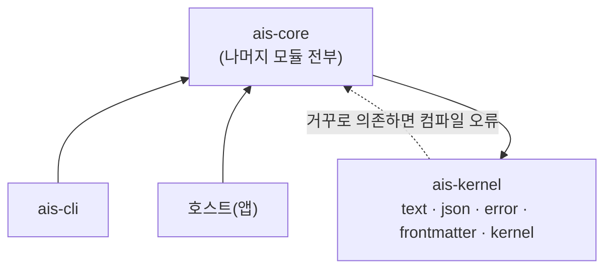

# 리팩토링 8단계 완료 기록 (1/N) — 바닥 크레이트 `ais-kernel`

## 요약

**결론:** `ais-core`에서 바닥 모듈 다섯(`text`, `json`, `error`, `frontmatter`, `kernel`)을 새 크레이트 `ais-kernel`로 떼어 냈다. 이 크레이트는 다른 크레이트를 의존하지 않아서, 바닥이 위(vault, write, commands …)를 보지 못한다는 것을 **컴파일러가 막는다**. 지금까지는 구조 시험(`architecture.rs`)이 글자를 세어 막았다. 동작은 그대로다: 골든 재생 어긋남 0, 엔진 시험 303건과 호스트 시험 158건이 통과한다.

계획: [`refactor-ddd-hexagonal-plan.md`](refactor-ddd-hexagonal-plan.md) §4 8단계. 추적: [이슈 #77](https://github.com/bnjjong/aisurada/issues/77). 앞 기록: [7단계 전체](refactor-step7-complete.md).

## 한 일

- **옮긴 것.** `text.rs`, `json.rs`, `error.rs`, `frontmatter/`, `kernel/`을 `git mv`로 `engine-rs/crates/ais-kernel/src`에 옮겼다. 내용은 거의 그대로다(고친 곳은 아래 둘뿐).
- **안쪽 경로가 안 바뀌게.** `ais-core`의 `lib.rs`가 이 모듈들을 같은 이름으로 다시 내놓는다(`pub use ais_kernel::{error, json, text}`, `frontmatter`와 `kernel`은 시험용 `test-support`일 때만 `pub`). 그래서 `crate::text::…` 같은 안쪽 경로 수백 곳을 고치지 않았다.
- **고친 곳 둘.** 크레이트 경계를 넘게 된 `frontmatter::dump_string`(`pub(crate)`였다)을 `pub`으로 했다. 7-6에서 `kernel/mod.rs`에 넣었던 모듈 닫기 매크로는 이 크레이트에서는 필요 없어서 평범한 `pub mod` 목록으로 되돌렸다(바깥에 내놓는 면을 좁히는 일은 `ais-core`의 `lib.rs`가 맡는다).
- **바깥 면.** `ais_core::kernel::actor::{CallContext, Caller}` 경로는 `ais_core::{CallContext, Caller}`로 바꿨다(`ais-cli` 세 파일과 호스트 한 파일). 바깥에 내놓는 면은 늘지 않았다.
- **구조 시험.** `architecture.rs`가 `ais-core`의 `src`만 보던 것을 엔진 소스를 이루는 크레이트들(`ais-core`, `ais-kernel`)을 한 소스 트리로 보게 고쳤다(`source_crates`, `engine_files`, `read_source`). 모듈 사이 참조 기준은 한 줄도 안 바뀌었다. 새 크레이트가 생길 때는 `source_crates`에 한 줄을 더한다.

## 확인

| 확인 | 결과 |
| --- | --- |
| 운영 설정 빌드 `cargo build -p ais-core -p ais-cli` | 경고 0 |
| 시험 설정 빌드 `cargo build --workspace --examples --tests` | 경고 0 |
| `bash test.sh`(골든 재생 포함) | 303건 통과, 어긋남 0 |
| 호스트 `cargo test` | 158건 통과 |

## 다음

- **8-2 `ais-domain`.** `note`와, 이미 순수한 `task`·`resource`의 집합체·규칙 파일(`task/aggregate.rs`, `task/transitions.rs`, `resource/aggregate.rs`, `resource/rules.rs`)이 대상이다. 이 파일들은 `ais-kernel`만 쓴다.
- **8-3 `ais-infra`.** `ports`와 `adapters`는 서로를 가리킨다(`ports`의 기본값이 `adapters::default_ports()`). 그래서 둘을 한 크레이트로 함께 뗀다.
