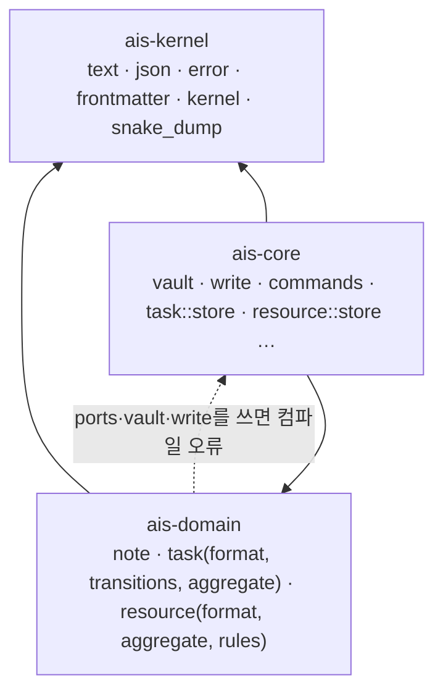

# 리팩토링 8단계 완료 기록 (2/N) — 도메인 크레이트 `ais-domain`

## 요약

**결론:** 노트 도메인 전체와 태스크·자원의 순수한 규칙 파일들을 새 크레이트 `ais-domain`으로 옮겼다. 이 크레이트는 `ais-kernel`만 의존하므로, 도메인 코드가 포트(`ports`)·어댑터·vault 읽기와 쓰기를 쓰면 **컴파일이 안 된다**. 지금까지는 구조 시험이 파일 목록(`PURE`)과 글자를 세어 막았다. 동작은 그대로다: 골든 재생 어긋남 0이다.

계획: [`refactor-ddd-hexagonal-plan.md`](refactor-ddd-hexagonal-plan.md) §4 8단계. 추적: [이슈 #77](https://github.com/bnjjong/aisurada/issues/77). 앞 기록: [8단계 1/N](refactor-step8a-complete.md).

## 한 일

| 옮긴 것 | 어디로 |
| --- | --- |
| `note/` 열두 파일(2,600줄) | `ais-domain/src/note/` |
| `task/{mod, format, transitions, aggregate}.rs` | `ais-domain/src/task/` |
| `resource/{mod, format, aggregate, rules}.rs` | `ais-domain/src/resource/` |
| `write/snake_dump.rs`(YAML 방출기) | `ais-kernel/src/snake_dump.rs` |

- **선행으로 한 두 가지.** (1) 태스크·자원의 `format.rs`가 `write::snake_dump`, `write::confine`, `write::slug`를 쓰고 있었다. 셋 다 바닥이나 노트 도메인에 속하는 코드라서, 방출기를 바닥 크레이트로 옮기고 나머지 둘은 본래 자리(`kernel::confine`, `note::slug`)에서 쓰게 했다. (2) 6e 기록이 미뤘던 일: `resource/rules.rs`가 저장소 모듈의 타입(`refs::Entry`, `store::Fields`)을 쓰고 있었다. 두 타입은 평범한 구조체라서 `resource` 루트(도메인)로 올렸고, 저장소 모듈은 `pub use`로 같은 경로를 유지한다.
- **같은 모듈 경로.** `ais-core`의 `task`와 `resource` 모듈은 `pub use ais_domain::task::*`처럼 도메인 쪽을 다시 내놓고 `store` 같은 저장소 모듈만 가진다. `crate::task::TaskStatus`, `crate::resource::aggregate::Policy` 같은 안쪽 경로는 하나도 안 바뀌었다.
- **고친 곳.** 크레이트 경계를 넘게 된 `pub(crate)` 아홉 개를 `pub`으로 했다. `ais-core`의 `approvals.rs`가 도메인 타입 `Policy`에 직접 붙이던 메서드(`to_value`)는 다른 크레이트의 타입에 붙일 수 없어서 같은 파일의 함수로 바꿨다. 이 일로 7단계 끝 쪽에서 쌓였던 안 쓰는 `use` 15줄도 드러나 지웠다(운영 빌드에서는 경고를 꺼 둬서 안 보이던 것이다).
- **구조 시험.** `source_crates`에 `ais-domain`을 더했다. 기준이 바뀐 곳: `resource -> write`와 `task -> write`가 줄고(방출기를 바닥으로 옮겨서), `task -> snake_dump`, `resource -> snake_dump`, `resource -> note`가 새로 생겼다. 모두 바닥이나 도메인으로 향하는 허용된 방향이다.

## 확인

| 확인 | 결과 |
| --- | --- |
| 운영 설정 빌드 `cargo build -p ais-core -p ais-cli` | 경고 0 |
| 시험 설정 빌드 `cargo build --workspace --examples --tests` | 경고 0 |
| `cargo test -p ais-domain -p ais-kernel` | 도메인 59건, 바닥 39건 통과(예전에는 `ais-core` 안에서 돌던 것들이다) |
| `bash test.sh`(골든 재생 포함) | 303건 통과, 어긋남 0(시험 수는 그대로다. 위 98건이 `ais-core`에서 이 두 크레이트로 자리를 옮겼다) |
| 호스트 `cargo test` | 158건 통과 |

## 남은 것

- **`task::store`, `resource::{approvals, changes, refs, resolver, store}`**는 `ais-core`에 있다. vault 파일과 승인 기록장을 읽고 쓰는 부분이라 도메인이 아니다. 저장소 포트(`Stored<T>` 따위)로 도메인과 갈라 놓는 일은 [이슈 #77](https://github.com/bnjjong/aisurada/issues/77)에 있다.
- 다음은 8-3 `ais-infra`(`ports`와 `adapters`를 함께).
