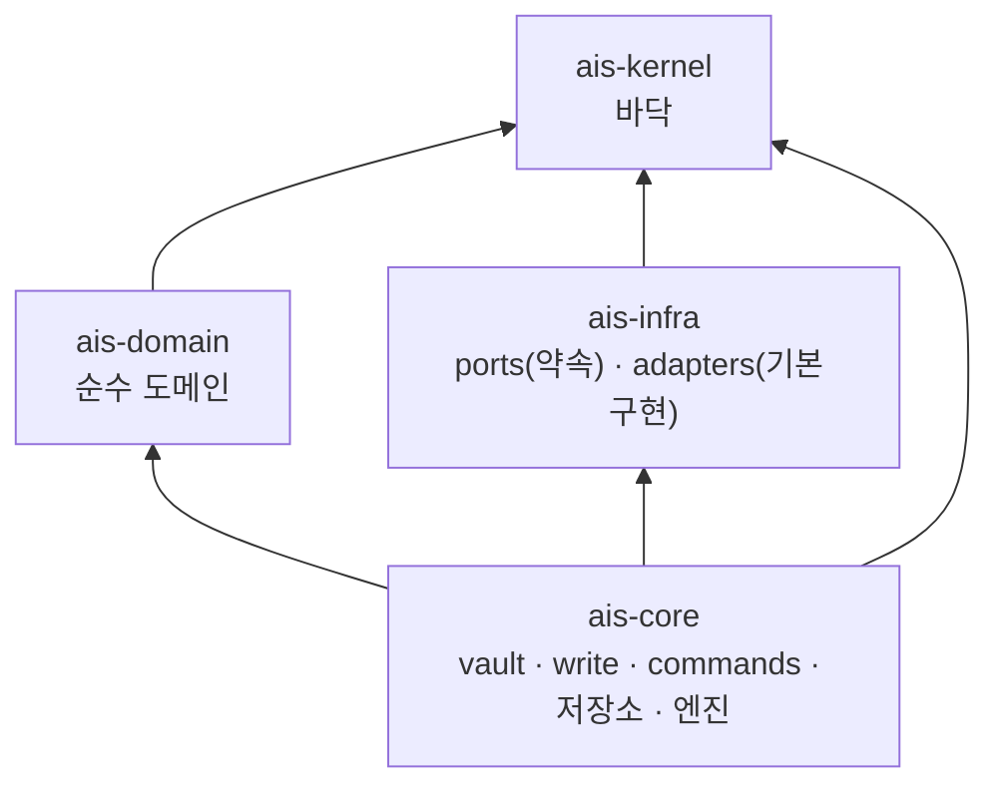

# 리팩토링 8단계 완료 기록 (3/N) — 인프라 크레이트 `ais-infra`

## 요약

**결론:** 바깥 세상에 닿는 약속(`ports`)과 그 기본 구현(`adapters`)을 새 크레이트 `ais-infra`로 옮겼다. 이 크레이트도 `ais-kernel`만 의존해서, 인프라가 도메인(`ais-domain`)이나 엔진(`ais-core`)을 보면 **컴파일이 안 된다**. 동작은 그대로다: 골든 재생 어긋남 0이다.

계획: [`refactor-ddd-hexagonal-plan.md`](refactor-ddd-hexagonal-plan.md) §4 8단계. 추적: [이슈 #77](https://github.com/bnjjong/aisurada/issues/77). 앞 기록: [8단계 2/N](refactor-step8b-complete.md).

## 한 일

- **옮긴 것.** `ports/`(세 파일)와 `adapters/`(여덟 파일)를 `ais-infra/src`로 `git mv`했다. 코드는 한 줄도 안 고쳤고, 시험용 접근자(`FlockLock::in_dir` 따위)를 열고 닫는 `test-support` feature만 이 크레이트에도 선언했다. `ais-core`의 `test-support`가 이것을 함께 켠다.
- **포트와 어댑터를 왜 한 크레이트에 뒀나.** 기본 약속 묶음(`ports`)이 기본 어댑터(`adapters::default_ports()`)를 가리키고, 어댑터는 약속을 구현해서 서로를 가리킨다. 나눠 놓으면 기본값을 밖에서 꽂아 줘야 하는데, 앱이 만든 스레드(자동 커밋 감시 따위)는 엔진을 거치지 않고 기본값을 곧바로 읽기 때문에 아무도 안 꽂은 스레드가 죽는다. 한 크레이트 안의 모듈로 두면 이 순환이 허용되고 위험이 없다. 계획서가 `ais-app`(포트)과 `ais-infra`(어댑터)로 나눈 것과 다른 점이다.
- **같은 모듈 경로.** `ais-core`가 `ports`와 `adapters`를 같은 이름으로 다시 내놓아(운영에서는 크레이트 안에서만 보이고 `test-support`일 때 `pub`) `crate::ports::fs` 같은 안쪽 경로 수백 곳이 그대로 통한다.
- **구조 시험.** `source_crates`에 `ais-infra`를 더했다. 모듈 사이 참조의 기준은 한 줄도 안 바뀌었다(모듈 이름이 그대로라서). 어댑터가 바깥 세상을 직접 부른 횟수의 열쇠가 `core/adapters/…`에서 `infra/adapters/…`로 바뀌었다(14줄, 숫자는 그대로다).

## 확인

| 확인 | 결과 |
| --- | --- |
| 운영 설정 빌드 `cargo build -p ais-core -p ais-cli` | 경고 0 |
| 시험 설정 빌드 `cargo build --workspace --examples --tests` | 경고 0 |
| `bash test.sh`(골든 재생 포함) | 303건 통과, 어긋남 0 |
| 호스트 `cargo test` | 158건 통과 |

## 확인하면서 본 것

- **호스트의 PTY 시험 간헐 실패 1건.** 시험 묶음을 한 번 돌렸을 때 `terminal::tests::stale_reader_cannot_remove_replacement`가 `failed to openpty: Device not configured`로 실패했다(터미널 코드이고 엔진을 안 부른다). 같은 시험만 단독으로 돌렸을 때도 두 번 실패했지만 호스트 전체를 다시 돌렸을 때는 158건이 통과했다. 기기의 PTY는 부족하지 않았다(최대 511개, 열린 것은 몇 개). 이 변경과 무관한 환경성 실패로 보이지만 원인은 확정하지 못했다. 앞선 8-1, 8-2 때 호스트 전체는 모두 통과했다.

## 남은 것

- **`ais-core`에 남은 것.** `vault`, `write`, `commands`, `session`, `model`, `engine`, 그리고 `task::store`, `resource::{approvals, changes, refs, resolver, store}`다. 도메인도 인프라도 아닌 유스케이스와 읽기·쓰기 부품이다. 계획서는 이를 `ais-app`으로 옮기고 `ais-core`를 얇은 앞문 파사드로 두자고 했다. 지금 `ais-core`가 그 앞문(좁은 `pub` 면과 `test-support`)을 이미 하고 있어서, 이름만 바꾸는 큰 파일 이동의 이득이 적다(8-4에서 판단한다).
- **`ais-ops`.** 에이전트 등록·진단·이주(`ais-cli`의 `register`, `doctor`, `migrate` 따위)를 떼는 일이다.
