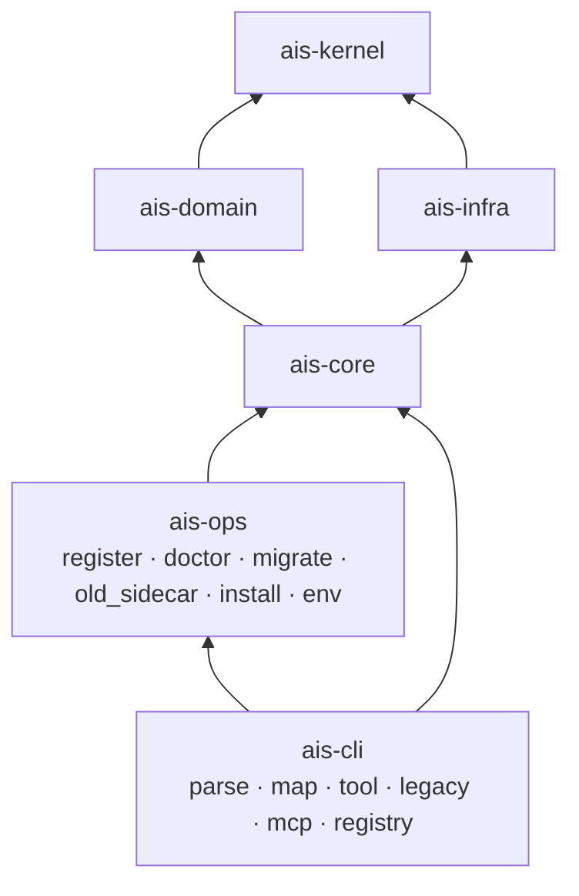

# 리팩토링 8단계 완료 기록 (4/N) — 운영 도구 크레이트 `ais-ops`

## 요약

**결론:** `ais-cli`에서 설치 환경을 만지는 운영 도구(에이전트 등록, 진단, 첫 실행 이주, 옛 사이드카 걷어 내기, 환경 읽기)를 새 크레이트 `ais-ops`로 옮겼다. 이 묶음은 엔진의 명령 해석(`parse`, `map`, `tool`, `legacy`)과 MCP 서버를 쓰지 않으므로, 그쪽을 보면 **컴파일이 안 된다**. `ais-cli`는 `ais-ops`를 의존하고 같은 이름으로 다시 내놓아 `ais_cli::register` 같은 바깥 경로(호스트, 시험)는 그대로다. 동작은 그대로다: 골든 재생 어긋남 0이다.

계획: [`refactor-ddd-hexagonal-plan.md`](refactor-ddd-hexagonal-plan.md) §4 8단계. 추적: [이슈 #77](https://github.com/bnjjong/aisurada/issues/77). 앞 기록: [8단계 3/N](refactor-step8c-complete.md).

## 한 일

| 옮긴 것 | 줄 수 |
| --- | --- |
| `doctor.rs`, `install.rs`, `old_sidecar.rs`, `migrate.rs`, `register.rs`, `agent_cli.rs`, `env.rs` | 약 1,570줄 |

- **경계를 가르는 것.** 이 일곱 모듈은 서로와 `env`만 쓰고, `ais-core`는 `json`·`text`·`vault::git`만 쓴다(엔진 명령을 부르지 않는다). 그래서 파일을 옮기는 것만으로 잘렸다.
- **`Outcome`.** 한 번의 호출 결과(표준 출력, 표준 오류, 종료 코드)가 운영 도구와 명령줄 양쪽에서 쓰여서 `ais-ops`로 옮기고 생성자(`out`, `err`)를 `pub`으로 했다. `CliError`를 `Outcome`으로 바꾸는 `from_error`는 `CliError`가 명령줄에 있어서 `ais-cli`의 함수(`outcome_from_error`)로 뺐다.
- **같은 경로.** `ais-cli`의 `lib.rs`가 `pub use ais_ops::{Outcome, agent_cli, doctor, env, install, migrate, old_sidecar, register}`로 다시 내놓는다. 호스트의 `ais_cli::run`·`ais_cli::env::Env`, 시험의 `ais_cli::register` 같은 경로를 하나도 안 고쳤다.
- **구조 시험.** 바깥 세상을 직접 부른 횟수를 세는 대상에 `ais-ops`를 더했다. 기준 열쇠가 `cli/…`에서 `ops/…`로 바뀌었다(숫자는 그대로).

## 확인

| 확인 | 결과 |
| --- | --- |
| 운영·시험 설정 빌드 | 경고 0 |
| `bash test.sh`(골든 재생 포함) | 305건 통과, 어긋남 0 |
| 호스트 `cargo test` | 158건 통과 |

## 하지 않은 것

- **`ais-app`(유스케이스 크레이트)와 `ais-core`를 얇은 파사드로 만드는 일.** 계획서는 `vault`·`write`·`commands`·`engine` 등을 새 크레이트 `ais-app`으로 옮기고 `ais-core`를 앞문으로 남기자고 했다. 지금 `ais-core`가 이미 앞문(좁은 `pub` 면과 `test-support`)이고, 나머지를 이름만 바꿔 약 2만 줄 옮겨도 의존 방향의 새 보장이 생기지 않는다(바닥·도메인·인프라는 이미 갈렸다). 이득 없이 큰 이동이라 하지 않았다. 유스케이스와 저장소(`task::store`, `resource::store`)를 포트로 가르는 일이 먼저다([이슈 #77](https://github.com/bnjjong/aisurada/issues/77)).
