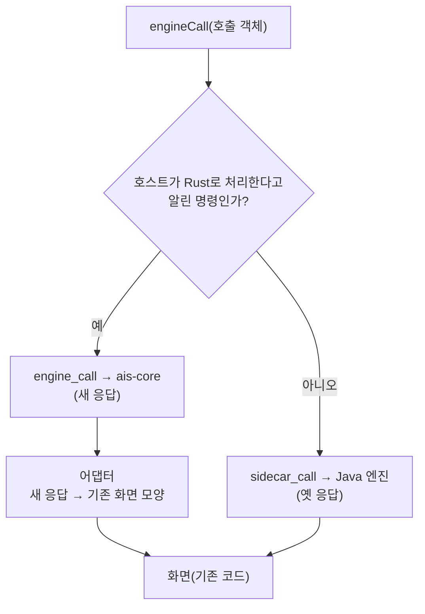

# Rust 엔진 이전 2단계 첫 묶음 — 새로고침 길의 읽기 명령 6개

## 요약

**결론:** 앱이 새로고침 때 부르는 읽기 명령 6개(`list_docs`, `list_agendas`, `list_projects`, `list_templates`, `list_trash`, `reindex`)를 Rust 엔진(`engine-rs/crates/ais-core`)으로 옮기고, 앱이 이 6개를 Rust 엔진으로 읽게 연결했다. Java 엔진과 같은 vault에서 응답을 맞대 어긋남이 없고(합성 vault와 진짜 vault 2개, 132건), 화면·호스트 시험도 통과한다. 앱에서 Rust 엔진이 실제로 도는 것을 **실제 앱 창에서는 확인하지 못했다**(아래 「확인하지 못한 것」). 문제가 생기면 앱을 `AISURADA_ENGINE=java`로 띄워 예전 경로로 되돌릴 수 있다.

이 기록은 vault의 노트 「2단계 전 결정 — 읽기 명령 응답 정리안 (A~F)」에서 추천안대로(전부 가) 진행한 결과다. 요구사항은 같은 기능을 하는 것을 기준으로 옮기고, 응답 모양도 정리하고(결정 1-나), 그에 맞춰 화면과 호스트도 고치는 것이었다. 앞 단계는 [1단계 기록](rust-engine-step1-yaml.md)이다.

## 1. 정리안 A~F를 어떻게 적용했나

| 결정 | 적용한 것 |
| --- | --- |
| A. 타입 있는 호출 | 화면이 호출 객체(`{command, args}`)를 만들고(`data/commands.ts`의 `Call`), 호스트의 `engine_call` 하나로 보낸다. Java 엔진으로 갈 때는 `toArgv`가 옛 `key=value` 목록으로 푼다. |
| B. 목록 감싸기 | 모든 목록 명령이 `{items, total, returned, truncated}`를 돌려준다. |
| C. 노트 필드 | `date`·`time`·`agendaTitle`을 빼고 `folder`를 더했다. 나머지 이름(`precondition` 포함)은 그대로다. `rootId`·`parentId`는 후속 노트를 읽는 둘째 묶음에서 더한다. |
| D. 오류 모양 | `{code, kind, message}`. 화면의 `SidecarCommandError`에 `kind`가 붙고, 옛 종료 코드(충돌은 5)도 맞춰 준다. 화면이 숫자로 가르는 곳(`vault.ts`)은 쓰기가 옮겨질 때 `kind`로 바꾼다. |
| E. 본문 | `list_docs`가 지금처럼 본문까지 준다(`bodies`). 화면 검색 구조는 건드리지 않았다. |
| F. 순서와 전환 | 새로고침 길 6개를 먼저 옮겼다. 명령마다 Rust/Java를 고르고, Rust 응답은 화면의 어댑터가 기존 모양으로 바꾼다. |

그림 설명: 화면의 길목(`engineCall`)이 명령마다 Rust와 Java 중 어느 쪽으로 보낼지 정한다. 문자열 목록(argv)으로 부르는 나머지 명령은 모두 Java 엔진이다.

## 2. 만든 것

| 자리 | 내용 |
| --- | --- |
| `ais-core` `vault/` | 본문 파일 읽기(울타리 가르기, `f1` 확인 값), 노트 메타 다듬기, 아젠다·프로젝트·템플릿·휴지통 읽기, 노트 훑기(폴더·단일 파일·JSON·HTML·확장자 폴더 노트, 후속 노트, 충돌 사본, 심볼릭 링크, 깊이 상한), 조건 필터, HTML 첨부 글 |
| `ais-core` `commands/`, `engine.rs`, `model/`, `error.rs` | 명령 6개와 진입점 `Engine::call(이름, 인자)`, 응답 모양, 오류 종류 |
| 호스트 `src-tauri/src/engine.rs` | `engine_commands`(어떤 명령을 Rust가 처리하는지), `engine_call`(열린 vault로 처리) |
| 화면 `workspace/engine.ts`, `data/commands.ts`, `workspace/platform.ts` | 길목의 라우팅, 응답 어댑터, 호출 객체, 호스트가 지원 명령을 알리는 함수 |
| 시험 도구 | `compat_check`(Java와 응답 맞대기), 합성 vault 생성기, `ais_call`(명령 하나 호출) |

## 3. 결과

| 확인 | 내용 | 결과 |
| --- | --- | --- |
| Java와 응답 맞대기 | 합성 vault(노트 20건), 진짜 vault, 손 확인용 vault에서 `list_docs`(메타·본문, 아젠다·유형·태그·즐겨찾기·날짜 조건, 오류 사례), `list_agendas`, `list_projects`, `list_templates`(갈래·유형 조건), `list_trash`, `reindex` | 132건, 어긋남 0 |
| Rust 단위·통합 시험 | `cargo test -p ais-core` | 31개 통과 |
| 호스트 시험 | `engine::`(실제 Tauri 호출 경로로 `engine_call`을 불러 열린 vault 읽기, 오류 종류) | 3개 통과 |
| 화면 시험 | 새 `engine-route.test.mjs` | 9개 통과 |
| 기존 화면 시험 | `data` 51, `workspace` 34, `interaction` 42, `autosave` 45, `navigation` 30, `views` 27, `tasks-ui` 18, `resources-ui` 15, `runner-ui` 13, `contracts` 4 | 모두 통과 |
| 타입 검사 | `pnpm typecheck` | 통과 |

합성 vault는 JSON·HTML 노트, 확장자 폴더 노트, 깊이 8을 넘는 후속 노트, 충돌 사본, 심볼릭 링크, 깨진 파일, 1MB 초과 파일, `created` 변형, 태그 50개 상한, 평가 점수의 경계 값, 프로젝트 저장소 검증, 템플릿·휴지통의 정상·오류 항목을 담는다. 건너뜀 이유 19종이 모두 Java와 같은 글로 나온다.

속도는 같은 vault(노트 12건)에서 `list_docs`(본문 포함)를 따로 실행해 쟀다: Java 단발 실행 약 445ms, Rust 약 70ms(둘 다 프로세스 시작 포함). 앱 안에서는 프로세스 시작이 없으므로 이보다 짧을 텐데, 앱에서 실제로 얼마나 줄었는지는 재지 않았다.

## 4. Java 엔진과 일부러 다르게 한 것

| 항목 | Java 엔진 | Rust 엔진 | 이유 |
| --- | --- | --- | --- |
| 응답 모양 | 명령마다 달랐고 `date`·`time`·`agendaTitle`이 있었다 | 정리안 B·C | 결정 1-나 |
| 훑기 중 예상 밖 문제 | 그 노트 뒤쪽 노트를 모두 목록에서 뺐다 | 그 노트만 이유를 적어 건너뛴다 | 노트가 갑자기 사라지는 일을 없애려고 |
| 평가 점수가 숫자 아님(NaN) | 훑기를 멈췄다 | 그 노트를 「평가 점수를 읽지 못했다」로 건너뛴다 | 같은 이유 |
| 코멘트 id가 노트 사이에 겹침 | 예전 색인의 유일성 제약 때문에 그 노트부터 뒤를 모두 뺐다 | 정상으로 읽는다 | 색인이 없는 지금은 제약이 없다 |
| `folder` | 응답에 없었고 화면이 경로 글자로 추측했다 | 폴더로 된 노트면 `true` | 확장자 폴더 노트(`x.md/`)는 화면의 추측이 틀렸다 |
| 같은 slug에 다른 id의 아젠다 | `reindex`는 실패, 읽기는 아젠다 표를 비운다 | `reindex`도 읽기처럼 표를 비운다 | 한 가지 규칙으로 맞췄다 |
| 템플릿·휴지통 `incomplete` 봉투 | 일부를 못 읽으면 `{templates, incomplete}`로 감쌌다 | 늘 같은 목록이다. 못 읽은 항목은 `reindex`의 `skipped`에 나온다 | 화면은 이 봉투를 읽지 않았다 |

## 5. 확인하지 못한 것과 남은 일

- **실제 앱 창에서 Rust 경로를 확인하지 못했다.** 실제 창 점검(acceptance)은 호스트 대역을 쓰는 하네스라서 이번 Rust 경로를 거치지 않는다. 호스트의 `engine_call`은 실제 Tauri 호출 경로(IPC)로, 화면의 라우팅은 가짜 호스트로 확인했지만, 앱을 빌드해서 눈으로 본 것은 아니다. 확인하려면 `docs/beta-hand-check.md`의 격리 실행법으로 앱을 띄워 노트 목록, 아젠다, 휴지통, 템플릿, 건너뜀 안내가 예전과 같은지 본다. 어긋나면 `AISURADA_ENGINE=java`로 띄워 비교한다.
- **둘째, 셋째 묶음은 아직이다:** 노트 하나를 여는 길(`get_doc`, `list_sub_notes`, `get_sub_note`, `list_comments`, `get_agenda_facts`, `list_attachments`)과 나머지(`search_docs`, `list_tags`, `get_template`, `history`). 후속 노트의 `rootId`·`parentId`도 그때 더한다.
- **어댑터는 임시다.** 화면 타입을 새 응답 모양으로 조이면 `engine.ts`의 어댑터와 화면의 `date`·`time` 재계산을 걷어낸다.
- **개발자 가이드 §8의 시험 수치**(Node 시험 450건, `cargo test` 102건)는 새 시험이 늘기 전 값이다. 전체 시험(`test-native.sh`)은 돌리지 않아서 고치지 않았다.
- 응답 모양에서 `precondition`·`f1` 이름은 쓰기 단계(3단계)에서 정한다.
