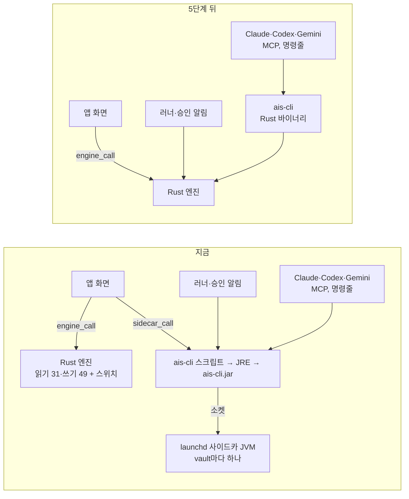

# Rust 엔진 이전 5단계 계획 — JVM 제거

## 요약

**결론:** 4단계까지로 앱 안의 명령은 거의 모두 Rust로 옮겨졌다. 남은 Java는 **앱 바깥으로 나가는 문**(`ais-cli`와 MCP 서버, launchd 사이드카)과 그 문을 지탱하는 부품(명령줄 해석 1.7천 줄, 출력, 등록 명령)이다. 5단계는 이것을 **Rust 바이너리 `ais-cli` 하나**로 바꾸고 번들의 Java 실행 환경(150MB)과 jar 4개를 없애는 일이다.

추천 순서는 **지우는 일을 맨 뒤로 미루는 것**이다. 먼저 Java를 그대로 둔 채 Rust `ais-cli`를 옆에 만들어 Java `ais-cli`와 맞대고(5a, 5b), 앱 호스트를 엔진 직접 호출로 바꾸고(5c), 사용자의 손 확인이 끝난 뒤에야 Java를 지운다(5d). 되돌릴 길(`AISURADA_ENGINE=java`)이 5d 전까지 살아 있다.

이 문서는 [4단계 계획](rust-engine-step4-plan.md)과 [4e 기록](rust-engine-step4e-note-tools.md)에 이어진다. **결정 6가지가 필요하다(§5).**

## 1. 지금 구조와 5단계 뒤 구조

(GitHub에서 그림으로 보인다.) 핵심은 세 가지다.

- **사이드카(상주 JVM)가 사라진다.** 호출마다 JVM을 띄우던 비용(수백 ms)이 없어지고, vault마다 launchd에 등록하던 일도 없어진다.
- **앱과 `ais-cli`가 같은 엔진 코드**를 쓴다. 이미 프로세스 사이 쓰기 잠금(vault 밖 `flock`)을 만들어 두었다.
- **번들이 가벼워진다.** `Resources/runtime/`(Java 실행 환경 약 150MB), `ais-cli.jar`, `ais-sidecar.jar`가 빠지고 `Resources/bin/ais-cli`가 스크립트에서 바이너리로 바뀐다. 경로가 그대로라서 **이미 등록된 MCP 연결이 깨지지 않는다.**

## 2. 남은 Java와 옮길 곳

| 덩어리 | Java | Rust에서 할 일 |
| --- | --- | --- |
| 명령줄 해석 | `args/ArgsParser` 1.7천 줄, `AisCliMain` 0.7천 줄 | 명령마다 허용 옵션, 자리 인자 개수, 오류 글, 종료 코드(0~5), 표준 오류 모양을 같게 옮긴다. 엔진은 JSON 호출을 받으므로 `key=value` 목록을 호출 객체로 바꾸는 층이다(화면의 `fromArgv`가 일부 하고 있다) |
| 출력 | `out/` 0.5천 줄 | 표준 출력 JSON(2칸 들여쓰기, 끝 LF)과 짝 없는 서로게이트 처리. 엔진 응답은 새 모양이라 **옛 모양으로 되돌리는 층**이 필요할 수 있다(결정 1) |
| MCP 서버 | `McpServer`·`McpTools` 0.6천 줄 + 등록 명령(`ClaudeMcpCommand`·`AgentMcpCommand`) 0.5천 줄 | JSON-RPC 표준 입출력 서버, 도구(가이드에는 읽기 전용 모드 13개, 쓰기 모드 28개로 적혀 있고 지금 코드는 태스크·자원 도구가 더 있다)의 이름·설명·스키마, 도구를 부를 때마다 vault 정하기, Codex의 `_meta.sessionId`, 에이전트 세션 출처 규칙(`SessionAgents`) |
| 등록·진단 | `InstallCommand`, `Launchctl`, `PlistGenerator`, `DoctorCommand`, `SweepCommand`, `McpRegistration` 약 1.5천 줄 | 사이드카가 없어지므로 `install`·`sweep`·`plist`는 **옛 등록을 걷어내는 이주 코드**로 줄어든다. `doctor`는 키·소켓·plist 진단에서 엔진·MCP 등록 진단으로 바꾼다 |
| 사이드카 | `serve/` 0.6천 줄, `frame/` 0.3천 줄, `engine/` 0.5천 줄 | 없앤다(소켓 프레임, 상태 파일, 상주 처리). 엔진 실행기는 이미 Rust에 있다 |
| 남은 명령 | `reindex_paths`(4e에서 미룸) | 훑개에 지정 경로 훑기를 더한다 |
| 호스트 | `sidecar.rs` 575줄과 시험 258줄, `ask.rs`의 `run_cli_process` | 화면의 `sidecar_call`을 `engine_call`로 모두 바꾼다. 러너와 승인 알림(`call_blocking`)은 엔진을 직접 부른다. AI(claude)를 띄울 때 PATH에 얹는 `ais-cli` 래퍼는 바이너리를 가리키게 한다 |
| 번들·릴리스 | `prepare-runtime.mjs`, `runtime-lock.json`, `tauri.release.conf.json`, `release.yml`의 Java 설치 | 실행 환경 내려받기와 번들 단계를 없애고 `cargo build`로 바이너리를 만들어 `Resources/bin/`에 둔다 |
| 시험·문서 | Java 시험 6.5천 줄(`test/aisurada`), `build.sh`, `test.sh`, 가이드, `mcp-guide.md`, `CommonRule.md`, `CLAUDE.md`의 명령 | 시험은 Rust로 옮기거나 맞대기로 대신하고, 문서의 명령과 설명을 바꾼다 |

옮길 Rust는 **약 4천~5천 줄**로 어림한다(명령줄 해석 2천, MCP 1.8천, 등록·진단 0.6천, 출력과 나머지 0.5천). 새 크레이트 `ais-cli`(바이너리 + MCP)를 두고 `ais-core`에 기대게 한다. 파일만 다루는 `ais-core`의 모양은 그대로라 결정 3(클라우드 대비)을 막지 않는다.

## 3. 이어받은 결정과 지금 받는 제약

- 엔진은 호스트 안에 두고 `ais-cli`는 같은 코드를 쓰는 작은 바이너리로 둔다(2-가). 사이드카와 launchd 등록은 없앤다.
- 파일 바이트는 Java와 같다(결정 A). 맞대기는 합성 vault 사본의 폴더 전체 바이트다(결정 E). 5단계는 **명령줄 표면**도 같은 방식으로 견준다: 같은 인자로 Java `ais-cli`와 Rust `ais-cli`를 돌려 표준 출력, 표준 오류, 종료 코드를 견준다.
- 쓰기 스위치(`AISURADA_ENGINE_WRITE=rust`, 결정 G)는 **실제 창 손 확인 뒤** 기본으로 켠다. 그 전에는 Java를 지울 수 없다(되돌릴 길이 사라지므로).
- 자동 커밋의 대기 기록과 유휴 타이머는 지금 사이드카 메모리에 있다([이슈 #58](https://github.com/bnjjong/aisurada/issues/58)). 사이드카를 없애려면 이것을 풀어야 한다(결정 2).

## 4. 쪼개기와 순서

| 묶음 | 내용 | Java를 지우나 | 끝났다고 보는 것 |
| --- | --- | --- | --- |
| 5a | `ais-cli` 크레이트: 엔진 명령 전부를 `key=value`로 받아 같은 출력·종료 코드로 돌린다. `reindex_paths` 포함 | 아니오 | Java `ais-cli`와 명령줄 맞대기 어긋남 0, Java 시험 가운데 명령줄 관련은 Rust로 옮김 |
| 5b | MCP 서버와 `claude-mcp`·`codex-mcp`·`gemini-mcp`, `doctor`, 옛 등록을 걷는 이주 | 아니오 | Java MCP와 같은 JSON-RPC 대화(도구 목록·호출·오류)를 견줌, 실제 Claude Code에 연결해 읽기·쓰기 1번씩 |
| 5c | 호스트: 화면·러너·승인 알림이 `engine_call`만 쓰게 하고, 자동 커밋을 사이드카 없이 돌리고, 번들에서 Java를 뺀 빌드를 만든다 | 아니오(`AISURADA_ENGINE=java` 되돌림 길 유지) | 앱 시험·`typecheck` 통과, 번들 크기와 호출 시간 측정, **사용자 손 확인** |
| 5d | Java 지우기: `src/`, `test/`, `build.sh`, `test.sh`, 사이드카 코드, 번들의 Java 부분, 문서 | **예** | 마지막 맞대기 뒤 Java를 `java-engine-final` 태그로 남기고 지움 |

5a와 5b는 서로 독립이라 순서를 바꿀 수 있지만, MCP 도구가 명령줄과 같은 호출 경로(`ais-cli` 안의 명령 실행기)를 쓰므로 5a가 먼저다.

## 5. 결정할 것

**1. AI가 보는 출력 모양(`ais-cli`와 MCP 도구의 응답)**

앱 안의 응답은 3단계 전에 새로 정리했다(목록은 `{items, total, returned, truncated}`, `date`·`time`·`agendaTitle`·`deepLink` 제거, 오류는 `{code, kind, message}`). 그런데 AI는 옛 모양을 보도록 `docs/mcp-guide.md`와 도구 설명에 적혀 있고, 사용자의 스크립트와 프롬프트도 옛 모양에 기대었을 수 있다.

| 선택 | 내용 | 장단점 |
| --- | --- | --- |
| **가(추천)** | `ais-cli`와 MCP는 **옛 모양**을 낸다. 엔진 응답을 옛 모양으로 되돌리는 얇은 층을 둔다 | 외부 계약이 안 바뀌고 Java와 출력을 바이트까지 견줄 수 있다. 맞대기 하네스가 이미 옛 모양을 새 모양으로 바꾸는 함수를 갖고 있어 거꾸로 만들기 쉽다. 층 하나(약 0.4천 줄)가 더 생긴다 |
| 나 | 새 모양을 그대로 내고 가이드와 도구 설명을 고친다 | 코드가 단순하다. AI와 사용자 스크립트가 바뀐 모양에 맞춰야 하고, Java와 견주려면 매번 변환이 필요하다 |
| 다 | 도구마다 정한다(AI에게 중요한 몇 개만 새 모양) | 규칙이 갈려 설명이 어렵다 |

**2. 자동 커밋과 앱이 닫힌 동안의 AI 쓰기(사이드카 없는 세상)**

지금은 상주 사이드카가 쓴 쪽 기록(누가, 세션)과 유휴 300초 타이머를 쥔다. `ais-cli` 단발 호출은 곧 끝나므로 타이머를 못 쥔다.

| 선택 | 내용 | 장단점 |
| --- | --- | --- |
| **가(추천)** | 대기 기록을 `.git/` 안 파일에 올려 프로세스 사이에 나눈다. 타이머는 **앱과 MCP 서버**(오래 사는 프로세스)가 돌리고, 둘 다 없을 때 쓴 AI 쓰기는 **다음에 앱이나 MCP가 뜰 때** 커밋한다. `ais-cli commit-vault`로 즉시도 된다 | 상주 프로세스가 없다. 앱을 안 열고 단발 `ais-cli`만 쓰는 사람은 커밋이 늦어진다 |
| 나 | 단발 호출도 쓰기 끝에 바로 커밋한다 | 가장 단순하다. 쓸 때마다 커밋이 생겨 커밋 수가 폭증하고 「5분 유휴」 의미가 사라진다 |
| 다 | 작은 상주 Rust 프로세스를 launchd에 둔다 | 지금과 같은 동작이다. 사이드카를 없애는 목적(상주·등록 제거)과 어긋난다 |

**3. Java 코드를 언제, 어떻게 지우나**

| 선택 | 내용 | 장단점 |
| --- | --- | --- |
| **가(추천)** | 5d에서 한 번에 지우고 태그 `java-engine-final`을 남긴다. 맞대기 하네스는 태그에서 jar를 지어 쓰는 스크립트(`tools/compat/build-oracle.sh`)로 바꿔 필요할 때만 돌린다 | 저장소가 가벼워지고 비교 기준도 남는다 |
| 나 | `legacy/`로 옮겨 얼려 두고 저장소에 남긴다 | 찾기 쉽다. 저장소에 죽은 코드 약 3만 줄(Java 원본, 시험 별도)이 계속 남는다 |
| 다 | 릴리스 한 번을 Rust로 내보낸 뒤에 지운다 | 가장 안전하다. 5단계가 한 릴리스만큼 늦게 끝난다 |

**4. 사이드카 이주(이미 쓰는 사람)**

launchd에 등록된 `co.kcd.aisurada.sidecar.<키>`와 `~/Library/LaunchAgents/`의 plist, `~/.local/bin/ais-cli`의 옛 래퍼가 남아 있을 수 있다.

| 선택 | 내용 | 장단점 |
| --- | --- | --- |
| **가(추천)** | 새 앱이 처음 뜰 때 옛 사이드카를 내리고(`launchctl bootout`) plist를 지운다. 지울 수 없는 것은 `ais-cli doctor`가 알린다 | 사용자가 할 일이 없다. 자동으로 지우는 일이라 범위(우리 레이블만)를 엄격히 한다 |
| 나 | `doctor`가 알려 주기만 하고 사용자가 `ais-cli sweep`을 돌리게 한다 | 안전하다. 사용자가 모르면 죽은 사이드카가 남는다 |

**5. 실제 창 손 확인을 5단계 앞에 끝낼까**

5c에서 쓰기 스위치 기본값을 켜고 Java 길을 없애려면 [이슈 #54·#61](https://github.com/bnjjong/aisurada/issues/54)의 손 확인이 필요하다(`engine-rs/tools/hand-check/run.sh --write rust --git`). 5a·5b는 이것과 상관없이 진행할 수 있다.

| 선택 | 내용 |
| --- | --- |
| **가(추천)** | 5a·5b를 먼저 하는 동안 사용자가 손 확인을 한다. 5c 시작 전에 결과를 받는다 |
| 나 | 손 확인이 끝날 때까지 5단계 전체를 멈춘다 |

**6. 지원 범위(번들)**

지금 릴리스는 Apple Silicon macOS 한 가지다(`prepare-runtime.mjs`가 arm64만 허용). Java가 빠지면 Intel Mac과 범용 바이너리도 쉬워진다.

| 선택 | 내용 |
| --- | --- |
| **가(추천)** | 5단계에서는 지금처럼 Apple Silicon만 낸다. 범용(`universal`)은 별도 일로 둔다 |
| 나 | `ais-cli`만 범용으로 짓는다(앱 본체는 그대로) |

## 6. 위험과 막는 법

| 위험 | 까닭 | 막는 법 |
| --- | --- | --- |
| 명령줄 동작이 미묘하게 달라진다 | 허용 옵션, 오류 글, 종료 코드, 표준 오류 모양이 계약이다 | 하네스에 명령줄 맞대기를 넣고 Java가 성공한 단계 수를 센다(이번 4단계에서 「양쪽이 똑같이 빈 응답」으로 맞아 보인 일이 두 번 있었다) |
| MCP 연결이 깨진다 | Claude Desktop·Code, Codex, Gemini CLI가 각자 설정에 서버 경로와 인자를 적어 둔다 | `Resources/bin/ais-cli` 경로와 `mcp` 인자를 그대로 둔다. 실제 Claude Code로 읽기·쓰기를 해 본다 |
| 앱이 닫힌 동안 AI 쓰기가 커밋되지 않는다 | 사이드카가 하던 유휴 커밋이 사라진다 | 결정 2의 대기 기록 공유, `ais-cli doctor`가 미커밋 변경을 알림 |
| 되돌릴 길이 없어진다 | Java를 지우면 `AISURADA_ENGINE=java`가 없다 | 5d 전까지 지우지 않고, 태그로 남긴다(결정 3) |
| 번들 서명·공증 | 새 바이너리가 번들에 들어간다 | 지금 임시 서명(`-`)이라 같은 방식으로 서명하고, 번들 검증(`verify-release.mjs`)을 바꿔 바이너리를 확인한다 |
| 큰 일이라 중간에 길을 잃는다 | 약 4천~5천 줄에 시험·문서까지 | 묶음마다 맞대기와 기록을 남기고(4단계와 같은 방식), 지우는 일을 맨 뒤에 둔다 |

## 7. 완료 기준

1. 5a·5b: 같은 인자·같은 JSON-RPC 대화를 Java와 Rust로 돌려 표준 출력, 표준 오류, 종료 코드, 응답이 어긋남 0이다. Java가 성공한 단계 수와 `HARNESS_TRACE`로 실제 경로를 확인한다.
2. 5c: 번들에 Java 실행 환경과 jar가 없는 빌드로 앱 시험과 `typecheck`가 통과하고, 사용자의 손 확인 점검표가 끝난다. 호출 시간과 번들 크기를 잰 값을 기록한다.
3. 5d: `java-engine-final` 태그를 남기고, `build.sh`·`test.sh`·`CommonRule.md`·`CLAUDE.md`·가이드·`mcp-guide.md`가 Rust 기준으로 바뀐다.
